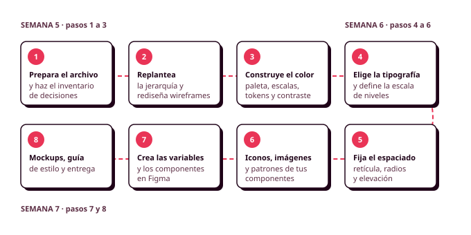

# Órbita 2 — Fundar el sistema visual
## Hoja de ruta

En la Órbita 1 construiste la estructura de tu aplicación, y en esta vas a decidir su aspecto. Como viste en el resumen de la órbita, en lugar de empezar pintando pantallas vas a construir primero un sistema de decisiones visuales (colores, tipografías, espacios, iconos y componentes) que después aplicarás a todos tus wireframes de una vez. Ese trabajo se organiza en ocho pasos repartidos en tres semanas. **Respeta el orden**, porque cada paso usa las decisiones del anterior: no puedes comprobar el contraste de tus textos sin haber elegido antes los colores, ni crear las variables en Figma sin saber qué valores van a tener.

### Paso 1: Prepara el archivo y haz el inventario de decisiones

Antes de nada, **solicita el plan de Educación de Figma si todavía no lo tienes**, porque sin él no podrás crear el modo oscuro. Después ordena tu archivo de Figma en páginas (portada, guía de estilo, componentes, wireframes y mockups) y deja los wireframes de la Órbita 1 tal como están.

Con el archivo preparado, coge uno de tus wireframes y haz una lista con todas las decisiones visuales que tendrás que tomar para convertirlo en una pantalla terminada, y al lado de cada una escribe el nombre del **token** semántico que le pondrías. Esa lista es el primer borrador de tu sistema.

Apuntes: [1. Por qué los tokens antes que las pantallas](01_tokens_antes_que_pantallas.md).

### Paso 2: Replantea la jerarquía y rediseña tus wireframes

Antes de elegir un solo color, vuelve a tus wireframes con lo que has aprendido sobre percepción visual y patrones de interfaz. Duplica las pantallas del happy path, pregúntate en cada una qué tiene que ver primero tu persona, si hay un único botón principal, si los elementos relacionados están agrupados y si el orden sigue sus decisiones, y **rediseña** en la copia lo que no funcione, todavía en escala de grises. Junto a cada cambio, anota el motivo. Los mockups del paso 8 se construyen a partir de estos wireframes rediseñados.

Apuntes: [2. Percepción visual y jerarquía](02_percepcion_visual.md).

### Paso 3: Construye el sistema de color

Elige el color principal, el secundario y los neutros a partir de tu brief, de tus personas y de lo que viste en los referentes. Convierte cada uno en una **escala** del 50 al 900 y añade los colores de estado (error, éxito y advertencia). Con las escalas hechas, decide los tokens semánticos y a qué tono apunta cada uno en el modo claro y en el oscuro, y comprueba con Stark que cada pareja de fondo y texto llega al menos a 4,5:1. Convierte la paleta a escala de grises para ver qué información depende solo del color.

Si usas alguna herramienta para generar o comparar paletas, anótalo en el `CHANGELOG.md`.

Apuntes: [3. Color: de la intuición al sistema](03_color.md).

### Paso 4: Elige la tipografía y define la escala

Elige una o dos familias de Google Fonts pensando en la legibilidad y en tus personas, con solo los pesos que necesites. Después construye una **escala** de entre seis y ocho niveles con nombre, tamaño, altura de línea y peso, y pruébala con un texto real de tu aplicación, duplicando los tamaños para simular la letra al 200 %.

Apuntes: [4. Tipografía: legibilidad, escala y jerarquía](04_tipografia.md).

### Paso 5: Fija el espaciado, la retícula, los radios y la elevación

Define una escala de espaciado sobre una cuadrícula de 4 u 8 píxeles, la **retícula** del dispositivo de tu persona principal (y de otros dispositivos si tus personas los usan), una escala de radios y entre dos y cuatro niveles de elevación. Coloca la retícula sobre tu wireframe más complejo y comprueba la alineación, las separaciones y el tamaño de los objetivos táctiles, que en el móvil tienen que llegar a 44 × 44 píxeles.

Apuntes: [5. Espaciado, retícula y composición](05_espaciado_reticula.md).

### Paso 6: Elige los iconos y revisa tus componentes

Elige **una sola librería de iconos** que tenga todos los que necesitas y anota su licencia. Las imágenes (fotos e ilustraciones) se quedan con el marcador del wireframe hasta la Órbita 3.

Después haz un inventario de los **componentes** de tus wireframes y anota a qué nivel de Atomic Design pertenece cada uno (átomo, molécula u organismo), qué patrón conocido sigue, qué estados necesita y si en algún momento de tu user flow se ha colado un patrón engañoso.

Apuntes: [6. Iconos e imágenes](06_iconos_imagenes.md) y [7. Patrones de interfaz](07_patrones_interfaz.md).

### Paso 7: Crea las variables y el modo oscuro en Figma

Pasa todas tus decisiones a **variables de Figma**: una colección de primitivos con un solo modo y una colección de semánticos con los modos claro y oscuro, cuyos valores son alias de los primitivos. Configura el ámbito, la descripción y la sintaxis de código de cada variable y crea los estilos de texto, de efecto y de retícula. Después rehaz tus componentes con **Auto layout** y variables, con propiedades de componente (texto, mostrar u ocultar icono, cambiar icono) y con sus variantes de estado. Termina comprobando que un botón y una tarjeta cambian por completo al pasar de un modo a otro.

Tienes la explicación paso a paso en la ayuda de variables en Figma y en la de Auto layout, responsive y variables.

### Paso 8: Construye los mockups, la guía de estilo y entrega

Duplica tus wireframes rediseñados y conviértelos en **mockups** del happy path, construidos enteros con Auto layout y con tus componentes, estilos y variables, pantalla a pantalla y siguiendo el orden del user flow. Haz la pantalla principal también en un segundo ancho (para comprobar que es responsive) y, junto con otra pantalla, en modo oscuro. Compara cada mockup con su wireframe rediseñado, revisa el contraste, el aumento de la letra y los objetivos táctiles, y comprueba que el prototipo recorre el flujo completo. Si quieres, haz el test de los cinco segundos con tu pantalla principal (es optativo).

Para terminar, escribe la **guía de estilo** (color, tipografía, componentes y decisiones que afectan al peso) con el motivo de cada decisión, revisa que el `CHANGELOG.md` recoge todas las veces que has usado una IA y entrega el enlace al archivo de Figma y el repositorio.

Una buena forma de saber si has terminado es **cambiar el color principal en tus variables y comprobar que cambia en todas las pantallas a la vez** sin que quede ningún botón con el color anterior. Si eso funciona, y si puedes explicar cada decisión de tu guía de estilo a partir de tus personas, tu sistema está listo para la Órbita 3.

Apuntes: [8. Del wireframe al mockup: guía de estilo y entregable](08_mockups_entregable.md).

---

Igual que en la Órbita 1, estos pasos no tienen un número de horas fijo. En total ocupan unas 15 horas de clase repartidas entre las semanas 5 y 7 del curso.
