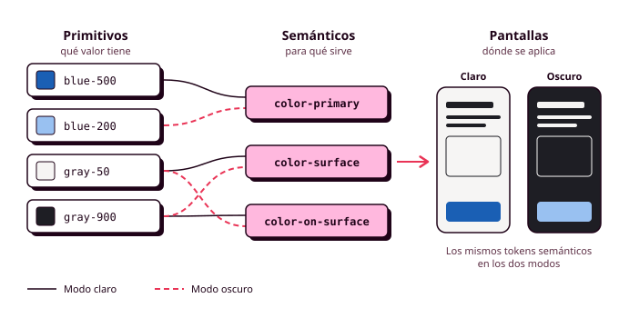

# Órbita 2 — Fundar el sistema visual

## 1. Por qué los tokens antes que las pantallas

Al terminar la Órbita 1 tienes los wireframes de todo el recorrido de tu aplicación, en blanco, negro y gris, enlazados en un prototipo que ya has podido probar. Lo más natural ahora sería abrir el primero y empezar a darle color: eliges un azul para el botón de reservar, pruebas un par de tipografías hasta dar con una que te guste y pasas a la pantalla siguiente. Ese método funciona bien en la primera pantalla, pero en cuanto llegas a la tercera empiezan los problemas, porque ya no recuerdas qué azul exacto pusiste en el botón, si el título medía 24 o 28 píxeles ni cuánto espacio dejaste entre las tarjetas. Por eso en esta órbita vas a trabajar en otro orden: **primero decidirás todos los valores visuales de tu aplicación y les pondrás nombre**, y al final de la órbita los aplicarás a todas tus pantallas.

Piensa en lo que ocurriría en la aplicación del polideportivo si se diseñara pantalla a pantalla. Después de dos semanas de trabajo, el botón "Reservar" aparece en cinco pantallas con tres azules ligeramente distintos, porque cada vez se eligió a ojo, y nadie se ha dado cuenta porque las pantallas nunca se han visto juntas. Entonces Manuel, que lee el móvil con la letra al 200 %, prueba el prototipo y apenas distingue el texto blanco sobre el más claro de esos azules. Para arreglarlo hay que buscar cada botón en cada pantalla y cambiarlo a mano, con el riesgo de dejarse alguno. Si el color del botón hubiera estado definido una sola vez y con un nombre, **el arreglo habría consistido en cambiar un único valor**.

### Qué es un token de diseño

Un **token de diseño** es una decisión visual a la que le das un nombre para poder reutilizarla siempre igual. Tiene dos partes, el nombre y el valor: el token `color-primary` puede valer `#1A5FB4`, y el token `space-4`, 16 píxeles. A partir de ese momento, cuando diseñas un botón le aplicas el nombre del token en lugar de escribir el valor, y si más adelante decides cambiar el color principal de la aplicación, lo cambias en el token y se actualizan a la vez todos los elementos que lo usan.

Esta idea ya la conoces de programación, porque es la misma que la de una variable. En lugar de repetir un número por todo el código, lo guardas en una variable con un nombre que explica para qué sirve y usas ese nombre cada vez que lo necesitas. Los tokens son las variables del diseño, y de hecho en Figma se crean con una función que se llama así, **variables**, que aprenderás a usar en el apartado 8. En la Órbita 3, esos mismos tokens se convertirán en propiedades personalizadas de CSS (`--color-primary`), de modo que el diseño y el código compartirán los mismos nombres. En eso consiste el sistema de diseño que vas a construir durante el curso: una única colección de decisiones con dos representaciones, una en Figma y otra en código, que tienen que coincidir siempre (RA1-d).

Verás que **los nombres de los tokens están en inglés**. Es la convención habitual en los sistemas de diseño (nombres como `primary`, `surface` u `on-surface` vienen de Material Design, el sistema de diseño de Google) y además te ahorra traducirlos cuando pasen al código, que también escribes en inglés.

### Dos niveles de tokens: primitivos y semánticos

Si al color principal de tu aplicación lo llamas `azul`, tendrás un problema el día que decidas que tu marca será verde, porque tendrás que cambiar el nombre en todas partes o quedarte con un token llamado `azul` que vale verde. Para evitarlo, **los sistemas de diseño organizan los tokens en niveles**, y en este módulo vas a trabajar con dos.

Los **tokens primitivos** recogen todos los valores que tienes disponibles y se nombran por lo que son: `blue-100`, `blue-500`, `gray-900` o `space-4`. Juntos forman la paleta completa de la que vas a ir eligiendo, como la caja de lápices de colores que tienes delante antes de empezar un dibujo. Un primitivo solo indica un valor, sin decir dónde se usa.

Los **tokens semánticos** se nombran por la función que cumplen en la interfaz. `color-primary` es el color de las acciones principales, `color-surface` es el fondo sobre el que se colocan los contenidos, `color-on-surface` es el color del texto que va encima de ese fondo y `color-error` es el de los mensajes de error. Un token semántico apunta a un primitivo en lugar de tener un valor propio, de modo que `color-primary` apunta a `blue-500`. En Figma, a esa referencia de un token a otro se le llama **alias**.

**Las pantallas usan únicamente tokens semánticos**. El botón "Reservar" lleva `color-primary` como fondo, y nunca `blue-500` directamente. Así, si la marca pasa a ser verde, basta con que `color-primary` apunte a `green-500` y no tienes que tocar ningún botón.

Esta separación es también la que hace posible el **modo oscuro**, que forma parte obligatoria del entregable de esta órbita. En el modo claro, `color-surface` apunta a un gris casi blanco y `color-on-surface` a un gris casi negro, y en el modo oscuro los dos se intercambian. Los componentes siguen usando exactamente los mismos tokens semánticos, y lo único que cambia de un modo a otro es el primitivo al que apunta cada uno. Lucía, que lleva el brillo del móvil al mínimo para que la batería le aguante todo el día, es muy probable que use el modo oscuro, y en las pantallas OLED de muchos móviles un fondo oscuro también reduce el consumo de energía (lo verás con más detalle en el apartado 8).

Algunos sistemas de diseño grandes añaden un tercer nivel, los tokens de componente (por ejemplo, `button-background`), que se usan solo dentro de un componente concreto. En este módulo los dejaremos para la Órbita 3, cuando construyas los componentes en código.

### Qué decisiones se convierten en token

En esta órbita vas a crear tokens para cinco tipos de decisiones, y cada una tiene su apartado (RA1-b, RA1-d):

| Categoría | Qué decide | Ejemplo | Apartado |
|---|---|---|---|
| **Color** | La paleta de marca y el uso de cada color en la interfaz, en modo claro y oscuro | `color-primary`, `color-surface`, `color-error` | 3 |
| **Tipografía** | Las familias, los tamaños, los pesos y la altura de línea, organizados en niveles con nombre | `display`, `heading`, `body`, `caption` | 4 |
| **Espaciado** | La separación entre elementos y el relleno interior de cada uno, sobre una cuadrícula de 4 u 8 píxeles | `space-2` (8 px), `space-4` (16 px) | 5 |
| **Radio** | Cuánto se redondean las esquinas de botones, tarjetas y campos | `radius-sm`, `radius-full` | 5 |
| **Elevación** | Las sombras que indican qué elementos quedan por encima de otros | `elevation-1`, `elevation-2` | 5 |

Para saber si un valor merece convertirse en token, hazte una pregunta sencilla: **¿lo vas a usar en más de un sitio o expresa una regla de tu aplicación?** El azul de los botones principales, el tamaño de los títulos de pantalla o la separación entre tarjetas cumplen las dos condiciones. El color concreto de una ilustración que solo aparece en la pantalla de bienvenida no cumple ninguna, así que no hace falta convertirlo en token.

### Por qué hacerlo ahora

Las decisiones que tomes en esta órbita las vas a arrastrar durante el resto del curso, y eso es una buena noticia si las tomas con cuidado. En la Órbita 3, si tus tokens están bien nombrados en Figma, pasarlos a CSS será casi copiarlos, mientras que si cada pantalla tiene sus propios valores sueltos tendrás que interpretarlos uno a uno y acabarás con un código igual de desordenado. En la Órbita 4 vas a comprobar la accesibilidad de tu sistema, y el contraste entre el texto y el fondo es mucho más fácil de revisar cuando solo tienes que comprobar unas pocas parejas de tokens (`color-on-surface` sobre `color-surface`, `color-on-primary` sobre `color-primary`) que cuando tienes que ir pantalla por pantalla. Si una pareja no llega al contraste mínimo, **lo corriges en el token y queda corregido en toda la aplicación** (RA5-a).

Un sistema de tokens también reduce el impacto ambiental de tu aplicación. Las **Web Sustainability Guidelines (WSG)** del W3C lo recogen en su **criterio 2.13, "Usar un sistema de diseño para mantener la coherencia de la interfaz"**, porque un conjunto pequeño de valores que se reutilizan genera hojas de estilo más ligeras que decenas de colores y tamaños que solo se usan una vez, y una interfaz coherente obliga a quien la usa a aprender menos cosas. En el apartado 4 verás otro caso concreto, el de las tipografías, donde cada familia y cada peso que añades es un archivo más que tiene que descargar el móvil de Lucía.

Y, por último, al final de esta órbita vas a aplicar el sistema a todos los wireframes del recorrido de tu user flow para convertirlos en **mockups**, que son las pantallas con su aspecto definitivo (apartado 9). Si para entonces tienes los tokens bien definidos, ese trabajo consistirá en asignar nombres a cada elemento, y cualquier cambio que te pidan las pruebas con personas lo podrás hacer en un solo sitio.

### Los tokens y las herramientas de IA

Hay herramientas que generan una paleta de colores en un segundo, como Coolors, o que proponen combinaciones de tipografías, como Fontjoy, y los asistentes de IA son capaces de devolver un sistema completo de tokens con muy buen aspecto. **Lo que ninguna de ellas puede hacer es tomar las decisiones por ti**, porque no conoce a tus personas, y tampoco sabe que Manuel necesita un contraste alto, que Lucía mira la pantalla con el brillo al mínimo o que tu color de error tiene que distinguirse bien de tu color principal.

Por eso, **cada valor de tu sistema necesita un motivo que puedas explicar**, y ese motivo tiene que salir de tus personas, del contraste, de la legibilidad o de la coherencia con el resto de tus decisiones. En la auditoría oral te voy a preguntar por qué tu `color-primary` es ese y no otro, y una respuesta como "lo elegí entre cinco propuestas de Coolors porque es el único que llega a un contraste de 4,5:1 con el texto blanco, que es lo que necesita Manuel" demuestra que has tomado tú la decisión, aunque la propuesta saliera de una herramienta. Cada vez que uses una de estas herramientas, anótalo en el `CHANGELOG.md`: qué le pediste, qué te propuso, qué conservaste y qué cambiaste.

### Antes de seguir

Antes de pasar al apartado siguiente, coge uno de tus wireframes y haz una lista con todas las decisiones visuales que tendrás que tomar para convertirlo en una pantalla terminada: el color del fondo, el del texto, el tamaño de cada título, la separación entre los elementos, la forma de los botones, etc. Al lado de cada una, **escribe el nombre del token semántico que le pondrías**. Si te salen nombres que describen el aspecto (`azul-oscuro`, `titulo-grande-negrita`) en lugar de la función, repasa la diferencia entre primitivos y semánticos, porque en el apartado 8 vas a crear estos tokens en Figma y conviene que tengas claros los nombres antes de empezar. Guarda esa lista, porque es el primer borrador de tu sistema.
