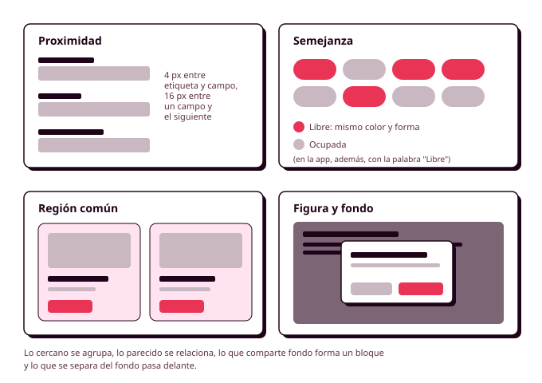

# Órbita 2 — Fundar el sistema visual

## 2. Percepción visual y jerarquía

Cuando alguien abre una pantalla, **durante el primer segundo no lee nada**. Su vista agrupa los elementos que parecen ir juntos, decide qué es lo más importante y elige por dónde empezar, y todo eso ocurre antes de que haya leído una sola palabra. Si en ese primer vistazo el botón de reservar no destaca, o si el precio de una pista parece pertenecer a la tarjeta de al lado, la persona tendrá que pararse a interpretar la pantalla, y cada vez que eso ocurre aumenta la probabilidad de que se equivoque o de que abandone. Por eso, antes de elegir un solo color, conviene que entiendas cómo percibimos lo que vemos. Los tokens que vas a crear en los apartados siguientes son las herramientas, y lo que aprendas en este apartado es el criterio para usarlas (RA1-a).

Seguramente ya has notado este efecto con tus wireframes. Aunque solo tenían grises, algunas pantallas se entendían a la primera y otras no, y la diferencia estaba en cómo habías agrupado y ordenado los elementos. Todo lo que veas aquí se aplica igual en escala de grises que en color, y el color, como verás, **sirve para reforzar una organización que ya funciona**.

### Cómo agrupa la vista: la Gestalt

A principios del siglo XX, un grupo de psicólogos alemanes estudió cómo organiza el cerebro lo que ve, y llegó a la conclusión de que tendemos a percibir conjuntos antes que elementos sueltos. A esta corriente se la conoce como **psicología de la Gestalt** (una palabra alemana que significa "forma" o "figura"), y de ella salen unos principios que hoy se usan en todas las interfaces. No hace falta que te los aprendas todos, porque hay cuatro que vas a aplicar constantemente.

La **proximidad** dice que los elementos que están cerca se perciben como un grupo. Es el principio más potente de todos y el que más se descuida. En el formulario de pago del polideportivo, cada etiqueta tiene que estar más cerca de su propio campo que del campo anterior, porque si "Teléfono" queda a la misma distancia del campo del nombre que del suyo, Manuel puede escribir el teléfono donde no toca. La regla práctica es que el espacio dentro de un grupo tiene que ser claramente menor que el espacio entre grupos, y en el apartado 5 lo convertirás en tokens de espaciado.

La **semejanza** dice que los elementos que se parecen (por color, forma o tamaño) se perciben como relacionados. En la cuadrícula de horarios del polideportivo, todas las horas libres comparten color y forma, de modo que Lucía las localiza de un vistazo sin leerlas una a una. La semejanza también funciona al revés, y si dos elementos que hacen cosas distintas se parecen demasiado, la persona pensará que hacen lo mismo. Por eso un enlace no puede tener el mismo aspecto que un texto normal, y por eso el botón de cancelar una reserva no debería parecerse al de confirmarla.

La **región común** dice que los elementos que comparten un mismo fondo o un mismo borde se perciben como un bloque. Es lo que hace una tarjeta: la foto de la pista, su nombre, el precio y el botón de reservar quedan unidos dentro de un rectángulo, y nadie duda de a qué pista pertenece cada precio. Cuando la proximidad no basta para separar dos grupos, una región común lo resuelve.

La **figura y fondo** explica que siempre distinguimos entre lo que está delante (la figura) y lo que queda detrás (el fondo). Cuando en una aplicación aparece un cuadro de diálogo para confirmar una reserva, la pantalla de detrás se oscurece para que el diálogo pase a ser la figura y la persona sepa que tiene que responder antes de seguir. Las sombras, que verás en el apartado 5, sirven precisamente para indicar qué elementos quedan por encima de otros.

Estos principios aparecen también en las **Leyes UX** que vimos en la primera semana del curso (la ley de proximidad, la ley de semejanza y la ley de región común), y puedes consultarlos con ejemplos en lawsofux.com.

### La jerarquía visual

La **jerarquía visual** es el orden en que una persona mira los elementos de una pantalla. Una pantalla con buena jerarquía tiene un elemento que destaca claramente sobre los demás, unos pocos elementos de segundo nivel y el resto en un plano discreto. Cuando todo tiene el mismo peso, la vista no sabe por dónde empezar, y cuando todo destaca, en la práctica no destaca nada.

Hay varias propiedades que hacen que un elemento atraiga la mirada antes que otro, y en tu sistema tendrás que combinarlas con cuidado:

1. **El tamaño.** Lo grande se ve antes que lo pequeño, y por eso el título de una pantalla es lo más grande que hay en ella.
2. **El contraste.** Un elemento muy oscuro sobre un fondo claro, o al revés, destaca más que uno gris sobre el mismo fondo. El contraste de luminosidad pesa más que el de color.
3. **El color.** Un color saturado en una pantalla mayoritariamente neutra atrae la vista enseguida, y es lo que aprovecharás en el apartado 3 con la regla del 60-30-10.
4. **El peso de la letra.** Un texto en negrita se ve antes que uno normal del mismo tamaño.
5. **El espacio alrededor.** Un elemento rodeado de espacio vacío destaca más que uno apretado entre otros.
6. **La posición.** Lo que está arriba y a la izquierda (en idiomas que se leen de izquierda a derecha) suele mirarse primero.

En la pantalla de detalle de una pista, lo que Lucía necesita ver primero es si hay hora libre y cómo reservarla, así que el botón "Reservar" lleva el color principal y es el único elemento de la pantalla con ese color. A este efecto se le llama **efecto de aislamiento** (o de Von Restorff, otra de las Leyes UX): cuando un elemento es distinto de todos los que lo rodean, se ve y se recuerda mejor. La consecuencia práctica es que cada pantalla debería tener una sola acción principal. Si en la misma pantalla hay tres botones con el color principal, has perdido el efecto, y la persona tendrá que leerlos los tres para decidir.

Una forma muy sencilla de comprobar la jerarquía es la **prueba del desenfoque**. Haz una captura de tu pantalla, desenfócala hasta que no se pueda leer ningún texto (en Figma puedes añadir un efecto de desenfoque a una copia del frame) y mira qué destaca. Si lo primero que ves es la acción más importante del paso del user flow en el que está esa pantalla, la jerarquía funciona. Si lo primero que ves es una foto decorativa o el logotipo, hay que corregirla.

Si quieres ver estas herramientas aplicadas a ejemplos concretos, en este vídeo Jaime, del canal Hey Jaime, explica cómo se construye la jerarquía visual en diseño gráfico con el tamaño, el color y el contraste, la tipografía, el espacio y la composición, que son casi las mismas propiedades de la lista anterior. El vídeo empieza directamente en la parte práctica (a partir del minuto 4), después de la presentación y de un fragmento patrocinado.

  <iframe src="https://www.youtube-nocookie.com/embed/_F4MTXXydWA?start=252" title="Jerarquía visual en diseño gráfico, de Hey Jaime" style="position:absolute; top:0; left:0; width:100%; height:100%; border:0;" allow="accelerometer; clipboard-write; encrypted-media; gyroscope; picture-in-picture" allowfullscreen loading="lazy"></iframe>

Si el vídeo no se carga, puedes verlo directamente en [YouTube](https://www.youtube.com/watch?v=_F4MTXXydWA&t=252s).

### Por dónde recorre la vista una pantalla

Los estudios con seguimiento ocular, como los que publicó el Nielsen Norman Group a partir de 2006, muestran que en las páginas con mucho texto la gente suele leer en forma de **F**: recorre la primera línea, baja, recorre un trozo de la siguiente y después baja por el borde izquierdo buscando palabras que le llamen la atención. En pantallas con poco texto, como una portada o una pantalla de bienvenida, la vista tiende a seguir un recorrido en **Z**, de arriba a la izquierda hacia la derecha, en diagonal hacia abajo y de nuevo hacia la derecha.

Estos recorridos son tendencias y no reglas, y la propia jerarquía de la pantalla puede cambiarlos. Aun así, tienen consecuencias útiles para tu diseño. **Lo más importante va al principio de los títulos y de los párrafos**, porque es lo que se lee al pasar la vista; las listas largas se entienden mejor si cada elemento empieza por la palabra que lo distingue ("Pádel, pista 3" en lugar de "Pista número 3 de pádel"); y en el móvil, donde el recorrido es casi siempre de arriba abajo, el orden vertical de la pantalla es el orden en que se van a ver las cosas.

### La jerarquía también tiene que existir para quien no ve la pantalla

Una persona ciega que usa un lector de pantalla no percibe que un título es más grande que el texto de debajo. Para ella, **la jerarquía existe solo si está escrita en el código**, con los encabezados de HTML (`h1`, `h2`, `h3`) en el orden correcto. Por eso la jerarquía visual que decidas en Figma tiene que corresponderse con una jerarquía de encabezados que tenga sentido, de modo que el título principal de la pantalla sea el `h1`, cada sección empiece por un `h2` y así sucesivamente. Lo comprobarás al maquetar en la Órbita 3 y al auditar la accesibilidad en la Órbita 4, pero conviene que lo tengas en la cabeza desde ahora, porque si en Figma usas un tamaño de letra grande solo porque queda bien y no porque sea un título, después no sabrás qué encabezado ponerle.

Lo mismo ocurre con el aumento de tamaño. Manuel lee con la letra al 200 %, y con ese aumento una pantalla de móvil muestra mucho menos contenido a la vez, así que los grupos tienen que seguir distinguiéndose aunque solo se vea una parte. **Una buena agrupación por proximidad y por región común resiste mucho mejor el aumento** que una pantalla que se apoya en la posición de los elementos para que se entienda (RA5-a).

### La jerarquía también se puede usar para engañar

Las mismas herramientas que sirven para guiar a la persona hacia lo que necesita sirven para empujarla hacia lo que le interesa a la empresa. El ejemplo más conocido es el aviso de cookies con un botón enorme y de color para "Aceptar todo" y un enlace gris y pequeño para "Rechazar". Las dos opciones están ahí, pero la jerarquía visual está diseñada para que la persona no vea la segunda. A esta técnica se la llama **interferencia visual**, y es uno de los patrones engañosos que vas a auditar en la Órbita 5 con el catálogo de deceptive.design.

La pregunta que tienes que hacerte para evitarlo es a quién sirve la jerarquía que has decidido. Destacar el botón de reservar ayuda a Lucía a hacer lo que ha venido a hacer. Destacar la opción de contratar el seguro de lesiones por encima de la de continuar sin él solo ayuda al negocio, y en ese caso las dos opciones tienen que tener un peso visual parecido. Las **Web Sustainability Guidelines (WSG)** del W3C lo plantean de forma parecida en su **criterio 2.9, "Diseñar para ayudar y no para distraer"**, porque una interfaz que guía a la persona sin desviarla le hace perder menos tiempo y cargar menos pantallas.

### Antes de seguir

Antes de pasar al color, coge el wireframe de la pantalla más importante de tu user flow y **haz con él la prueba del desenfoque**. Después escribe, junto al wireframe, qué elemento tiene que verse en primer lugar, cuáles en segundo lugar y cuáles pueden quedar en un plano discreto, y comprueba que lo que has escrito coincide con lo que se ve desenfocado. Revisa también los grupos de la pantalla: dentro de cada grupo, los elementos tienen que estar más cerca entre sí que del grupo de al lado. Guarda estas notas, porque en el apartado 8, cuando apliques el sistema a tus wireframes, tendrás que comprobar que el color y la tipografía refuerzan esa jerarquía en lugar de cambiarla.
