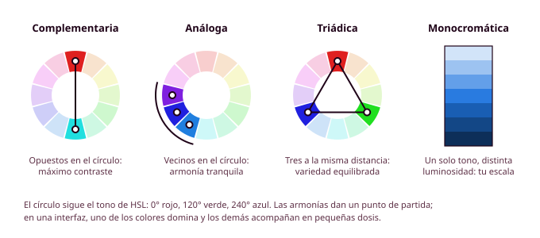
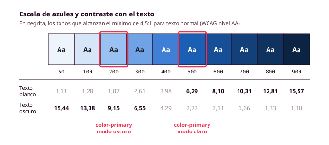

mkdocs serve -f mkdocs.local.yml# Órbita 2 — Fundar el sistema visual

## 3. Color: de la intuición al sistema

Seguramente has elegido colores muchas veces sin pensarlo demasiado, para la funda del móvil, para el fondo de una presentación o para una página que hiciste en clase, y el criterio casi siempre fue el mismo: que te gustara. En una aplicación, en cambio, **el color tiene trabajo que hacer**. Le indica a la persona qué se puede pulsar, cuál es la acción más importante de la pantalla, si algo ha salido bien o mal y dónde termina un bloque de contenido y empieza el siguiente. Además, tiene que hacerlo en condiciones muy distintas, porque Lucía mira la pantalla con el brillo al mínimo dentro del autobús y Manuel la lee con la letra al 200 %. En este apartado vas a pasar del "este azul me gusta" a un sistema en el que cada color tiene una función, un nombre y un contraste comprobado (RA1-b).

### Cómo se describe un color en pantalla

Las pantallas forman los colores mezclando luz roja, verde y azul, y por eso los colores de una interfaz se describen con el modelo **RGB**, que indica cuánta luz de cada tipo hay en un color. Ya conoces la forma más habitual de escribirlo, el código hexadecimal de CSS: en `#1A5FB4`, las dos primeras cifras corresponden al rojo, las dos siguientes al verde y las dos últimas al azul.

El hexadecimal es cómodo para copiar un color de un sitio a otro, pero no sirve para pensar en él, porque mirando `#1A5FB4` nadie sabe decir si es claro u oscuro. Para trabajar con color en diseño es más útil el modelo **HSL**, que describe un color con tres valores que se entienden a simple vista: el **tono** (en qué parte del círculo cromático está, de 0 a 360 grados, donde el 0 es el rojo, el 120 el verde y el 240 el azul), la **saturación** (lo intenso o lo apagado que es) y la **luminosidad** (lo claro o lo oscuro que es). Figma te deja ver cualquier color en HSL desde el selector de color, y te va a venir muy bien en cuanto empieces a crear variantes más claras y más oscuras de un mismo color, porque bastará con mantener el tono y mover la luminosidad.

HSL tiene una limitación que conviene que conozcas. Dos colores con la misma luminosidad en HSL no se ven igual de claros, ya que nuestro ojo percibe el amarillo mucho más luminoso que el azul aunque los números digan lo contrario. Por eso **nunca hay que fiarse de los valores para decidir si un texto se lee bien sobre un fondo**, y siempre se comprueba el contraste con una herramienta, como verás más abajo. CSS incluye un modelo más moderno, `oklch()`, que corrige este problema y que usarás en la Órbita 3.

### Un poco de teoría del color: el círculo cromático

El **círculo cromático** es una forma de ordenar los colores colocando los tonos alrededor de una circunferencia, de modo que cada uno queda entre los dos que más se le parecen. La idea viene de Isaac Newton, que a principios del siglo XVIII unió los dos extremos del arcoíris (el rojo y el violeta) para cerrar el espectro en un círculo. Seguramente ya lo has visto, y ahora entenderás por qué el tono de HSL se mide en grados: es la posición del color en ese círculo, con el rojo en 0, el verde en 120 y el azul en 240.

Conviene que sepas que hay más de un círculo cromático, porque los colores no se mezclan igual con luz que con pintura. En una pantalla los colores se forman sumando luz, así que los **primarios** son el rojo, el verde y el azul (RGB), y al mezclarlos de dos en dos aparecen los **secundarios**, que son el cian, el magenta y el amarillo; si se suman los tres, se obtiene el blanco. En la impresión ocurre lo contrario, porque las tintas restan luz, y por eso las imprentas trabajan con cian, magenta, amarillo y negro (CMYK). El círculo que aprendiste en el colegio, con el rojo, el amarillo y el azul como primarios, es el tradicional de la pintura. Para diseñar una interfaz te interesa el de la luz, que es el que usan Figma y las herramientas de color digitales.

El círculo también permite distinguir los **colores cálidos** (rojos, naranjas y amarillos) de los **fríos** (verdes, azules y violetas). Los cálidos tienden a parecer más cercanos y llaman antes la atención, y los fríos parecen alejarse y resultan más tranquilos, lo que también influye en la jerarquía visual que viste en el apartado 2.

La utilidad práctica del círculo está en las **armonías**, que son combinaciones de tonos que suelen funcionar bien juntas por la posición que ocupan:

- La **complementaria** combina dos tonos opuestos en el círculo, como el azul y el naranja. Es la que más contraste de tono produce, y por eso un toque del complementario sobre una interfaz dominada por el principal destaca mucho.
- La **análoga** usa tres tonos vecinos, como el azul, el azul violáceo y el violeta. Da un resultado tranquilo y coherente, aunque cuesta que algún elemento destaque.
- La **triádica** usa tres tonos separados por la misma distancia (120 grados). Da mucha variedad, pero es difícil de equilibrar en una interfaz.
- La **monocromática** usa un solo tono con distintas luminosidades y saturaciones. Es justo lo que harás al construir las escalas de cada color más adelante en este apartado.

Hay más armonías, como la complementaria dividida (un tono y los dos vecinos de su opuesto) o la tetrádica (dos parejas de complementarios), pero con estas cuatro tendrás de sobra para este módulo. Herramientas como Adobe Color te dejan elegir una armonía sobre el círculo y ver la paleta que resulta, y además incluyen una **comprobación de si los colores se distinguen con los tipos de daltonismo más frecuentes**.

Ten en cuenta dos cosas cuando uses las armonías en una interfaz. La primera es que en una pantalla los colores no se reparten a partes iguales, porque uno domina y los demás acompañan en pequeñas dosis, como verás con la regla del 60-30-10. La segunda es que **una armonía solo habla del tono**, y dos tonos muy distintos en el círculo pueden tener casi la misma luminosidad, de modo que el contraste para leer un texto lo tendrás que comprobar siempre aparte.

Por último, el pintor y profesor Josef Albers demostró en *La interacción del color*, que tienes en la bibliografía del módulo, que un mismo color parece distinto según los colores que lo rodean. A este efecto se le llama **contraste simultáneo**, y es el motivo por el que un color que te encanta en la paleta puede no funcionar en la pantalla, o por el que el mismo azul se ve diferente en el modo claro y en el oscuro. Por eso los colores se prueban siempre colocados en una pantalla real y nunca solo en una muestra aislada (RA1-a, RA1-b).

Para entrenar el ojo antes de elegir tu paleta, te recomiendo el **juego [Color](https://color.method.ac/)**, de Method of Action. Tienes que ajustar un color hasta que coincida con otro, o encontrar su complementario, su análogo o los colores de una tríada, y al terminar te dice lo cerca que te has quedado. Antes de empezar te pide calibrar el brillo y el contraste de la pantalla, y tiene un modo para personas con daltonismo. En diez minutos verás que distinguir el tono, la saturación y la luminosidad cuesta más de lo que parece, y entenderás mejor por qué las paletas se comprueban con herramientas y no solo a ojo.

### Qué comunica un color

Algunos colores llevan un significado que la gente ya trae aprendido de otras aplicaciones y de la vida diaria. El rojo se asocia con los errores y con las acciones peligrosas, el verde con lo que ha salido bien, el amarillo o el ámbar con las advertencias, y el azul con los enlaces. **Ir en contra de estas convenciones obliga a quien usa tu aplicación a aprender algo nuevo**, así que solo tiene sentido hacerlo con un motivo de peso. El resto de asociaciones (el azul transmite confianza, el naranja energía...) dependen mucho de la cultura y del contexto, y te pueden servir de orientación, pero no te van a dar por sí solas la respuesta correcta. Si te interesa este tema, *Psicología del color*, de Eva Heller, lo trata con detalle.

**El color nunca puede ser la única forma de transmitir una información**, y esta regla no tiene excepciones. Alrededor de un 8 % de los hombres y un 0,5 % de las mujeres tienen algún tipo de daltonismo, y muchas otras personas ven la pantalla con reflejos, con poco brillo o en una pantalla de mala calidad. Las pautas de accesibilidad WCAG lo recogen en su criterio 1.4.1 (Uso del color). En la paleta de ejemplo del polideportivo que verás en este apartado, el azul principal, el rojo de error y el verde de éxito tienen una luminosidad casi idéntica, de modo que, si conviertes la pantalla a escala de grises, los tres se ven prácticamente iguales. Por eso un campo con un error lleva el borde en rojo, pero también un icono y un texto que explica qué ha fallado, y una pista libre se marca en verde y además con la palabra "Libre" (RA5-a).

Si quieres repasar estas ideas con ejemplos, en este vídeo breve Eze Cichello explica cómo funciona el color, cómo se forma, la diferencia entre RGB y CMYK, cómo combinar colores y qué dice la psicología del color. Ten en cuenta que el modelo CMYK es el de la impresión, así que para tu aplicación solo te interesa el RGB, y que lo que cuenta sobre psicología del color conviene tomarlo con la misma prudencia que has visto en esta sección.

  <iframe src="https://www.youtube-nocookie.com/embed/yRiyah61rU4" title="Curso breve de color, de Eze Cichello" style="position:absolute; top:0; left:0; width:100%; height:100%; border:0;" allow="accelerometer; clipboard-write; encrypted-media; gyroscope; picture-in-picture" allowfullscreen loading="lazy"></iframe>

<small>**Fuente:** vídeo de Eze Cichello publicado en YouTube ([ver en YouTube](https://www.youtube.com/watch?v=yRiyah61rU4), por si no se carga aquí). Se incluye con fines exclusivamente educativos; todos los derechos pertenecen a su autor.</small>

### La paleta de marca

La paleta de una aplicación se organiza en tres grupos. El **color principal** es el que identifica la aplicación y el que se usa en las acciones más importantes, como el botón de reservar. El **color secundario** acompaña al principal en elementos con menos protagonismo, como los filtros, las etiquetas o algún detalle de la interfaz. Los **neutros** son los grises (y a veces los blancos y negros ligeramente teñidos) que se usan en los fondos, los textos y los bordes, y aunque parezcan los menos importantes son los que ocupan la mayor parte de la pantalla.

Esa proporción es la clave para que una interfaz se entienda. Si casi todo es neutro y el color principal aparece solo en lo que la persona tiene que hacer, su mirada irá directa a la acción importante. Si, por el contrario, el color principal está en el fondo, en los títulos, en los iconos y en los botones, ninguna de esas cosas destacará sobre las demás. Muchos diseñadores usan como orientación la regla del 60-30-10 (un 60 % de neutros, un 30 % de color secundario y superficies y un 10 % de color principal), y aunque no hay que medirlo con regla, te ayudará a no pasarte. Las **Web Sustainability Guidelines (WSG)** del W3C insisten en lo mismo desde otro punto de vista, cuando piden **usar la decoración con moderación (criterio 2.7)** y **diseñar para ayudar a la persona y no para distraerla (criterio 2.9)**, porque un color sin función le quita atención a los que sí la tienen.

Para elegir el color principal **parte de lo que ya sabes de tu proyecto**. En el brief definiste qué problema resuelve tu aplicación y para quién, y en el análisis de referentes viste qué colores usan las aplicaciones parecidas, tanto para seguir esa convención como para diferenciarte de ellas. En el polideportivo, el servicio es municipal y lo usan personas de edades muy distintas, así que el principal es un azul sobrio que transmite seriedad y se distingue bien del rojo de los errores en tono (aunque no en luminosidad, como ya has visto). El secundario es un verde azulado que se usa en los filtros y en las etiquetas de tipo de pista.

**Empieza por tu propio criterio**: escribe qué tiene que transmitir tu aplicación y prueba dos o tres candidatos sobre uno de tus wireframes antes de buscar nada fuera. Herramientas como Coolors, que genera paletas al momento, o Realtime Colors, que enseña cómo quedaría una paleta aplicada a una página web de ejemplo, te pueden servir después para contrastar esas primeras ideas. Si usas alguna herramienta para generar propuestas, anota en el `CHANGELOG.md` cuál fue, qué te propuso y qué decidiste tú.

### De un color a una escala

Con un único azul no tienes suficiente para toda la aplicación. Necesitarás una versión algo más oscura para cuando el ratón pase por encima del botón, una muy clara para el fondo de un aviso informativo y una más luminosa para el modo oscuro, en el que el azul de siempre se vería apagado sobre un fondo casi negro. Por eso cada color de la paleta se convierte en una **escala** de tonos numerados, normalmente del 50 (casi blanco) al 900 (casi negro), en la que el 500 suele ser el color de partida. Cada paso de la escala es un token primitivo: `blue-50`, `blue-100`, y así hasta `blue-900`.

Puedes generar las escalas a mano en Figma, manteniendo el tono en HSL y cambiando la luminosidad, pero es más rápido usar una herramienta como UI Colors (uicolors.app), que crea la escala completa a partir de un color, o Leonardo (leonardocolor.io), de Adobe, que la construye a partir de los contrastes que necesitas. Sea cual sea la herramienta, **revisa el resultado**, porque las escalas automáticas a veces generan tonos demasiado saturados en los extremos o pasos que apenas se distinguen entre sí.

**Necesitarás una escala para el color principal, otra para el secundario y otra para los grises**. Para los colores de estado (el rojo de los errores, el verde de lo que ha salido bien y el ámbar de las advertencias) te bastan dos o tres pasos de cada uno: uno para el modo claro, otro para el oscuro y, si quieres, uno muy suave para los fondos de los avisos.

En el esquema tienes la escala de azules del polideportivo con el contraste de cada tono cuando lleva encima texto blanco y cuando lleva texto oscuro. Fíjate en el 400. Es el azul más claro sobre el que se podría poner texto blanco, y **con un 3,98:1 no llega al mínimo para texto normal**, de modo que es justo el tono con el que a Manuel le costaba leer el botón en el ejemplo del apartado 1. En el modo claro, el color principal es el 500, el primero que supera el mínimo con texto blanco, y en el modo oscuro es el 200, que funciona con texto oscuro encima.

### Los tokens semánticos de color

Con las escalas tienes todos los colores disponibles, y ahora toca decidir qué función cumple cada uno, es decir, crear los tokens semánticos que vas a aplicar en las pantallas. En este módulo vas a trabajar con estos:

| Token | Para qué sirve | Modo claro | Modo oscuro | Contraste de la pareja |
|---|---|---|---|---|
| `color-primary` / `color-on-primary` | Acción principal y su texto | `blue-500` / `white` | `blue-200` / `gray-900` | 6,29 / 9,15 |
| `color-secondary` / `color-on-secondary` | Elementos secundarios y su texto | `teal-700` / `white` | `teal-300` / `gray-900` | 6,30 / 8,78 |
| `color-surface` / `color-on-surface` | Fondo general y texto principal | `gray-50` / `gray-900` | `gray-900` / `gray-50` | 15,96 / 15,96 |
| `color-on-surface-variant` | Texto secundario sobre el fondo | `gray-600` | `gray-400` | 6,05 / 6,07 |
| `color-error` / `color-on-error` | Errores y acciones peligrosas | `red-600` / `white` | `red-300` / `gray-900` | 5,63 / 7,08 |
| `color-success` / `color-on-success` | Confirmaciones | `green-700` / `white` | `green-300` / `gray-900` | 5,38 / 9,51 |
| `color-warning` / `color-on-warning` | Advertencias | `amber-400` / `gray-900` | `amber-300` / `gray-900` | 9,08 / 11,11 |

Los tokens que empiezan por `on-` son los que van encima de otro color, normalmente el texto o los iconos. **Cada color de fondo tiene su pareja `on-`**, y así, cuando diseñas un botón de error, no tienes que pensar qué color de texto le va, porque ya está decidido en `color-on-error` y su contraste ya está comprobado. Fíjate en el caso del ámbar: con texto blanco no llega ni a 2:1, así que en las advertencias el texto es oscuro en los dos modos. Es habitual con los amarillos y los ámbar, y si en tu paleta aparece uno, te pasará lo mismo.

Fíjate también en que, en el modo oscuro, el color principal y los de estado usan tonos más claros de su escala y llevan texto oscuro encima. Por eso el modo oscuro no se resuelve invirtiendo los colores: cada token semántico apunta, en cada modo, al tono de la escala que mejor funciona.

### El contraste

El **contraste** es la diferencia de luminosidad entre un texto y su fondo, y se expresa como una proporción que va de 1:1 (el mismo color) a 21:1 (negro sobre blanco). Las pautas WCAG 2.2 fijan unos mínimos que en este módulo son obligatorios:

| Qué se comprueba | Nivel AA (mínimo) | Nivel AAA (objetivo) |
|---|---|---|
| Texto normal | 4,5:1 | 7:1 |
| Texto grande (desde 24 píxeles, o desde unos 19 en negrita) | 3:1 | 4,5:1 |
| Bordes de los campos, iconos y otros elementos de la interfaz | 3:1 | (no se define) |

El nivel AA es el mínimo que exige la normativa de accesibilidad, y el AAA es el objetivo al que conviene acercarse siempre que se pueda. En la tabla de tokens de la sección anterior verás que algunas parejas superan holgadamente el 7:1 y otras se quedan entre 5 y 7, y es razonable, porque llegar al AAA en todos los colores de marca a veces obliga a usar tonos tan oscuros que la aplicación pierde su carácter. **Lo que no se puede hacer es quedarse por debajo del AA.** Ten en cuenta, además, que los mínimos están pensados para condiciones normales y que Lucía usa el móvil con el brillo al mínimo, así que dejar algo de margen por encima del 4,5:1 es una buena decisión.

Para medir el contraste dentro de Figma tienes el plugin **Stark**, que comprueba la pareja de colores que selecciones y te dice qué nivel alcanza, y fuera de Figma puedes usar el comprobador de contraste de WebAIM. La ventaja de trabajar con tokens es que no tienes que revisar pantalla por pantalla, porque te basta con comprobar cada pareja de la tabla una vez en cada modo. Si una pareja falla, cambias el primitivo al que apunta el token y el problema desaparece de toda la aplicación. En la Órbita 4 volverás a revisar estos contrastes sobre la web ya programada (RA5-c).

### Antes de seguir

Antes de pasar a la tipografía, comprueba tres cosas de tu sistema de color. La primera es que tienes una tabla como la de este apartado con todas tus parejas de tokens, en los dos modos, y que **ninguna baja de 4,5:1**. La segunda es que, si conviertes tu paleta a escala de grises (puedes hacerlo con una captura y cualquier editor de imágenes), sabes qué elementos de tu aplicación dejarían de entenderse y qué vas a añadir para que no dependan solo del color. La tercera es que puedes explicar en una frase por qué cada token semántico apunta al tono que has elegido, porque esas frases son las que te voy a pedir en la auditoría oral y las que pondrás en la guía de estilo al final de la órbita.
