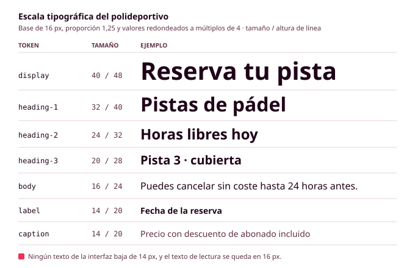

# Órbita 2 — Fundar el sistema visual

## 4. Tipografía: legibilidad, escala y jerarquía

Si quitas los colores, las imágenes y los iconos de casi cualquier aplicación, lo que queda es texto: el nombre de cada pantalla, las etiquetas de los botones, las horas libres, el precio, los mensajes de error. Por eso **la tipografía es probablemente la decisión visual que más influye en que una interfaz se entienda**, y también la que más se nota cuando falla. Si Manuel tiene que acercarse el móvil a la cara para distinguir un 3 de un 8 en la hora de su reserva, da igual lo bien elegidos que estén los colores. En este apartado vas a elegir las tipografías de tu aplicación y a organizarlas en una escala de niveles con nombre, de forma que cada texto de tus pantallas tenga un estilo asignado y un motivo para tenerlo (RA1-b).

### Algunos términos que vas a necesitar

Una **familia tipográfica** es el conjunto de letras que comparten un mismo diseño, como Inter, Roboto o Atkinson Hyperlegible. Dentro de una familia hay varios **pesos**, que indican lo gruesos que son los trazos y que se numeran de 100 (muy fino) a 900 (muy grueso), de modo que el 400 es el peso normal y el 700, la negrita. Cada combinación de peso y estilo (normal o cursiva) es, en la web, un archivo distinto que hay que descargar, y verás enseguida por qué esto importa.

Las familias se clasifican en unos pocos grupos. Las de **palo seco** (en inglés, *sans serif*) no tienen remates en los extremos de los trazos, y son las más habituales en las interfaces porque se leen bien en tamaños pequeños y en pantallas de poca resolución. Las de **serifa** tienen esos pequeños remates y se asocian a la prensa y a los libros, y funcionan bien en títulos o en textos largos de lectura. Las **monoespaciadas** dan el mismo ancho a todas las letras, como en tu editor de código, y se usan para cifras que tienen que alinearse o para mostrar código. Las **decorativas** y las **caligráficas** tienen mucha personalidad, pero solo sirven para un logotipo o un título muy grande, nunca para el texto de la interfaz.

Por último, la **altura de la x** es la altura de las letras minúsculas sin ascendentes ni descendentes (como la x, la a o la o). Dos tipografías al mismo tamaño pueden parecer de tamaños muy distintos según su altura de la x, y las que la tienen generosa se leen mejor en pantalla.

### Qué hace que un texto se lea bien en pantalla

La **legibilidad** depende de la tipografía, pero sobre todo de cómo la uses, y hay unas pocas reglas que vas a aplicar en todo tu sistema.

1. **El texto de lectura empieza en 16 píxeles.** Es el tamaño por defecto de los navegadores y el mínimo razonable para leer párrafos en el móvil. En tu sistema, ningún texto de la interfaz debería bajar de 14 píxeles, ni siquiera las notas pequeñas.
2. **La altura de línea del texto de lectura ronda 1,5 veces el tamaño de la letra.** Con 16 píxeles de letra, unos 24 de altura de línea. Si es menor, las líneas se apelotonan y la vista se salta de una a otra; si es mucho mayor, el párrafo se deshace. Los títulos, que son más grandes y tienen menos líneas, funcionan con alturas de línea más ajustadas, de alrededor de 1,2.
3. **Las líneas de texto no deberían superar los 75 caracteres.** Entre 45 y 75 caracteres por línea es la medida que se recomienda desde hace décadas en tipografía impresa, y en pantalla funciona igual. En un móvil no tendrás este problema, pero en un portátil un párrafo que ocupa todo el ancho de la pantalla resulta agotador.
4. **El texto se alinea a la izquierda.** El texto justificado crea huecos irregulares entre palabras que dificultan mucho la lectura a las personas con dislexia, y en pantalla, donde no hay un buen sistema de división de palabras, esos huecos son aún mayores.
5. **Las mayúsculas, solo para textos muy cortos.** Un botón o una etiqueta pueden ir en mayúsculas, pero una frase entera en mayúsculas se lee más despacio, porque perdemos la forma de las palabras que nos ayuda a reconocerlas.
6. **Los caracteres que se confunden tienen que distinguirse.** En una aplicación de reservas, las horas, los precios y los códigos son importantes, así que comprueba que en tu tipografía se distinguen bien la I mayúscula, la l minúscula y el 1, y la O del 0.

Estas reglas tienen mucho que ver con la accesibilidad. Las pautas WCAG piden que el texto se pueda ampliar hasta el 200 % sin perder contenido (criterio 1.4.4) y que la interfaz siga funcionando si la persona aumenta el espaciado entre líneas, letras y palabras (criterio 1.4.12). Manuel tiene la letra de su móvil al 200 %, así que **tu escala tiene que aguantar que todos los tamaños se dupliquen**. En Figma lo comprobarás en el apartado 8, y en la Órbita 3 usarás unidades relativas (`rem`) para que el navegador respete ese ajuste (RA5-a).

### Elegir las tipografías de tu aplicación

Para la mayoría de las interfaces basta con **una sola familia de palo seco** con varios pesos, que se encargue tanto de los títulos como del texto. Si quieres dar más personalidad a tu aplicación, puedes añadir una segunda familia solo para los títulos, siempre que contraste claramente con la primera (por ejemplo, una con serifa para los títulos y una de palo seco para el resto). Dos familias son el máximo que vas a usar en este módulo.

**Elige pensando en tus personas y en el tono de tu proyecto**. Una aplicación municipal que usan personas de todas las edades necesita una tipografía clara y neutra, con buena altura de la x y cifras fáciles de leer, como Inter o Atkinson Hyperlegible, una familia diseñada por el Braille Institute pensando en personas con baja visión. Una aplicación para un festival de música puede permitirse un título más expresivo, siempre que el texto de la interfaz siga siendo una tipografía legible.

Para comparar combinaciones te puede servir Fontjoy, que propone parejas de tipografías al azar. Antes de decidirte, **prueba la combinación con textos reales de tu aplicación** (el nombre de una pista, una hora, un precio y un mensaje de error), porque una tipografía que queda muy bien en el texto de muestra puede funcionar mal con cifras. Como siempre, anota en el `CHANGELOG.md` las herramientas que hayas usado y por qué te has quedado con lo que elegiste.

La mayoría de las tipografías de Google Fonts tienen una licencia libre (la SIL Open Font License) que permite usarlas en una web sin pagar. Si eliges una tipografía de otro sitio, **comprueba su licencia antes de usarla**, porque muchas fuentes comerciales cobran por usarlas en una web aunque sean gratuitas para uso personal.

Si quieres repasar todo esto con ejemplos, en este vídeo breve Eze Cichello explica la diferencia entre tipografía y fuente, las familias con serifa y de palo seco, cómo combinar dos tipografías, cómo elegirlas y qué hay que mirar en sus licencias. Está pensado para el diseño gráfico en general, así que, cuando lo veas, piensa en cada consejo aplicado a una pantalla pequeña y a textos de interfaz.

  <iframe src="https://www.youtube-nocookie.com/embed/M-MUn0Zi3yA" title="Curso breve de tipografía, de Eze Cichello" style="position:absolute; top:0; left:0; width:100%; height:100%; border:0;" allow="accelerometer; clipboard-write; encrypted-media; gyroscope; picture-in-picture" allowfullscreen loading="lazy"></iframe>

<small>**Fuente:** vídeo de Eze Cichello publicado en YouTube ([ver en YouTube](https://www.youtube.com/watch?v=M-MUn0Zi3yA), por si no se carga aquí). Se incluye con fines exclusivamente educativos; todos los derechos pertenecen a su autor.</small>

### Cuánto pesa una tipografía

Cada familia y cada peso que eliges es un archivo que el navegador tiene que descargar antes de mostrar el texto con su aspecto definitivo, y con conexiones lentas, como la del móvil de Lucía en algunas zonas del polideportivo, eso se nota en el tiempo de carga y en el consumo de datos. Las **Web Sustainability Guidelines (WSG)** del W3C lo recogen en su **criterio 2.18, "Usar tipografía web optimizada y apropiada"**, que pide servir las fuentes en un formato optimizado y dar preferencia a las tipografías que ya vienen instaladas en el dispositivo siempre que sea posible.

En este módulo puedes elegir tus tipografías con libertad, pero con unos límites:

- Como máximo **dos familias**.
- Como máximo **cuatro archivos en total** (por ejemplo, el 400 y el 700 de la familia del texto y el 700 de la de los títulos). Si tu familia es **variable**, es decir, si incluye todos sus pesos en un único archivo, cuenta como uno solo, aunque suele pesar más que un peso suelto.
- Los archivos tienen que estar en formato **WOFF2**, que es el más comprimido, y a ser posible solo con los caracteres que necesitas (los del alfabeto latino, en lugar de incluir también el griego o el cirílico).
- En la guía de estilo tienes que indicar **cuánto pesan en total** tus tipografías y por qué te compensa ese peso.

La alternativa más ligera es usar las **tipografías del sistema**, que son las que ya tiene instaladas cada dispositivo (San Francisco en los de Apple, Roboto en Android y Segoe UI en Windows) y que no hay que descargar. Su inconveniente es que tu aplicación se verá con una tipografía distinta en cada dispositivo, pero para muchas interfaces es una opción excelente y perfectamente defendible en la auditoría oral.

### La escala tipográfica

Igual que con el color, en lugar de elegir el tamaño de cada texto por separado vas a definir una **escala**, es decir, un conjunto cerrado de tamaños entre los que elegirás siempre. Una escala evita que acabes con títulos de 22, 23 y 24 píxeles que nadie distingue entre sí, y hace que la diferencia entre un nivel y el siguiente se note.

La forma más habitual de construirla es la **escala modular**: partes de un tamaño base (16 píxeles) y lo multiplicas una y otra vez por una misma proporción. Con una proporción de 1,25 obtienes 16, 20, 25, 31, 39..., y si redondeas a múltiplos de 4 para que encajen con la cuadrícula de espaciado del apartado siguiente, te quedan 16, 20, 24, 32 y 40. Las proporciones pequeñas (1,125 o 1,2) dan escalas suaves, adecuadas para pantallas pequeñas y aplicaciones con mucha información, y las grandes (1,333 o 1,5) dan títulos mucho más llamativos. La herramienta Typescale (typescale.com) te enseña cómo queda cada proporción con tu tipografía.

A cada nivel de la escala le das un nombre que indica su función, igual que hiciste con los tokens semánticos de color. Tu sistema tiene que tener entre seis y ocho niveles, y estos son los del polideportivo:

| Nivel | Tamaño / altura de línea | Peso | Para qué se usa |
|---|---|---|---|
| `display` | 40 / 48 | 700 | El título de la pantalla de inicio y poco más |
| `heading-1` | 32 / 40 | 700 | El título principal de cada pantalla |
| `heading-2` | 24 / 32 | 600 | Las secciones dentro de una pantalla |
| `heading-3` | 20 / 28 | 600 | Los títulos de las tarjetas y los bloques pequeños |
| `body` | 16 / 24 | 400 | Todo el texto de lectura |
| `label` | 14 / 20 | 600 | Las etiquetas de los campos y el texto de los botones |
| `caption` | 14 / 20 | 400 | Notas, fechas y textos de apoyo |

Fíjate en que `label` y `caption` tienen el mismo tamaño y se distinguen por el peso, y en que **los niveles de título se corresponden con los encabezados de HTML** que viste en el apartado 2 (`heading-1` con el `h1`, `heading-2` con el `h2`...). Esa correspondencia no tiene por qué ser exacta en todos los casos, pero te ayudará mucho cuando maquetes en la Órbita 3. Fíjate también en que el `display` de 40 píxeles es grande para un móvil de 360 píxeles de ancho, así que el polideportivo solo lo usa en la pantalla de inicio. Si en tu proyecto necesitas tamaños distintos para móvil y para escritorio, puedes resolverlo con los modos de las variables de Figma.

Cuando definas la escala, recuerda lo que viste sobre jerarquía. Si el `heading-2` y el `heading-3` se parecen demasiado, nadie los distinguirá, y si tienes ocho niveles pero en tus pantallas solo usas cuatro, sobran niveles.

### Antes de seguir

Antes de pasar al espaciado, comprueba que tienes elegidas una o dos familias, con su licencia comprobada y el peso total de los archivos anotado, y que tu escala tiene entre seis y ocho niveles con nombre, tamaño, altura de línea y peso. Después coge un texto real de tu aplicación (por ejemplo, la pantalla de confirmación de una reserva) y escríbelo con tu escala, asignando un nivel a cada línea. Si alguna línea no encaja en ningún nivel, o si dudas entre dos, apúntalo, porque o te falta un nivel o te sobra uno que se parece demasiado a otro. Por último, **duplica todos los tamaños de ese texto** para simular la letra al 200 % de Manuel y comprueba que la pantalla sigue entendiéndose.
