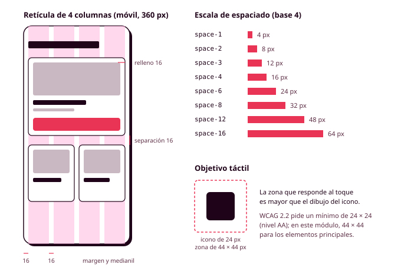

# Órbita 2 — Fundar el sistema visual

## 5. Espaciado, retícula y composición

En tus wireframes de la Órbita 1 colocaste los elementos a ojo, dejando más o menos espacio según te parecía. Para comprobar si la estructura funcionaba era suficiente, pero si miras dos pantallas seguidas seguramente descubrirás que la separación entre el título y la primera tarjeta no es la misma en las dos, o que el botón está a 13 píxeles del borde en una pantalla y a 18 en la otra. Son diferencias pequeñas que nadie sabría señalar, pero que **hacen que una aplicación parezca descuidada sin que se sepa muy bien por qué**. En este apartado vas a decidir cuánto espacio hay entre los elementos, sobre qué estructura se colocan, qué forma tienen sus esquinas y cómo se indica que uno está por encima de otro, y todo eso lo convertirás en tokens (RA1-c, RA1-f).

### Una escala de espaciado

Igual que hiciste con los tamaños de letra, vas a trabajar con un conjunto cerrado de espacios entre los que elegirás siempre, construido sobre una **cuadrícula base** de 4 u 8 píxeles. Eso significa que todas las medidas de tu interfaz (márgenes, rellenos, separaciones, alturas de botones) serán múltiplos de 4. El motivo es práctico: los múltiplos de 4 se dividen bien entre dos, lo que evita medios píxeles en las pantallas de alta densidad, que muestran cada píxel de diseño con dos o tres píxeles físicos, y además hacen muy fáciles las cuentas. Si 16 píxeles se te quedan cortos, el siguiente paso es 24, y no 19 ni 21.

Los tokens de espaciado del polideportivo se nombran por el número de veces que contienen la unidad de 4 píxeles: `space-1` son 4 píxeles, `space-2` son 8, `space-4` son 16, y así hasta `space-16`, que son 64. Fíjate en que **la escala da saltos cada vez más grandes** (4, 8, 12, 16, 24, 32, 48, 64), porque entre 4 y 8 píxeles se nota mucho la diferencia, mientras que entre 60 y 64 no la percibe nadie. También puedes nombrarlos por tallas (`space-xs`, `space-sm`, `space-md`...), y las dos formas son válidas siempre que uses la misma en todo el sistema.

El espaciado es la herramienta con la que aplicas el principio de proximidad del apartado 2, y por eso se usa con una regla muy sencilla: **el espacio dentro de un grupo es menor que el espacio entre grupos**. En la tarjeta de una pista, el nombre y el precio están separados por 4 u 8 píxeles, el contenido de la tarjeta queda a 16 píxeles de su borde, y entre una tarjeta y la siguiente hay 16 o 24. Si la separación entre dos tarjetas fuera menor que el relleno interior de cada una, los contenidos de una parecerían pertenecer a la otra.

### La retícula

Una **retícula** (en inglés, *grid*) es una estructura de columnas invisibles sobre la que se colocan los elementos de una pantalla. Los diseñadores de carteles y de libros la usan desde hace mucho tiempo, y *Sistemas de retículas*, de Josef Müller-Brockmann, sigue siendo la referencia clásica. En una interfaz, la retícula hace que los elementos se alineen entre sí aunque estén en zonas distintas de la pantalla, y te da un criterio para decidir cuánto ocupa cada uno.

Una retícula tiene tres partes: las **columnas**, que son las franjas donde se coloca el contenido; los **medianiles**, que son los espacios entre columnas; y los **márgenes**, que son los espacios entre las columnas exteriores y el borde de la pantalla. Las combinaciones más habituales son estas:

| Pantalla | Columnas | Medianil | Margen |
|---|---|---|---|
| Móvil (360 píxeles de ancho) | 4 | 16 px | 16 px |
| Tablet | 8 | 16 o 24 px | 24 px |
| Escritorio | 12 | 24 px | 32 px, con el contenido limitado a un ancho máximo |

El número 12 se usa tanto en escritorio porque se divide entre 2, 3, 4 y 6, de modo que puedes repartir la pantalla en dos mitades, en tres tarjetas o en cuatro sin salirte de la retícula. En el móvil, con 4 columnas, una tarjeta puede ocupar el ancho completo o la mitad. En escritorio **conviene limitar el ancho del contenido** (por ejemplo, a 1200 píxeles), porque en una pantalla muy ancha las líneas de texto superarían los 75 caracteres que viste en el apartado anterior.

En este módulo tienes que definir la retícula para el dispositivo de tu persona principal y, si alguna de tus personas usa otro tipo de pantalla, también para ese. En Figma se añade a cada frame desde la sección de **Layout grid**, y puedes guardarla como estilo para reutilizarla. Los puntos exactos en los que la web cambia de una retícula a otra (los **breakpoints**) los decidirás en la Órbita 3 a partir de los dispositivos reales de tus personas.

### Composición y ritmo

Con la escala de espaciado y la retícula ya tienes casi todo lo necesario para componer una pantalla, pero hay dos ideas más que te van a ayudar.

La primera es la **alineación**. Cuantas menos líneas de alineación tenga una pantalla, más ordenada parecerá. Si el título, el texto de las tarjetas y el botón empiezan todos en el mismo borde izquierdo, la vista recorre la pantalla siguiendo esa línea. Si cada elemento empieza a una distancia distinta del borde, la pantalla parecerá desordenada aunque no sepas explicar por qué. Por eso conviene que los textos se alineen con el borde de la columna y no se centren salvo en elementos muy concretos, como el título de una pantalla de bienvenida.

La segunda es el **ritmo**, que consiste en repetir siempre las mismas separaciones para las mismas relaciones. Si entre el título de una sección y su contenido siempre hay 16 píxeles, y entre una sección y la siguiente siempre hay 48, la persona aprende sin darse cuenta dónde empieza y dónde acaba cada bloque. El espacio vacío forma parte del diseño, y una pantalla con aire suficiente se entiende mejor que una en la que se ha intentado aprovechar cada píxel.

Si quieres ver estas ideas aplicadas, en este vídeo el diseñador Eze Cichello explica cómo compone sus piezas: la jerarquía visual, las retículas, la regla de los tercios, el espacio en blanco y cuándo tiene sentido romper las reglas. Está pensado para el diseño gráfico en general (carteles, publicaciones, identidades), pero los mismos principios sirven para una pantalla. La regla de los tercios, en concreto, te será útil sobre todo para encuadrar las fotos y las cabeceras de tu aplicación. En cuanto a romper las reglas, ten en cuenta que **en una interfaz solo compensa cuando la ruptura tiene un propósito claro**, como destacar la acción principal, porque cada excepción es algo más que la persona tiene que interpretar.

  <iframe src="https://www.youtube-nocookie.com/embed/wEocy9cz3yw?start=74" title="Principios de composición, de Eze Cichello" style="position:absolute; top:0; left:0; width:100%; height:100%; border:0;" allow="accelerometer; clipboard-write; encrypted-media; gyroscope; picture-in-picture" allowfullscreen loading="lazy"></iframe>

<small>**Fuente:** vídeo de Eze Cichello publicado en YouTube ([ver en YouTube](https://www.youtube.com/watch?v=wEocy9cz3yw&t=74s), por si no se carga aquí). Se incluye con fines exclusivamente educativos; todos los derechos pertenecen a su autor.</small>

En Figma, la herramienta que te permite aplicar todo esto sin tener que medir es **Auto layout**, que coloca los elementos de un frame en fila o en columna con una separación y un relleno fijos. Cuando crees tus variables en Figma verás que esa separación y ese relleno pueden usar directamente tus tokens de espaciado.

### El tamaño de los objetivos táctiles

Un **objetivo táctil** es la zona de la pantalla que responde cuando la tocas, y no tiene por qué coincidir con el dibujo del elemento. Un icono de 24 píxeles puede tener a su alrededor una zona activa de 44 × 44, de modo que no hace falta acertar en el dibujo exacto para pulsarlo.

Lucía reserva desde el autobús, de pie y con el pulgar de una sola mano, y un objetivo pequeño le obligará a intentarlo dos o tres veces. Las pautas WCAG 2.2 piden que los objetivos midan al menos 24 × 24 píxeles (criterio 2.5.8, nivel AA), y las guías de Apple y de Google recomiendan 44 y 48 respectivamente. En este módulo, los botones, los enlaces de navegación y los iconos que se pueden pulsar en el móvil tendrán una zona activa de al menos **44 × 44 píxeles**, y entre dos objetivos táctiles cercanos habrá espacio suficiente para no pulsar uno por otro (RA5-a).

### El radio de las esquinas

El **radio** indica cuánto se redondean las esquinas de los botones, las tarjetas o los campos de formulario. Parece un detalle menor, pero cambia mucho el carácter de una aplicación: las esquinas rectas transmiten seriedad y precisión, y las muy redondeadas resultan más cercanas e informales. Lo importante es que el radio sea coherente en todo el sistema, y por eso también se convierte en tokens:

| Token | Valor | Uso en el polideportivo |
|---|---|---|
| `radius-none` | 0 | Imágenes a sangre que ocupan todo el ancho |
| `radius-sm` | 4 px | Campos de formulario y etiquetas |
| `radius-md` | 8 px | Botones y tarjetas |
| `radius-lg` | 16 px | Cuadros de diálogo y paneles inferiores |
| `radius-full` | 9999 px | Elementos con forma de píldora, como los botones de hora |

Cuando un elemento redondeado está dentro de otro, como la foto de una pista dentro de su tarjeta, el radio interior tiene que ser menor que el exterior. La regla habitual es que **el radio exterior sea igual al interior más el relleno que los separa**, y si no la aplicas, las esquinas de los dos elementos no se verán paralelas.

### La elevación y las sombras

La **elevación** indica qué elementos quedan por encima de otros, y es la aplicación directa del principio de figura y fondo. Una tarjeta ligeramente elevada se separa del fondo, un menú desplegable queda por encima de la pantalla, y un cuadro de diálogo está por encima de todo. En el modo claro, la elevación se representa sobre todo con **sombras**, y conviene que tengas pocos niveles y bien diferenciados:

| Token | Sombra (desplazamiento vertical, desenfoque, opacidad) | Uso |
|---|---|---|
| `elevation-0` | Sin sombra | Elementos planos sobre el fondo |
| `elevation-1` | 1 px, 3 px, 12 % | Tarjetas |
| `elevation-2` | 4 px, 12 px, 16 % | Menús desplegables y elementos fijos al desplazar la pantalla |
| `elevation-3` | 12 px, 32 px, 20 % | Cuadros de diálogo y paneles inferiores |

Usa las sombras con moderación. Una interfaz en la que todo está elevado no tiene jerarquía, y las **Web Sustainability Guidelines (WSG)** del W3C recomiendan **usar los recursos decorativos con cuidado (criterio 2.7)**. En el modo oscuro, además, las sombras apenas se ven sobre un fondo casi negro, así que allí la elevación se indica haciendo un poco más claras las superficies que están por encima. En Figma, las sombras se guardan como **estilos de efecto**.

### Antes de seguir

Antes de pasar a los iconos, comprueba que tienes una escala de espaciado basada en 4 u 8 píxeles con sus nombres, la retícula del dispositivo de tu persona principal, una escala de radios y entre dos y cuatro niveles de elevación. Después coge tu wireframe más complejo, colócale encima la retícula y revisa tres cosas: que los elementos se alinean con las columnas, que **todas las separaciones son valores de tu escala** y que, en cada grupo, el espacio interior es menor que el que lo separa del grupo siguiente. Mide también los botones y los iconos que se pueden pulsar, y si alguno no llega a 44 × 44 píxeles en el móvil, anótalo para corregirlo cuando hagas los mockups.
