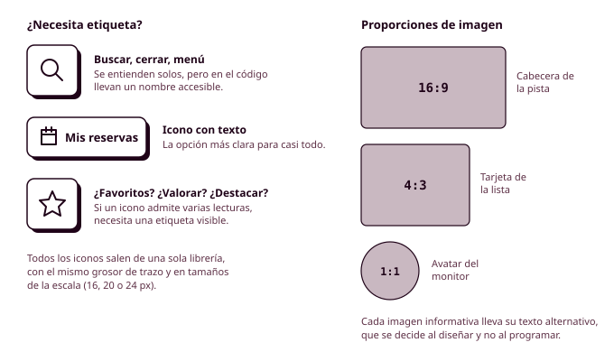

# Órbita 2 — Fundar el sistema visual

## 6. Iconos e imágenes

En tus wireframes, los iconos eran círculos o cuadrados grises y las imágenes, rectángulos con una X dentro. Ahora toca decidir qué hay en cada uno de esos huecos, y **es una decisión que va más allá de lo estético**. Un icono bien elegido le ahorra a Lucía leer una etiqueta mientras va de pie en el autobús, y una foto de la pista real le dice a Manuel si es cubierta o descubierta antes de reservarla. En este apartado vas a elegir la librería de iconos de tu aplicación y a fijar unas reglas para las imágenes, y las dos cosas formarán parte de tu guía de estilo (RA1-b).

### Para qué sirve un icono

Un **icono** es un dibujo sencillo que representa una acción, un objeto o un estado, y funciona como un atajo visual. Cuando funciona, se reconoce más rápido que una palabra y ocupa menos espacio. El problema es que solo funciona cuando la persona ya conoce su significado, y son muy pocos los iconos que todo el mundo entiende igual: la lupa para buscar, la X para cerrar, la casa para volver al inicio, la papelera para borrar y poco más. El resto (una estrella, un corazón, una campana, unas flechas en círculo) admiten varias lecturas según la aplicación en la que aparezcan. La estrella puede querer decir "favoritos", "valorar" o "destacado", y la persona no sabrá cuál hasta que la pulse.

Por eso, en este módulo, la regla general es que **los iconos van acompañados de una etiqueta de texto**. Solo pueden ir solos los que tienen un significado universal y, aun así, en el código llevarán un nombre accesible para que un lector de pantalla pueda anunciarlos (lo harás en la Órbita 4 con el atributo `aria-label`). La barra de navegación inferior del polideportivo tiene cuatro iconos, y cada uno lleva debajo su palabra ("Inicio", "Reservar", "Mis reservas", "Perfil"), porque a Manuel no le sirve de nada un icono de calendario si no sabe si le lleva a reservar o a ver las reservas que ya tiene.

Hay otra distinción que te conviene tener clara desde ahora. Algunos iconos son **informativos**, porque transmiten algo que no está en el texto de al lado (por ejemplo, un icono de aviso junto a un mensaje que no dice que es un aviso), y otros son **decorativos**, porque repiten lo que ya dice el texto. Los primeros necesitan un texto alternativo para quien no puede verlos, y los segundos se ocultan a los lectores de pantalla para que no repitan lo mismo dos veces. Anótalo en tus diseños, porque en la Órbita 4 lo necesitarás para escribir el código accesible.

### Una sola librería de iconos

Los iconos de una aplicación tienen que parecer de la misma familia, igual que las letras de una tipografía, y la forma más sencilla de conseguirlo es sacarlos todos de **una sola librería**. Si mezclas iconos de dos librerías distintas, se notará enseguida en el grosor del trazo, en el redondeo de las esquinas o en el nivel de detalle. Estas son algunas librerías gratuitas que puedes usar, todas con plugin o archivo para Figma:

| Librería | Estilo | Licencia |
|---|---|---|
| Lucide | Trazo fino y redondeado, muy neutro | ISC (libre, también para uso comercial) |
| Phosphor | Seis estilos (de trazo fino a relleno) dentro de la misma familia | MIT |
| Material Symbols | El sistema de Google, con grosor y relleno ajustables | Apache 2.0 |
| Heroicons | Pocos iconos, muy cuidados, en trazo y relleno | MIT |

Antes de elegir una, **comprueba que tiene todos los iconos que necesita tu aplicación**, porque cambiar de librería a mitad del proyecto obliga a rehacerlo todo. Y fíjate en la licencia, como hiciste con las tipografías. Todas las de la tabla permiten usarlas en un proyecto comercial, pero no todas las que encontrarás en internet lo permiten, y en la Órbita 3 tendrás que justificar las licencias de todo el material gráfico de tu web.

En cuanto a tamaños, los iconos se dibujan sobre una cuadrícula cuadrada (normalmente de 24 × 24 píxeles) y se usan en unos pocos tamaños de tu escala de espaciado: 16 píxeles junto a textos pequeños, 20 junto al texto normal y 24 en la navegación y en los botones de solo icono. Recuerda que un icono de 24 píxeles que se puede pulsar **necesita una zona activa de 44 × 44 a su alrededor**, como viste en el apartado anterior. El color de los iconos sale de tus tokens semánticos (normalmente `color-on-surface` o `color-on-surface-variant`), y cuando un icono transmite información por sí solo tiene que cumplir el contraste de 3:1 con su fondo que piden las pautas WCAG para los elementos gráficos (criterio 1.4.11).

En Figma, convierte cada icono que uses en un **componente**, y dentro de tus botones y elementos de navegación usa instancias de esos componentes. Así podrás cambiar un icono por otro sin tocar el resto del botón. Para la web, los iconos se exportan en formato **SVG**, que es un formato vectorial (las formas se describen con coordenadas en lugar de con píxeles), de modo que se ven nítidos a cualquier tamaño, pesan muy poco y se les puede cambiar el color desde CSS. Exporta solo los iconos que usas. Cargar una librería entera de 1500 iconos para usar 15 es un desperdicio de datos que las **Web Sustainability Guidelines (WSG)** desaconsejan, y es uno de los errores más habituales en las webs.

### Para qué sirve una imagen

**Las imágenes son, con mucha diferencia, lo que más pesa en una web**, así que cada una tiene que justificar su presencia. Antes de incluir una, pregúntate qué información aporta que no esté ya en el texto. En el polideportivo, la foto de cada pista ayuda a Manuel a saber si es cubierta, si tiene gradas o si es la que está junto a la piscina, y por eso está en la ficha de la pista. La foto de una persona sonriendo con una raqueta en la pantalla de inicio no le dice nada que le ayude a reservar, y por eso no está.

Las **Web Sustainability Guidelines (WSG)** del W3C lo plantean en dos criterios. El **criterio 2.7** pide usar el diseño decorativo con cuidado, y el **criterio 2.15** pide que las imágenes que sean necesarias estén optimizadas, con el tamaño y el formato adecuados y con carga diferida cuando tenga sentido. La optimización la harás en la Órbita 3, pero la decisión de cuántas imágenes hay y para qué sirven se toma ahora, en el diseño, y es la que más influye en el peso final de cada página.

Cuando decidas incluir una imagen, define también su **proporción**, es decir, la relación entre su ancho y su alto. Las más habituales son 16:9 para cabeceras y vídeos, 4:3 para tarjetas y 1:1 para avatares y miniaturas. Si fijas dos o tres proporciones en tu sistema, todas las tarjetas de una lista tendrán la misma altura aunque las fotos originales sean distintas, y en la Órbita 3 podrás reservar ese espacio en el código para que la página no dé saltos mientras cargan.

### Imágenes y texto

Poner texto encima de una foto es muy tentador y casi siempre da problemas de contraste, porque una foto tiene zonas claras y zonas oscuras y el texto se leerá bien en unas y mal en otras. Si necesitas hacerlo, coloca debajo del texto una capa de color semitransparente o un degradado oscuro y **comprueba el contraste en la zona más desfavorable de la foto**. En la mayoría de los casos es más sencillo, más accesible y más ligero poner el texto debajo o al lado de la imagen.

**Nunca uses una imagen para mostrar texto**, como un cartel con los horarios del polideportivo convertido en foto. Un lector de pantalla no puede leerlo, no se adapta cuando Manuel aumenta la letra, no se puede buscar ni copiar y pesa mucho más que el mismo texto escrito.

### Texto alternativo y responsabilidad

Cada imagen informativa necesita un **texto alternativo**, que es una descripción breve que leerá el lector de pantalla y que aparecerá si la imagen no se carga. La pregunta para escribirlo es qué información perdería alguien que no puede ver la imagen. Para la foto de la pista 3, algo como "Pista de pádel cubierta con paredes de cristal y gradas a la izquierda" es útil, y "Imagen de una pista" no aporta nada. Las imágenes decorativas, en cambio, llevan un texto alternativo vacío para que el lector de pantalla las ignore. Escribe estos textos en tus diseños de Figma, en una nota junto a cada imagen, porque quien mejor sabe qué información transmite una imagen es quien decidió ponerla (RA5-a).

Las imágenes también comunican a quién va dirigida una aplicación. Si todas las fotos de personas de tu proyecto muestran a gente joven, delgada y sin ninguna diversidad funcional, estás diciendo sin palabras que Manuel no es el público de la aplicación. **Elige imágenes que representen a las personas que de verdad la van a usar**. Y si generas imágenes con IA, indícalo en el `CHANGELOG.md`, revisa que no reproduzcan estereotipos y no las uses nunca para inventar personas que parezcan reales, como clientes que dan su opinión sobre el servicio, porque eso es un engaño. Para las fotos que no sean tuyas, comprueba la licencia (Unsplash y Pexels tienen licencias propias que permiten el uso gratuito, y las imágenes con licencia Creative Commons tienen condiciones que dependen de cada tipo); lo verás con más detalle en la Órbita 3.

Por último, piensa en los **estados vacíos** y en los errores de carga. Si una pista todavía no tiene foto, o si la conexión de Lucía falla y la imagen no llega, la tarjeta tiene que seguir entendiéndose, con un fondo de color de tu sistema y quizá un icono, en lugar de un hueco en blanco o un icono de imagen rota.

### Antes de seguir

Antes de pasar a los patrones de interfaz, haz una lista de todos los iconos que aparecen en tus wireframes y comprueba que la librería que has elegido los tiene todos, que has anotado su licencia y que cada uno lleva etiqueta salvo que su significado sea universal. Después revisa cada imagen de tus wireframes y escribe junto a ella qué información aporta. **Si no sabes qué escribir, plantéate quitarla.** Para las que se queden, anota su proporción y su texto alternativo, y comprueba que tu sistema tiene un máximo de tres proporciones distintas.
