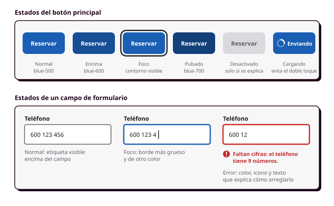
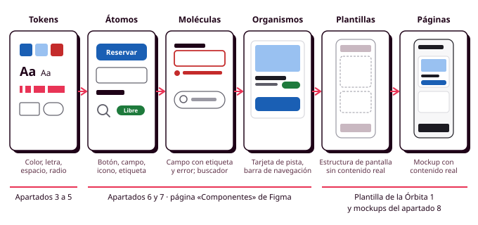

# Órbita 2 — Fundar el sistema visual

## 7. Patrones de interfaz

Cuando abres por primera vez una tienda online, sabes sin que nadie te lo explique que el carrito está arriba a la derecha, que el logotipo te lleva a la portada y que el botón más llamativo de la ficha de un producto sirve para comprarlo. Lo sabes porque lo has visto cientos de veces en otras webs. A esas soluciones que se repiten de una aplicación a otra se las llama **patrones de interfaz**, y son una de las herramientas más útiles que vas a tener como diseñador, porque te permiten aprovechar todo lo que tus personas ya han aprendido usando otras aplicaciones. En este apartado vas a conocer los patrones más habituales, los componentes con los que se construyen y los errores que conviene evitar, incluidos los que se cometen a propósito para engañar a quien usa la aplicación (RA1-c, RA6-c).

### Qué es un patrón y por qué conviene usarlo

Un **patrón** es una solución que ya ha funcionado para un problema que aparece una y otra vez. El concepto viene de la arquitectura (el arquitecto Christopher Alexander describió en los años setenta los patrones que se repiten en las casas y las ciudades), y del diseño de interfaces lo recoge, por ejemplo, el libro *Designing Interfaces*, de Jenifer Tidwell, que tienes en la bibliografía del módulo. Una barra de pestañas, un formulario de pago en varios pasos o una lista con un buscador encima son patrones.

La razón para usarlos la resume la **ley de Jakob**, otra de las Leyes UX: las personas pasan la mayor parte de su tiempo en otras aplicaciones, así que esperan que la tuya funcione igual que las que ya conocen. Cada vez que te apartas de un patrón establecido, obligas a quien usa tu aplicación a aprender algo nuevo, y eso solo compensa cuando la solución nueva es claramente mejor. Las **Web Sustainability Guidelines (WSG)** del W3C lo recogen en su **criterio 2.10, "Usar patrones de diseño establecidos y componentes esenciales"**, porque los patrones conocidos acortan los recorridos y evitan pantallas y pruebas inútiles.

Usar patrones consiste en resolver los problemas habituales de la forma que la gente ya espera, para dedicar tu creatividad a lo que de verdad hace distinta a tu aplicación.

### Los componentes más habituales

Los patrones se construyen con **componentes**, que son las piezas reutilizables de una interfaz. Ya empezaste a crearlos en tus wireframes, y en esta órbita vas a darles su aspecto definitivo con tus tokens. Estos son los que aparecen en casi todas las aplicaciones (C1.f):

**Botones.** Una aplicación suele tener tres niveles: el **principal**, con el color `primary`, para la acción más importante de la pantalla; el **secundario**, con borde o con un fondo suave, para las acciones alternativas; y el **terciario** o de texto, para acciones de poca importancia como "Ver más". Como viste en el apartado 2, en cada pantalla debería haber un solo botón principal. La etiqueta de un botón dice lo que va a pasar ("Reservar pista", "Cancelar reserva") en lugar de un genérico "Aceptar".

**Campos de formulario.** Cada campo lleva una **etiqueta visible encima**, que no desaparece al escribir. Usar el texto de ejemplo del interior del campo (el *placeholder*) como etiqueta es un antipatrón muy extendido, porque en cuanto Manuel empieza a escribir ya no sabe qué le estaban pidiendo. Para elegir entre opciones se usan las **casillas de verificación** (cuando se pueden marcar varias), los **botones de opción** (cuando solo se puede elegir una entre pocas) y los **desplegables** (cuando son muchas). Los interruptores (*switches*) son para ajustes que se aplican al momento, como activar las notificaciones.

**Tarjetas.** Agrupan la información de un mismo elemento (la foto, el nombre y el precio de una pista) aplicando la región común del apartado 2. Si toda la tarjeta se puede pulsar, tiene que parecerlo, y no debería contener a la vez otros botones que hagan cosas distintas.

**Navegación.** En el móvil, la **barra de navegación inferior** con tres a cinco destinos es el patrón más cómodo para usar con una mano, como hace Lucía, porque queda al alcance del pulgar. El **menú hamburguesa** (las tres rayas que despliegan un menú) ahorra espacio, pero esconde las opciones, y los estudios de usabilidad muestran que lo que está escondido se usa mucho menos, así que resérvalo para las secciones secundarias. En escritorio, la navegación suele ir en una barra superior con todas las secciones principales a la vista. Las **migas de pan** (la ruta "Inicio > Pistas > Pádel") ayudan a orientarse cuando hay varios niveles.

**Mensajes y avisos.** Los **avisos** dentro de la pantalla informan de algo que afecta a lo que estás viendo ("Esta pista cierra por mantenimiento el día 12"); las **notificaciones breves** (*toasts*) confirman una acción y desaparecen solas ("Reserva cancelada"); y los **cuadros de diálogo** interrumpen para pedir una decisión que no puede esperar ("¿Seguro que quieres cancelar la reserva?"). Los cuadros de diálogo son los más molestos, así que úsalos solo cuando la acción no se pueda deshacer.

**Estados vacíos y de carga.** Una lista sin elementos ("Todavía no tienes reservas") es una oportunidad para explicar qué se puede hacer, con un botón que lleve a reservar. Mientras se cargan los datos, una versión gris de la estructura de la pantalla (lo que se llama un *skeleton*) le indica a Lucía que algo está pasando y evita que la pantalla dé saltos cuando llega el contenido.

Conocer el **nombre exacto** de cada componente es más útil de lo que parece. Cuando hables con quien programe la aplicación, cuando busques cómo lo resuelven otros sistemas de diseño o cuando lo documentes en tu guía de estilo, decir "un *toast*" o "un *popover*" ahorra muchas explicaciones, y confundir un *tooltip* con un *popover* puede llevar a programar algo distinto de lo que habías diseñado. Si ves un elemento en una aplicación y no sabes cómo se llama, consulta [Name That UI](https://namethatui.com), un diccionario visual de componentes de interfaz en el que puedes buscar describiendo lo que ves con tus propias palabras, y que además explica las diferencias entre los que más se confunden.

### Los estados de un componente

Cada componente tiene un aspecto distinto para cada **estado** en el que puede estar, y tienes que diseñarlos todos. Si no lo haces, quien lo programe en la Órbita 3 (que serás tú) tendrá que inventárselos sobre la marcha.

Los botones tienen como mínimo un estado **normal**, uno **encima** (cuando el ratón pasa por encima), uno de **foco** (cuando se llega a él con el teclado), uno **pulsado** y uno **desactivado**, y a menudo uno de **carga**, que evita que alguien pulse dos veces y reserve dos pistas. Los campos de formulario tienen, además del normal y el de foco, uno de **error** y uno desactivado. Fíjate en que cada estado usa un primitivo distinto de tu escala de color, y en que el error se indica con el color rojo y, además, con un icono y un texto que explica cómo arreglarlo, como viste en el apartado 3.

El estado de foco merece especial atención. Las personas que navegan con el teclado, como quien no puede usar un ratón por una diversidad funcional motora, necesitan saber en todo momento qué elemento está seleccionado, y las pautas WCAG exigen que el foco sea visible (criterio 2.4.7, nivel AA). Diseña un contorno de foco claro y con contraste suficiente, y **no lo elimines nunca porque "queda feo"**. En cuanto al estado desactivado, úsalo con prudencia. Un botón de "Reservar" gris que no se puede pulsar no le dice a Manuel qué le falta, y suele ser mejor dejarlo activo y, al pulsarlo, señalar el campo que falta por rellenar (RA5-a).

En Figma, los estados se crean como **variantes** de un mismo componente, de modo que en tus pantallas podrás cambiar de un estado a otro desde el panel de propiedades. Las variantes de tus botones y tus campos usarán los tokens de color, tipografía, espaciado y radio que has definido en los apartados anteriores.

Si quieres un repaso rápido de todo esto, en este vídeo Kole Jain recorre en menos de diez minutos los conceptos básicos de UI y UX. Empieza por las **affordances y los significantes** (las pistas visuales que te indican que algo se puede pulsar, arrastrar o escribir), sigue con los botones, el feedback y los estados de los componentes, las microinteracciones y los elementos superpuestos, como los diálogos, y por el camino repasa también la jerarquía, las retículas, la tipografía, el color, el modo oscuro y las sombras, así que te sirve como resumen de casi toda la órbita. Está en inglés, así que, si te cuesta seguirlo, activa los subtítulos desde la configuración del reproductor.

  <iframe src="https://www.youtube-nocookie.com/embed/EcbgbKtOELY" title="Every UI/UX Concept Explained in Under 10 Minutes, de Kole Jain" style="position:absolute; top:0; left:0; width:100%; height:100%; border:0;" allow="accelerometer; clipboard-write; encrypted-media; gyroscope; picture-in-picture" allowfullscreen loading="lazy"></iframe>

<small>**Fuente:** vídeo de Kole Jain publicado en YouTube ([ver en YouTube](https://www.youtube.com/watch?v=EcbgbKtOELY), por si no se carga aquí). Se incluye con fines exclusivamente educativos; todos los derechos pertenecen a su autor.</small>

### Cómo se organizan los componentes: Atomic Design

Cuando una aplicación crece, la lista de componentes se vuelve difícil de manejar y hace falta una forma de ordenarlos. La más conocida es **Atomic Design**, que el diseñador Brad Frost propuso en 2013 y desarrolló en su libro *Atomic Design* (2016). Su idea central es que una interfaz se construye de abajo arriba, combinando piezas pequeñas para formar otras más grandes, y para explicarlo toma prestados los nombres de la química:

1. **Átomos.** Son las piezas más pequeñas que tienen sentido por sí mismas, como un botón, un campo de texto, un icono o la etiqueta de "Libre".
2. **Moléculas.** Son grupos pequeños de átomos que funcionan juntos como una unidad, como un campo de formulario completo (etiqueta, campo y mensaje de error) o un buscador (icono, campo y botón).
3. **Organismos.** Son bloques más complejos, formados por moléculas y átomos, que ya forman una sección reconocible de la pantalla, como la tarjeta de una pista o la barra de navegación inferior.
4. **Plantillas.** Son la estructura de una pantalla con sus organismos colocados, pero sin contenido real. Es lo que hiciste en la Órbita 1 con la plantilla de pantalla de tus wireframes (RA1-f).
5. **Páginas.** Son una plantilla con contenido real, es decir, tus mockups del apartado 8. En las páginas es donde se comprueba si el sistema aguanta los nombres de pista largos, las listas vacías y los mensajes de error de verdad.

Por debajo de los átomos están los tokens que has definido en los apartados 3 a 5. Un átomo como el botón principal usa `color-primary`, `label`, `space-4` y `radius-md` en lugar de tener valores propios, y por eso, **cuando cambias un token, el cambio llega a todos los niveles que hay por encima**.

Atomic Design tiene más de diez años y se sigue usando en muchos equipos, aunque de una forma más flexible que al principio. El propio Frost explica que es un modelo mental para pensar la interfaz a la vez como un todo y como un conjunto de piezas, y que su proceso no es lineal, porque mientras diseñas una página descubrirás que te falta un átomo y tendrás que volver atrás. Por eso no merece la pena discutir si un componente concreto es una molécula o un organismo. **Lo importante es que las piezas grandes se construyan con las pequeñas** y que cada pieza tenga un nombre que diga para qué sirve. Los sistemas de diseño actuales lo combinan, además, con los tokens, que en la propuesta original apenas aparecían.

En este módulo lo vas a usar para ordenar la página de componentes de tu archivo de Figma, con una sección para los átomos, otra para las moléculas y otra para los organismos, y te servirá también en la Órbita 3, porque la biblioteca de componentes en HTML y CSS se construye en el mismo orden, empezando por los átomos que reutilizarás en todo lo demás. Una buena señal de que tu sistema está bien construido es que, **al cambiar un átomo (por ejemplo, el radio del botón), el cambio aparece en todas las moléculas, los organismos y las páginas que lo contienen**.

### Antipatrones

Un **antipatrón** es una solución que parece razonable y que se repite mucho, pero que causa problemas. Ya has visto dos: el texto de ejemplo usado como etiqueta y el menú hamburguesa para las secciones principales. Hay otros que encontrarás a menudo:

- **Los carruseles que avanzan solos.** Mueven el contenido antes de que dé tiempo a leerlo, y casi nadie pasa de la segunda diapositiva.
- **Los iconos sin etiqueta de significado ambiguo**, como viste en el apartado anterior.
- **El scroll infinito en páginas con pie.** Si la lista no se acaba nunca, no hay forma de llegar al pie de página, donde suelen estar el contacto o los avisos legales.
- **Los formularios que borran lo escrito al dar un error**, que obligan a Manuel a empezar de nuevo.
- **Los enlaces que dicen "Pincha aquí"**, que no indican adónde llevan y que un lector de pantalla anuncia todos igual.

### Patrones engañosos

Hay patrones que se diseñan para que la persona haga algo que no quería hacer: aceptar un seguimiento, comprar un extra o no darse de baja. Se llaman **patrones engañosos** (en inglés, *deceptive patterns* o *dark patterns*), y el diseñador Harry Brignull los ha catalogado en deceptive.design. Ya viste uno en el apartado 2, la interferencia visual, y estos son otros que podrían aparecer en una aplicación como la del polideportivo:

| Patrón | Cómo se vería en el polideportivo |
|---|---|
| **Urgencia falsa** | Un aviso de "¡Solo queda 1 pista libre!" que aparece siempre, haya las que haya |
| **Opciones preseleccionadas** | El seguro de lesiones ya marcado en el pago, para que se contrate si nadie se fija |
| **Confirmshaming** (avergonzar para que aceptes) | Un botón para rechazar el seguro con el texto "No, prefiero arriesgarme a lesionarme" |
| **Costes ocultos** | Unos gastos de gestión que solo aparecen en el último paso del pago |
| **Difícil de cancelar** | Reservar con un toque, pero tener que llamar por teléfono en horario de oficina para cancelar |
| **Insistencia** | Una ventana que pide activar las notificaciones cada vez que se abre la aplicación |

Estos patrones pueden aumentar las ventas durante un tiempo, pero acaban haciendo que la gente desconfíe de la aplicación, y algunos están prohibidos por la normativa europea de protección de los consumidores, como los costes ocultos y las casillas premarcadas para contratar servicios adicionales. Las **Web Sustainability Guidelines (WSG)** del W3C los rechazan en su **criterio 2.11, "Evitar ser manipulador o engañoso"**, entre otras cosas porque hacen que la gente cargue páginas y repita acciones que no necesitaba, y los Principios Éticos de la Web del W3C piden que la web respete a las personas y no se aproveche de ellas. En la Órbita 5 auditarás tu propio proyecto y el de un compañero buscando estos patrones, pero conviene que los evites desde ahora. La prueba es sencilla: si tuvieras que explicarle a Manuel por qué has diseñado así un elemento y la explicación te diera vergüenza, probablemente has diseñado un patrón engañoso.

### Dónde buscar patrones

Cuando tengas que resolver un problema de interfaz, busca primero cómo lo han resuelto otros. Los sistemas de diseño públicos de grandes organizaciones documentan sus componentes con mucho detalle, explican cuándo usar cada uno y, en muchos casos, incluyen pautas de accesibilidad. Algunos que te van a servir son **Material Design** (de Google), las **Human Interface Guidelines** (de Apple) y el **GOV.UK Design System**, el del gobierno británico, que es una referencia excelente en accesibilidad y en claridad, porque está pensado para que lo use toda la población. También puedes recorrer tus referentes de la Órbita 1 fijándote solo en cómo resuelven cada componente.

### Antes de seguir

Antes de pasar a Figma, haz una lista de todos los componentes que aparecen en tus wireframes (botones, campos, tarjetas, navegación, avisos...) y, junto a cada uno, anota a qué nivel de Atomic Design pertenece, qué patrón conocido sigue y en qué aplicación lo has visto. Si alguno no sigue ningún patrón, justifica por qué tu solución es mejor que la habitual. Después escribe, para tu botón principal y para tus campos de formulario, qué estados necesitan. Por último, **recorre tu user flow buscando los momentos en los que tu aplicación pide algo a la persona** (datos, pagos, permisos, confirmaciones) y comprueba que en ninguno de ellos has usado, sin darte cuenta, uno de los patrones engañosos de la tabla.
