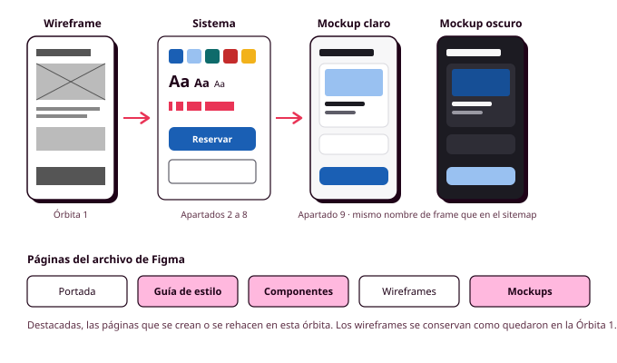

# Órbita 2 — Fundar el sistema visual

## 8. Del wireframe al mockup: guía de estilo y entregable

Has llegado al momento que seguramente esperabas desde el principio de la órbita, el de ver tus pantallas con su aspecto definitivo. Si has trabajado los apartados anteriores con cuidado, este paso va a ser más rápido de lo que imaginas, porque casi todas las decisiones ya están tomadas y guardadas en tu sistema, y lo que queda es aplicarlas. Al terminar tendrás tres cosas: los **mockups** del happy path de tu user flow (con la pantalla principal en dos anchos y en modo oscuro), el **prototipo** que los enlaza y la **guía de estilo** que explica cada decisión. Con ellas cierras la órbita y preparas el terreno para la maquetación de la Órbita 3 (RA1-d, RA1-f).

### Organiza el archivo de Figma

Antes de empezar, ordena el archivo en el que tienes los wireframes, porque a partir de ahora vas a trabajar con mucho más material y en la Órbita 3 tendrás que encontrar cada cosa rápidamente. Organízalo en páginas:

1. **Portada**, con el nombre del proyecto, tu nombre y la fecha de la última versión.
2. **Guía de estilo**, con la documentación del sistema que verás al final de este apartado.
3. **Componentes**, con todos los componentes de tu aplicación y sus variantes de estado, ordenados en secciones de átomos, moléculas y organismos, como viste en el apartado 7.
4. **Wireframes**, con los de la Órbita 1 tal como los dejaste y, al lado, los rediseñados en el apartado 2 con sus notas. No borres ni modifiques los originales, porque son la prueba de cómo ha evolucionado tu proyecto y te los puedo pedir en la auditoría oral.
5. **Mockups**, con las pantallas definitivas.

### Del wireframe al mockup, paso a paso

Un **mockup** es la representación de una pantalla con su aspecto definitivo: colores, tipografía, iconos, imágenes y espaciado reales, aunque todavía no funcione como una web. Para construir los tuyos, sigue este orden:

1. **Duplica los frames de los wireframes rediseñados** en la página de mockups. Al duplicarlos se conservan los nombres de cada frame (que coinciden con los del sitemap) y las conexiones del prototipo, así que no tendrás que volver a enlazarlos.
2. **Sustituye los componentes de los wireframes por los definitivos.** Si en la Órbita 1 usaste componentes para la cabecera, los botones o las tarjetas, ahora basta con actualizar esos componentes con tus variables y tus estilos, o con cambiar cada instancia por el componente nuevo.
3. **Aplica los estilos de texto** a todos los textos, empezando por los títulos y siguiendo por el resto. Cada texto de la pantalla tiene que tener uno de los estilos de tu escala.
4. **Aplica los colores semánticos** a los fondos, los textos, los bordes y los iconos que no formen parte de un componente.
5. **Construye la pantalla entera con Auto layout.** La pantalla, sus secciones y las tarjetas ocupan el ancho disponible (*Fill*), los botones y los iconos se ajustan a su contenido (*Hug*) o tienen su tamaño fijo, y todos los espacios (*gap* y relleno) salen de tus variables de espaciado. No dejes ningún elemento colocado a mano: si cambias un texto o añades una tarjeta, el resto tiene que recolocarse solo.
6. **Coloca los iconos** de tu librería como instancias de sus componentes. Si alguna pantalla lleva fotos o ilustraciones, deja por ahora el marcador del wireframe, porque las imágenes las trabajarás en la Órbita 3.
7. **Sustituye los textos de relleno por textos reales.** Un mockup con "Lorem ipsum" no te dice si el nombre más largo de una pista cabe en su tarjeta, ni si el mensaje de error se entiende.
8. **Aplica el modo oscuro a la pantalla principal y a otra pantalla del recorrido.** Duplica cada una, cámbiale el modo desde el panel derecho y pon los dos frames uno junto al otro, con el mismo nombre y la indicación del modo.
9. **Comprueba que la pantalla principal es responsive.** Duplícala y cámbiale el ancho al otro tipo de dispositivo (de 360 a 1280 píxeles, o al revés). Si está bien construida con Auto layout, solo tendrás que hacer pequeños ajustes, como pasar unas tarjetas a dos columnas con *wrap* o poner un ancho máximo al texto. Lo tienes explicado en la ayuda de Auto layout, responsive y variables.

Trabaja pantalla a pantalla siguiendo el orden del user flow, y termina una antes de empezar la siguiente. Seguramente, al aplicar el sistema a la segunda o la tercera pantalla, descubrirás que te falta un token o que uno de tus niveles tipográficos no se usa nunca. Es lo normal. **Corrígelo en el sistema (no en la pantalla)** y anótalo, porque esos ajustes son justo el tipo de decisiones que tendrás que explicar.

### Revisa los mockups antes de darlos por buenos

Con todas las pantallas terminadas, repasa cada una con las comprobaciones que has ido aprendiendo en la órbita. Es la parte más pesada del trabajo, pero es la que te asegura que tus mockups, además de verse bien, funcionan para tus personas.

- **La jerarquía.** Compara cada mockup con su wireframe rediseñado. Lo primero que se ve tiene que seguir siendo lo que decidiste en el apartado 2, y el color y la tipografía tienen que reforzarlo.
- **El contraste.** Comprueba con Stark los textos y los iconos de cada pantalla en los dos modos, prestando especial atención a los textos sobre imágenes y a los estados desactivados.
- **El color como única señal.** Convierte una captura de cada pantalla a escala de grises y comprueba que los errores, los estados y los elementos seleccionados se siguen distinguiendo.
- **El aumento de la letra.** Duplica la pantalla más importante y aumenta todos sus textos al doble para simular la configuración de Manuel. Los textos no deberían cortarse ni taparse unos a otros, aunque la pantalla necesite más desplazamiento.
- **Los objetivos táctiles.** Mide los elementos que se pueden pulsar en el móvil y comprueba que llegan a 44 × 44 píxeles.
- **Los valores sueltos.** Selecciona los elementos de cada pantalla y comprueba que todos los colores, tamaños y espacios vienen de una variable o de un estilo.

### El prototipo de alta fidelidad

Como duplicaste los frames de los wireframes, tus mockups ya están enlazados y forman un **prototipo de alta fidelidad**, que se parece mucho más a la aplicación final que el de la Órbita 1. Revisa que todas las conexiones siguen funcionando y que se puede recorrer el happy path completo de principio a fin.

Si quieres añadir transiciones entre pantallas, hazlo con moderación. Una transición breve ayuda a entender de dónde viene una pantalla, pero las animaciones largas o llamativas marean a algunas personas y gastan energía sin aportar nada, como recuerdan las **Web Sustainability Guidelines (WSG)** del W3C en su **criterio 2.17, "Asegurar que las animaciones sean proporcionales y fáciles de controlar"**. En la Órbita 3 harás que la web respete la preferencia de movimiento reducido de cada persona.

Si te da tiempo, puedes hacer de forma optativa el **test de los cinco segundos** en Lyssna con la pantalla principal de tu prototipo, como hiciste con los referentes en la Órbita 1. Enséñasela a cuatro o cinco personas parecidas a tu persona principal durante cinco segundos y pregúntales qué recuerdan, para qué creen que sirve la aplicación y qué harían a continuación. Si las respuestas no coinciden con lo que querías transmitir, revisa la jerarquía de esa pantalla (RA6-a).

### La guía de estilo

La **guía de estilo** es el documento que recoge todas las decisiones visuales de tu aplicación y explica cómo y cuándo se usa cada una. Sirve para que cualquier persona que trabaje en el proyecto (incluido tú dentro de tres meses) aplique el sistema sin tener que adivinarlo, y es un documento habitual en cualquier empresa que tenga un producto digital. La tuya va en su propia página del archivo de Figma y se organiza en estas secciones:

| Sección | Qué incluye |
|---|---|
| **Principios** | Tres o cuatro frases que resumen el carácter visual de la aplicación y para quién está pensada, apoyadas en tus personas |
| **Color** | Las escalas de primitivos y la tabla de tokens semánticos en los dos modos, con el contraste de cada pareja y el motivo de cada decisión |
| **Tipografía** | Las familias de Google Fonts elegidas y los pesos que se usan, y la escala con un ejemplo de cada nivel y su uso |
| **Espaciado y retícula** | La escala de espaciado y las retículas de cada tamaño de pantalla |
| **Radio y elevación** | Los tokens de radio y los niveles de elevación, con un ejemplo de qué elemento usa cada uno |
| **Iconos** | La librería, su licencia, los tamaños que se usan y la regla de cuándo llevan etiqueta |
| **Imágenes** | Las proporciones permitidas, el criterio para decidir si una imagen es necesaria y cómo se escribe su texto alternativo |
| **Componentes** | Cada componente con sus estados, cuándo se usa y cuándo no |
| **Decisiones que afectan al peso** | Un resumen de las decisiones que reducen el peso de la aplicación: número de familias y pesos tipográficos, iconos en SVG, modo oscuro |

En esta órbita vas a escribir cuatro de estas secciones: **color**, **tipografía**, **componentes** y **decisiones que afectan al peso**. En la de tipografía, añade una tabla que relacione cada nivel de tu escala con la etiqueta HTML a la que se aplicará (`h1`, `p`, `label`...). Las demás secciones las completarás en la Órbita 6.

Lo más importante de la guía son los **motivos**, porque los valores ya están guardados en las variables. Junto a cada decisión importante tiene que haber una frase que explique por qué la tomaste, y esa frase tiene que apoyarse en tus personas, en las pautas de accesibilidad, en los criterios de sostenibilidad o en los principios de percepción que has visto en esta órbita. Una frase como "el principal es `blue-500` porque es el primer tono de la escala que supera 4,5:1 con texto blanco" es un motivo que cualquiera puede comprobar. Escribe las descripciones de los componentes de forma práctica, como si se las explicaras a un compañero que va a usarlos mañana, y mostrando ejemplos de uso correcto e incorrecto cuando ayuden a entenderlo.

Esta guía es la base del `DESIGN.md` que escribirás en la Órbita 6, así que el trabajo que hagas ahora te lo ahorrarás entonces.

### Qué entregas al terminar la órbita

Al final de la órbita entregarás el enlace a tu archivo de Figma, con permiso de visualización, y el repositorio de GitHub actualizado. En el archivo tienen que estar:

- Las colecciones de variables de primitivos y de semánticos, con los modos claro y oscuro.
- Los estilos de texto, de efecto y de retícula.
- Los wireframes rediseñados, con sus notas, junto a los originales.
- La página de componentes, ordenada por niveles de Atomic Design, con componentes construidos con Auto layout, propiedades y variantes de estado de los botones y los campos de formulario.
- Los mockups de todas las pantallas del happy path, construidos con Auto layout y enlazados en un prototipo, con la pantalla principal en un segundo ancho y en modo oscuro junto con otra pantalla.
- La guía de estilo con las secciones de color, tipografía, componentes y decisiones que afectan al peso.

En el repositorio tiene que estar el `CHANGELOG.md` con todas las veces que has usado una herramienta de IA en esta órbita, con lo que le pediste, lo que te propuso, lo que conservaste y lo que cambiaste.

### Cómo saber si has terminado

**Hay dos pruebas que te dirán si tu sistema funciona de verdad**. La primera consiste en cambiar el color principal en la colección de semánticos (por ejemplo, haciendo que `color/primary` apunte a un verde de tus primitivos) y mirar los mockups. Si todos los botones principales de todas las pantallas cambian a la vez y no queda ninguno azul, tu sistema está bien construido, y basta con deshacer el cambio. La segunda consiste en cambiar todos los mockups de modo claro a oscuro y recorrer el prototipo completo. Si todo se lee bien y nada desaparece contra el fondo, el modo oscuro está terminado.

En la auditoría oral te pediré que me expliques algunas decisiones concretas, como por qué tu color de error es ese tono, por qué el título de la pantalla de reserva usa el nivel `heading-1` o por qué tu barra de navegación tiene cuatro destinos. **Si tu guía de estilo recoge los motivos, solo tendrás que contarme lo que ya escribiste.**
