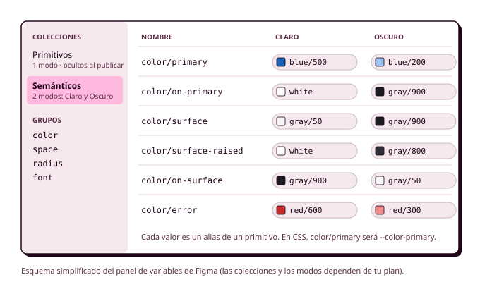

# Órbita 2 — Ayuda: variables en Figma

!!! note "Material de apoyo"
    Esta ayuda acompaña al paso 7 de la hoja de ruta y del proyecto. Síguela con Figma abierto y tu archivo del proyecto delante.

## Variables en Figma: modo claro y oscuro

Hasta ahora has tomado decisiones: una paleta con sus escalas, unos tokens semánticos con su contraste comprobado, una escala tipográfica, una escala de espaciado, una retícula, unos radios y unas sombras. Seguramente las tienes en tablas, en notas o en un tablero de FigJam. En este apartado vas a convertirlas en **variables de Figma**, que es la forma en que Figma guarda los tokens, y vas a construir con ellas los dos modos de tu aplicación. Es la parte más técnica de la órbita, así que tómatela con calma la primera vez: cuando entiendas cómo se organizan las variables, el resto del trabajo será bastante mecánico (RA1-e).

Recuerda que, para crear el modo oscuro, necesitas el plan de Educación de Figma, porque los modos de las variables no están disponibles en el plan gratuito. Si todavía no lo has solicitado, hazlo antes de empezar este apartado.

Antes de empezar, este vídeo te enseña cómo se crean y se aplican las variables en Figma. Velo con Figma abierto y prueba cada paso en tu archivo.

  <iframe src="https://www.youtube-nocookie.com/embed/fn4rP20U2UM" title="Variables en Figma" style="position:absolute; top:0; left:0; width:100%; height:100%; border:0;" allow="accelerometer; clipboard-write; encrypted-media; gyroscope; picture-in-picture" allowfullscreen loading="lazy"></iframe>

<small>**Fuente:** vídeo publicado en YouTube ([ver en YouTube](https://www.youtube.com/watch?v=fn4rP20U2UM), por si no se carga aquí). Se incluye con fines exclusivamente educativos; todos los derechos pertenecen a su autor.</small>

### Qué es una variable en Figma

Una **variable** de Figma es un valor con nombre que puedes aplicar a las propiedades de cualquier elemento: el color de un relleno, el tamaño de un texto, el relleno de un Auto layout o el radio de una esquina. Cuando cambias el valor de la variable, cambian todos los elementos que la usan, igual que ocurre con una variable en programación. Figma tiene cuatro tipos de variables:

- **Color**, para los rellenos, los bordes y los colores de texto.
- **Número**, para los tamaños, los espaciados, los radios, las alturas de línea y los pesos de la letra.
- **Cadena de texto**, para valores como el nombre de una familia tipográfica.
- **Booleana** (verdadero o falso), que sirve para mostrar u ocultar elementos y que en esta órbita no vas a necesitar.

Las variables se crean desde el panel derecho de Figma, en la opción de **variables locales** que aparece cuando no tienes nada seleccionado.

### Cómo se organizan: colecciones, grupos y modos

Las variables se guardan en **colecciones**, que son conjuntos de variables relacionadas. Dentro de cada colección, puedes ordenarlas en **grupos** escribiendo una barra en el nombre: si llamas a una variable `color/primary`, Figma la mete en el grupo `color`. Esa barra es la que, en la Órbita 3, se convertirá en un guion en el nombre de la propiedad personalizada de CSS (`--color-primary`).

Cada colección puede tener uno o varios **modos**, que son versiones alternativas de los mismos valores. Una colección con los modos "Claro" y "Oscuro" tiene, para cada variable, un valor en cada modo, y al aplicar un modo u otro a una pantalla cambian todos los valores a la vez. Así es como se construye el modo oscuro sin duplicar ni un solo componente.

Con los dos niveles de tokens del apartado 1, la organización que vas a usar es esta:

| Colección | Modos | Qué contiene |
|---|---|---|
| **Primitivos** | Uno solo | Las escalas de color (`blue/50` a `blue/900`, `gray/...`, `red/...`), la escala de espaciado (`space/1` a `space/16`), los radios (`radius/sm`...) y los tamaños, alturas de línea, pesos y familias de la tipografía |
| **Semánticos** | Claro y Oscuro | Los tokens de color que se aplican en las pantallas (`color/primary`, `color/on-primary`, `color/surface`...), cuyos valores son alias de los primitivos |

Para crear un **alias**, en lugar de escribir un valor en la celda de una variable semántica, haz clic sobre ella y elige la variable primitiva a la que tiene que apuntar. Si todas tus variables semánticas son alias, cualquier cambio en una escala de primitivos se propagará automáticamente a los modos claro y oscuro.

### Tres ajustes que ahorran errores

Figma tiene tres opciones en cada variable que te ayudarán a mantener el sistema ordenado.

La primera es el **ámbito** (*scoping*), que limita en qué propiedades aparece una variable. Si a tus variables de espaciado les indicas que solo se usan en el espacio entre elementos y en el relleno, no te aparecerán cuando elijas el tamaño de un texto, y no podrás aplicarlas donde no corresponde. A los colores de texto (`on-surface`, `on-primary`...) puedes limitarlos al color de texto y de los iconos, y a los de fondo (`surface`, `primary`...), a los rellenos.

La segunda es **ocultar las variables al publicar**. Las variables primitivas solo existen para que las usen las semánticas, así que conviene ocultarlas en la biblioteca para que nadie (ni tú dentro de dos semanas) aplique `blue/500` directamente a un botón.

La tercera es la **sintaxis de código**, un campo en el que puedes escribir cómo se llama esa variable en el código (por ejemplo, `var(--color-primary)`). Figma la muestra en el modo de desarrollo cuando alguien inspecciona un elemento, y así, en la Órbita 3, sabrás exactamente qué propiedad de CSS tienes que escribir en cada sitio.

Rellena también la **descripción** de las variables semánticas con una frase que explique para qué sirven ("Fondo de las acciones principales; una sola por pantalla"). Esas descripciones son las que después pasarán a tu guía de estilo y a tu `DESIGN.md`.

### Aplicar las variables

Con las variables creadas, ya puedes aplicarlas. En cualquier propiedad que admita una variable verás un pequeño icono junto al valor, y al pulsarlo podrás **elegir la variable en lugar de escribir el número o el color**. Haz lo siguiente con tus componentes:

1. Aplica los colores semánticos a los rellenos, los bordes y los textos de tus botones, campos, tarjetas y navegación.
2. Aplica las variables de espaciado al espacio entre elementos y al relleno de los Auto layout.
3. Aplica las variables de radio a las esquinas.
4. Crea un **estilo de texto** para cada nivel de tu escala tipográfica (`display`, `heading-1`...), y dentro de cada estilo vincula la familia, el tamaño, el peso y la altura de línea a tus variables tipográficas. Así el estilo agrupa los valores y la variable guarda cada valor por separado.
5. Guarda tus sombras como **estilos de efecto** (`elevation-1`, `elevation-2`...) y tus retículas como **estilos de retícula**.

Una forma rápida de saber si lo has hecho bien es seleccionar un componente y comprobar que, en el panel derecho, no queda ningún valor escrito a mano (Figma los muestra sin el icono de variable).

### Construir el modo oscuro

Para ver una pantalla en modo oscuro, selecciona el frame y, en la sección de apariencia del panel derecho, cambia el modo de la colección "Semánticos" de "Claro" a "Oscuro". Todos los elementos de dentro del frame que usen variables semánticas cambiarán a la vez. **Si algo no cambia, es que tiene un valor escrito a mano o un primitivo aplicado directamente**, y tendrás que corregirlo.

Ahora bien, que el cambio funcione no significa que el modo oscuro esté bien diseñado. Un buen modo oscuro sigue unas reglas propias:

**No se invierten los colores.** Si te limitas a intercambiar el blanco por el negro, el color principal se verá apagado y los colores de estado vibrarán sobre el fondo oscuro. Como viste en el apartado 3, en el modo oscuro el principal y los de estado usan tonos más claros y menos saturados de su escala, y llevan texto oscuro encima.

**El fondo no es negro puro.** Un fondo completamente negro con texto blanco crea un contraste tan fuerte que cansa la vista, y en algunas pantallas produce un efecto de arrastre al desplazarse. Lo habitual es usar un gris muy oscuro, como el `gray-900` del polideportivo.

**La elevación se indica con superficies más claras.** Las sombras apenas se ven sobre un fondo oscuro, así que en el modo oscuro un elemento que está por encima de otro se distingue porque su superficie es un poco más clara. Para eso, el polideportivo añade el token `color/surface-raised`, que en el modo claro es blanco (y se combina con la sombra) y en el modo oscuro es `gray-800`. Las tarjetas, los menús y los diálogos usan ese token como fondo.

**El contraste se vuelve a comprobar.** Que una pareja de tokens tenga buen contraste en el modo claro no garantiza nada en el oscuro. Revisa todas tus parejas con Stark en los dos modos, como hiciste en la tabla del apartado 3.

**Las imágenes y los iconos se revisan.** Un logotipo oscuro desaparece sobre un fondo oscuro, y una foto muy luminosa puede deslumbrar. Si tu logotipo no funciona en los dos fondos, necesitarás una versión para cada modo.

### Por qué un modo oscuro, y para quién

Muchas personas prefieren el modo oscuro, por comodidad o porque les molesta la luz intensa, y **algunas personas con baja visión o con sensibilidad a la luz lo necesitan para poder usar la pantalla**. Los sistemas operativos permiten elegirlo, y en la Órbita 3 harás que tu web respete esa preferencia con la consulta de medios `prefers-color-scheme` y que, además, ofrezca un interruptor para cambiarlo.

También se suele decir que el modo oscuro ahorra energía, y es cierto en parte. En las pantallas **OLED**, que tienen la mayoría de los móviles actuales, cada píxel produce su propia luz, así que un píxel oscuro consume menos que uno claro. Un estudio de la Universidad de Purdue de 2021 midió el efecto en varios móviles y encontró que, con el brillo al máximo, pasar al modo oscuro ahorraba entre un 39 % y un 47 % de la energía de la pantalla, pero que con el brillo entre el 30 % y el 50 %, que es como usa el móvil mucha gente, el ahorro bajaba a entre un 3 % y un 9 %. En las pantallas LCD, como las de muchos portátiles, no hay ahorro, porque la luz de fondo está siempre encendida. Lucía, que lleva el brillo al mínimo, apenas ahorrará batería con el modo oscuro, pero lo agradecerá cuando use la aplicación de noche. Es un buen ejemplo de que una decisión de diseño sostenible tiene que apoyarse en datos y no en lo que se repite, y de que el modo oscuro se justifica sobre todo por las personas que lo prefieren o lo necesitan.

### Otros modos que te pueden servir

Los modos no sirven solo para el claro y el oscuro. Si en el apartado 4 viste que necesitabas tamaños de letra distintos en el móvil y en el escritorio, puedes crear una colección "Tipografía" con dos modos, "Móvil" y "Escritorio", en la que `font/size/display` valga 40 en uno y 56 en el otro. **Es optativo**, y solo tiene sentido si tu proyecto se va a usar de verdad en los dos tipos de pantalla.

### Antes de seguir

Antes de pasar a los mockups, abre el panel de variables y comprueba que tienes una colección de primitivos con un solo modo y las variables ocultas al publicar, y una colección de semánticos con los modos claro y oscuro en la que todos los valores son alias. Comprueba que tus variables de espaciado, radio y color tienen el ámbito limitado y que las semánticas tienen descripción y sintaxis de código. Después coge tu botón principal y una tarjeta, colócalos en un frame, **cambia el modo de claro a oscuro y fíjate en si cambia todo lo que tiene que cambiar**. Si algún elemento se queda igual, busca el valor que se ha escrito a mano y sustitúyelo por una variable.
