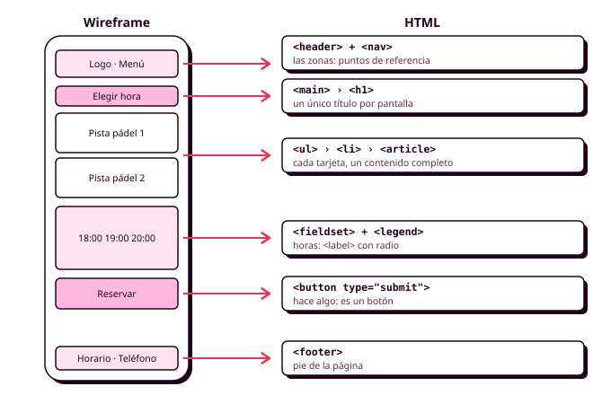

# Órbita 3 — Dar forma al sistema

## 1. Repaso de HTML5

En esta órbita vas a convertir tus mockups de Figma en una aplicación que funciona en el navegador, y lo primero que hay que escribir es el HTML. Puede parecer el paso fácil, porque el HTML lo conoces desde el curso pasado y el trabajo vistoso llega después con CSS, pero en la práctica es el que más condiciona todo lo demás. **Un buen CSS solo puede construirse sobre un buen HTML**: si una lista de pistas está hecha con `<div>` sueltos, no podrás alinearla bien con Grid; si la hora de la reserva es un `<div>` con un evento de clic en lugar de un botón, no se podrá elegir con el teclado; y si la pantalla no tiene encabezados, Manuel no podrá recorrerla con el lector de pantalla del móvil, por muy bonita que la dejes.

Este apartado es un repaso de lo que necesitas de HTML5 para maquetar tu sistema, con el foco puesto en elegir el elemento correcto para cada parte de tus wireframes. Lo que ya viste en Lenguajes de Marcas sigue valiendo, y para cualquier etiqueta concreta tienes la referencia completa en [lenguajehtml.com](https://lenguajehtml.com/), de Manz, el mismo autor de la web de CSS que usaremos en los apartados siguientes. En la Órbita 4 volveremos sobre el HTML desde el punto de vista de la accesibilidad, con ARIA y la navegación por teclado, así que aquí nos quedamos en lo que hace falta para que tu estructura sea correcta desde el principio (RA2-a, RA6-b).



### La estructura de un documento

Todas las pantallas de tu aplicación empiezan igual, y conviene que tengas una plantilla correcta desde el primer día, porque cada error que haya en ella se repetirá en todas las páginas.

```html
<!DOCTYPE html>
<html lang="es">
<head>
  <meta charset="UTF-8">
  <meta name="viewport" content="width=device-width, initial-scale=1.0">
  <meta name="color-scheme" content="light dark">
  <title>Elegir hora · Pádel · Polideportivo municipal</title>
  <meta name="description" content="Reserva una pista del polideportivo municipal en menos de un minuto.">
  <link rel="icon" href="img/favicon.svg" type="image/svg+xml">
  <link rel="stylesheet" href="css/main.css">
</head>
<body>
  <!-- contenido de la pantalla -->
</body>
</html>
```

Cada línea tiene su razón de ser:

- **`<!DOCTYPE html>`** le dice al navegador que use el modo estándar. Sin él, el navegador entra en el llamado "modo de compatibilidad" (*quirks mode*), que imita errores de navegadores antiguos, y el modelo de cajas deja de comportarse como esperas.
- **`lang="es"`** indica el idioma del contenido. Los lectores de pantalla lo usan para elegir la pronunciación, y el navegador para separar las palabras con guiones o traducir la página. Si una parte del contenido está en otro idioma, ese elemento lleva su propio `lang`.
- **`charset="UTF-8"`** asegura que las tildes y la eñe se ven bien. Tiene que ser lo primero del `<head>`.
- **`viewport`** es imprescindible para el diseño adaptable. Sin esta línea, el móvil finge ser una pantalla de escritorio de unos 980 píxeles y lo encoge todo, y ninguna de tus media queries funcionará.
- **`color-scheme`** avisa al navegador, antes incluso de descargar el CSS, de que tu aplicación tiene modo oscuro, y evita el fogonazo blanco que verían Lucía y cualquiera que tenga el modo oscuro activado mientras se carga la página.
- **`<title>`** es lo primero que anuncia un lector de pantalla al abrir la página, lo que aparece en la pestaña y en los resultados de los buscadores. Cada pantalla tiene el suyo, de lo más concreto a lo más general, como en el ejemplo.
- **`description`** es el texto que muestran los buscadores debajo del título (RA5-h).

El `<link>` al CSS va siempre en el `<head>`, para que el navegador tenga los estilos antes de pintar nada. Los `<script>`, cuando los añadas en DWEC, irán también en el `<head>` con el atributo `defer`, que hace que se descarguen sin detener la lectura del HTML.

### Elementos, etiquetas y atributos

Un **elemento** de HTML se escribe con una **etiqueta de apertura** y una de **cierre** (`<p>` y `</p>`), y entre las dos va su contenido, que puede ser texto u otros elementos. Algunos elementos no tienen contenido y por eso no se cierran, como ``, `<input>`, `<meta>` o `<br>`, y se les llama **elementos vacíos**. Los **atributos** van dentro de la etiqueta de apertura y añaden información o cambian el comportamiento del elemento: `<a href="/reservas">`, ``.

Hay unos cuantos **atributos globales** que funcionan en cualquier elemento y que vas a usar constantemente:

| Atributo | Para qué sirve |
|---|---|
| `class` | Nombres de clase para el CSS. Un elemento puede tener varios, separados por espacios |
| `id` | Identificador único en la página, para enlaces internos, para asociar una etiqueta a su campo y para JavaScript |
| `lang` | Idioma del contenido de ese elemento |
| `hidden` | Oculta el elemento a todo el mundo, igual que `display: none` |
| `data-*` | Datos propios para JavaScript (`data-court-id="7"`) |
| `aria-*` | Información adicional para las tecnologías de apoyo, que verás en la Órbita 4 |

Recuerda la regla de los apuntes de CSS3: **el `id` no se usa para dar estilo**. Pon a cada elemento la clase que necesites, y reserva el `id` para lo que no puede hacerse de otra forma.

### Por qué importa la semántica

HTML tiene más de cien elementos, y casi todos sirven para decir **qué es** cada cosa, mientras que su aspecto lo decide el CSS. Un `<h2>` es el título de una sección, aunque en tu diseño se vea pequeño; un `<button>` es un control que hace algo cuando se pulsa, tenga la forma que tenga; y un `<nav>` es el bloque de navegación, esté arriba, abajo o escondido en un menú. Cuando eliges el elemento por su significado, ganas varias cosas a la vez:

- **Accesibilidad.** Los lectores de pantalla anuncian cada elemento por su función ("botón", "encabezado de nivel 2", "navegación") y permiten saltar de uno a otro. Manuel puede pedirle al lector del móvil que le lea solo los encabezados de una pantalla para saber qué hay en ella (RA5-a).
- **Comportamiento gratis.** Un `<button>` se puede enfocar con el tabulador, se activa con Intro y con Espacio y se puede desactivar con un atributo. Si lo construyes con un `<div>`, tendrás que programar todo eso a mano con JavaScript, y lo más probable es que se te olvide algo.
- **Buscadores.** Los buscadores entienden mejor una página con una estructura clara de encabezados y regiones (RA5-h).
- **Menos código.** Los elementos nativos ya traen su comportamiento, así que no hace falta añadir clases, scripts ni librerías para conseguirlo. Las **WSG** recomiendan precisamente usar HTML semántico y elementos nativos antes que soluciones hechas con JavaScript, porque el resultado pesa menos y funciona aunque el script no llegue a cargar.
- **Un CSS más limpio.** Cuando cada parte de la pantalla tiene un elemento con sentido, el CSS se escribe sobre una estructura que entiendes.

La forma de saber si estás usando bien la semántica es preguntarte, ante cada elemento, **qué es esto para quien no lo ve**. Si la respuesta es "un título", es un encabezado. Si es "algo que se pulsa para hacer algo", es un botón. Y si es "nada, solo una caja para colocar cosas", entonces sí, es un `<div>`.

### La estructura de una pantalla

HTML5 tiene un grupo de elementos que describen las grandes zonas de una pantalla, y los lectores de pantalla los usan como **puntos de referencia** (*landmarks*) para saltar directamente de una zona a otra.

| Elemento | Qué es | En el polideportivo |
|---|---|---|
| `<header>` | La cabecera de la página o de una sección | El logo y el menú principal |
| `<nav>` | Un bloque de enlaces de navegación importante | El menú principal y la barra inferior del móvil |
| `<main>` | El contenido principal. **Solo puede haber uno visible por página** | El selector de pista y hora |
| `<aside>` | Contenido relacionado, pero que se puede quitar sin que se pierda lo principal | El resumen de la reserva en escritorio |
| `<footer>` | El pie de la página o de una sección | El horario del polideportivo y el teléfono |
| `<section>` | Una parte temática del contenido, siempre con su encabezado | "Pistas disponibles", "Horas libres" |
| `<article>` | Un contenido completo que tendría sentido por sí solo | Cada tarjeta de pista, cada reserva de la lista |

Dos dudas aparecen siempre. La primera es la diferencia entre `<section>` y `<article>`. Un `<article>` es algo que podrías sacar de la página y seguiría entendiéndose (una reserva, una noticia del polideportivo, una tarjeta de pista con su nombre, su precio y su botón), mientras que una `<section>` es una parte de algo más grande que solo tiene sentido dentro de su página. La segunda es cuándo usar un `<div>`. La respuesta es que **un `<div>` es correcto cuando lo único que necesitas es un contenedor para el CSS**, como el envoltorio de una cuadrícula o la fila con el título y el precio de una tarjeta. Lo que hay que evitar es usar un `<div>` para algo que ya tiene un elemento propio.

Si en una pantalla hay dos `<nav>` (el menú principal arriba y la barra de pestañas abajo en el móvil), ponle a cada uno un nombre con `aria-label`, para que el lector de pantalla pueda distinguirlos: `<nav aria-label="Principal">` y `<nav aria-label="Secciones">`.

### Encabezados: el índice de la pantalla

Los encabezados, de `<h1>` a `<h6>`, forman el **índice** de cada pantalla, y son la forma principal en la que una persona que usa un lector de pantalla se hace una idea de lo que hay. Por eso tienen unas reglas que hay que respetar:

- **Un único `<h1>` por pantalla**, con el título de esa pantalla ("Elegir hora", "Mis reservas").
- **Sin saltos de nivel.** Después de un `<h2>` puede venir otro `<h2>` o un `<h3>`, pero no un `<h4>`.
- **El nivel lo decide la estructura.** Si el título de una tarjeta tiene que verse pequeño, sigue siendo un `<h3>` si es lo que le corresponde, y su tamaño lo decides en CSS con el token de tu escala que quieras.

Esta última regla conecta con tu escala tipográfica de la Órbita 2. Allí viste que `heading-1` se corresponde normalmente con el `<h1>`, `heading-2` con el `<h2>`, y así sucesivamente, pero que esa correspondencia no tiene por qué ser exacta. En el HTML eliges el nivel por la estructura, y en el CSS eliges el estilo por el aspecto que dibujaste.

Una forma rápida de comprobar tus encabezados es leer solo ellos, en orden, como si fueran el índice de un libro. Si con ese índice se entiende qué hay en la pantalla, están bien.

### Texto

Para el texto de tus pantallas te van a bastar unos pocos elementos, pero conviene que uses el adecuado en cada caso:

- **`<p>`** para los párrafos. Un texto suelto dentro de un `<div>` funciona, pero no le dice a nadie qué es.
- **`<strong>`** para lo que tiene importancia ("**La reserva no se puede cancelar** con menos de dos horas de antelación") y **`<em>`** para el énfasis, el que harías con la voz al leerlo. `<b>` e `<i>` también existen, pero solo cambian el aspecto, así que si lo único que quieres es una palabra en negrita por estética, hazlo en CSS.
- **`<time>`** para las fechas y las horas, con el atributo `datetime` en formato estándar: `<time datetime="2026-11-12T19:00">jueves 12 a las 19:00</time>`. La persona lee la fecha escrita como le resulta natural, y el navegador, el buscador o tu JavaScript tienen la versión que pueden procesar. En una aplicación de reservas lo vas a usar en todas partes.
- **`<small>`** para la letra pequeña, como los avisos legales o las condiciones, y **`<abbr>`** para las abreviaturas, con su forma completa en `title`.

#### Listas

Las listas son mucho más frecuentes de lo que parece en una interfaz, y casi cualquier grupo de elementos del mismo tipo es una lista: los enlaces de un menú, las pistas disponibles, las horas libres, las reservas de una persona. Marcarlas como lista permite que el lector de pantalla anuncie "lista, 6 elementos" antes de empezar, y Manuel sabe así cuántas pistas tiene por delante.

- **`<ul>`** para las listas sin orden (el menú, las pistas).
- **`<ol>`** para las que tienen un orden que importa (los pasos de la reserva).
- **`<dl>`**, con `<dt>` y `<dd>`, para las parejas de término y descripción, como el resumen de una reserva ("Pista: Pádel 2", "Hora: 19:00", "Precio: 8 €").

```html
<dl class="booking-summary">
  <dt>Pista</dt>   <dd>Pádel 2</dd>
  <dt>Día</dt>     <dd><time datetime="2026-11-12">Jueves 12 de noviembre</time></dd>
  <dt>Hora</dt>    <dd><time datetime="19:00">19:00</time></dd>
  <dt>Precio</dt>  <dd>8 €</dd>
</dl>
```

### Enlaces y botones

Esta es probablemente la distinción más importante de todo el apartado, y la que más se confunde cuando se maqueta a partir de un diseño, porque en Figma un enlace y un botón pueden tener exactamente el mismo aspecto. La regla es sencilla: **un enlace lleva a otro sitio y un botón hace algo**.

- **`<a href="...">`** es un enlace, y se usa cuando al pulsarlo cambias de pantalla o vas a otra parte de la misma página. "Ver mis reservas" es un enlace, aunque lo hayas dibujado como un botón.
- **`<button>`** es un botón, y se usa cuando al pulsarlo pasa algo en la pantalla en la que estás: se envía un formulario, se abre un diálogo, se marca un favorito. "Reservar", "Cancelar reserva" o "Mostrar más horas" son botones.

La diferencia también se nota en el comportamiento. Un enlace se activa con Intro y se puede abrir en otra pestaña, y un botón se activa con Intro y con Espacio. El lector de pantalla los anuncia de forma distinta, y la persona espera cosas distintas de cada uno. El aspecto lo decides después en CSS, y tu componente `.button` de la Órbita 2 se puede aplicar tanto a un `<button>` como a un `<a>`.

Dentro de un formulario, un `<button>` envía el formulario por defecto. Si un botón está dentro de un formulario pero no tiene que enviarlo (por ejemplo, el de "Mostrar más horas"), ponle `type="button"`, y al de envío ponle `type="submit"` para que se vea claro cuál es cuál.

Y una última regla: el texto de un enlace o de un botón tiene que entenderse **fuera de contexto**. Un lector de pantalla puede mostrar la lista de todos los enlaces de la página, y una lista con cinco "Ver más" no sirve de nada. "Ver horarios de la pista de pádel 2" sí. Si el diseño solo deja sitio para un icono, el texto va igualmente en el HTML, oculto visualmente o en un `aria-label`.

### Imágenes y gráficos

Una imagen se inserta con ``, y tiene cuatro atributos que no deberían faltar nunca:

```html

```

- **`alt`** es el texto alternativo, lo que lee un lector de pantalla y lo que aparece si la imagen no carga. Describe lo que la imagen aporta en ese contexto, que es lo que la persona necesita saber. Si la imagen es decorativa y no aporta nada, el atributo va igualmente, pero vacío (`alt=""`), para que el lector de pantalla la ignore.
- **`width`** y **`height`** indican el tamaño original de la imagen. No fijan el tamaño con el que se ve (eso lo decide el CSS), pero le dicen al navegador la proporción, para que reserve el hueco antes de descargarla y la página no salte mientras se carga.
- **`loading="lazy"`** hace que la imagen solo se descargue cuando está a punto de aparecer en pantalla. Las imágenes que no se ven al abrir la página no se descargan si la persona no llega a ellas, y eso ahorra datos a Lucía y energía a todos, como piden las **WSG**. La imagen principal, la que se ve nada más abrir la pantalla, no lleva `lazy`.

Cuando una imagen tiene un pie de foto, se agrupan los dos con **`<figure>`** y **`<figcaption>`**. Cómo servir una imagen distinta a cada tamaño de pantalla con `<picture>` y `srcset`, cómo elegir el formato y cuánto debe pesar cada imagen lo verás en el apartado de multimedia, porque es donde más peso se gana o se pierde en una aplicación.

Los **iconos** de tu librería se insertan normalmente como SVG, dentro del HTML o con un ``. Si el icono va acompañado de un texto que ya dice lo mismo (una lupa junto a la palabra "Buscar"), es decorativo y lleva `aria-hidden="true"` para que el lector de pantalla no lo anuncie dos veces. Si el icono va solo, el botón que lo contiene necesita un nombre accesible.

### Tablas

Las tablas sirven para **datos con filas y columnas**, como el cuadrante de ocupación de las pistas o el historial de reservas, y nunca para colocar elementos en la pantalla (para eso está Grid). Una tabla bien hecha tiene un título y sus celdas de encabezado marcadas, para que el lector de pantalla pueda decir, al llegar a una celda, a qué fila y a qué columna pertenece.

```html
<table>
  <caption>Tus reservas de noviembre</caption>
  <thead>
    <tr>
      <th scope="col">Día</th>
      <th scope="col">Pista</th>
      <th scope="col">Hora</th>
    </tr>
  </thead>
  <tbody>
    <tr>
      <th scope="row"><time datetime="2026-11-12">Jueves 12</time></th>
      <td>Pádel 2</td>
      <td><time datetime="19:00">19:00</time></td>
    </tr>
  </tbody>
</table>
```

`<caption>` es el título de la tabla, `<thead>` y `<tbody>` separan la cabecera de los datos y `scope` indica si cada `<th>` es el encabezado de una columna (`col`) o de una fila (`row`). En el móvil, una tabla ancha se envuelve en un contenedor con desplazamiento horizontal, como viste en los apuntes de CSS3.

### Formularios

La aplicación del polideportivo es, en el fondo, un formulario: se elige una pista, un día y una hora y se envía. Los formularios son también la parte de una interfaz donde más fácil es equivocarse con el HTML, y donde más se nota.

```html
<form class="booking-form" action="/reservas" method="post">
  <div class="field">
    <label for="date">Día</label>
    <input type="date" id="date" name="date" required min="2026-11-02">
  </div>

  <fieldset class="slots">
    <legend>Hora</legend>
    <label class="slot"><input type="radio" name="time" value="18:00"> 18:00</label>
    <label class="slot"><input type="radio" name="time" value="19:00"> 19:00</label>
    <label class="slot"><input type="radio" name="time" value="20:00" disabled> 20:00</label>
  </fieldset>

  <div class="field">
    <label for="phone">Teléfono de contacto</label>
    <input type="tel" id="phone" name="phone" autocomplete="tel"
           aria-describedby="phone-hint">
    <p id="phone-hint" class="field__hint">Solo lo usaremos si hay que cancelar la pista.</p>
  </div>

  <button type="submit" class="button">Reservar</button>
</form>
```

En este ejemplo están casi todas las reglas que necesitas:

- **Cada campo tiene su `<label>`**, unido a él con `for` (que apunta al `id` del campo) o envolviéndolo. La etiqueta es lo que el lector de pantalla anuncia al llegar al campo y, además, al pulsarla se activa el campo, lo que agranda el objetivo táctil. **Un `placeholder` no sustituye a la etiqueta**, porque desaparece en cuanto se empieza a escribir.
- **Los grupos de opciones van en un `<fieldset>` con su `<legend>`.** Las horas son botones de opción (`type="radio"`) con el mismo `name`, porque solo se puede elegir una, y el `<legend>` dice a qué pregunta responden. Las píldoras de hora de tu sistema son, por tanto, etiquetas que contienen un botón de opción, y en los apuntes de CSS3 viste cómo darles estilo con `:has()`.
- **El tipo de campo correcto.** `type="date"`, `"time"`, `"email"`, `"tel"` o `"number"` hacen que el móvil muestre el teclado o el selector adecuado y que el navegador valide el formato sin que escribas JavaScript.
- **Los atributos de validación** (`required`, `min`, `max`, `pattern`, `minlength`) le dicen al navegador qué es un valor correcto, y las pseudoclases `:user-invalid` y `:valid` de CSS se apoyan en ellos.
- **`autocomplete`** permite que el navegador rellene los datos que ya conoce, como el nombre o el teléfono, y ahorra tiempo a todo el mundo.
- **Las ayudas y los mensajes de error se asocian al campo** con `aria-describedby`, para que el lector de pantalla los lea al llegar a él.
- **Pide solo los campos imprescindibles.** Cada campo de más es tiempo, errores y datos que se guardan. Las **WSG** lo incluyen entre sus criterios, y el diseño ético también: si el polideportivo no necesita la fecha de nacimiento de Lucía para reservar una pista, no se la pidas.

### Elementos interactivos nativos

HTML tiene algunos elementos que resuelven sin JavaScript patrones que antes necesitaban una librería, y que encajan con varios de los componentes de la Órbita 2:

- **`<details>` y `<summary>`** forman un bloque desplegable que se abre y se cierra al pulsar el resumen, y que funciona con el teclado y con el lector de pantalla. Sirve para las preguntas frecuentes o para las condiciones de la reserva.
- **`<dialog>`** es un cuadro de diálogo, como el de "¿Seguro que quieres cancelar la reserva?". Para abrirlo hace falta una línea de JavaScript, pero el navegador se encarga de mantener el foco dentro, de cerrarlo con Escape y de oscurecer el fondo.

Antes de construir un desplegable o un diálogo con `<div>` y JavaScript, comprueba si existe un elemento nativo que lo haga. Casi siempre será más accesible, más ligero y más fácil de mantener.

### Del wireframe al HTML

Con todo lo anterior ya puedes traducir tus pantallas. Te recomiendo hacerlo siempre en este orden, pantalla a pantalla y siguiendo tu user flow, y **escribir el HTML completo de una pantalla antes de escribir una sola línea de CSS**:

1. **Las zonas.** Abre el wireframe (el de la Órbita 1, que se ve más claro sin colores) y marca encima la cabecera, la navegación, el contenido principal, el contenido secundario y el pie.
2. **Los encabezados.** Escribe el `<h1>` y los encabezados de cada sección, y lee el índice que resulta.
3. **Los componentes.** Para cada componente de tu inventario de la Órbita 2, decide qué elemento es: la tarjeta de pista es un `<article>` dentro de un `<li>`, la píldora de hora es un `<label>` con un botón de opción, el botón "Reservar" es un `<button type="submit">`.
4. **El contenido real.** Escribe los textos de verdad, con su longitud real. Un nombre de pista de veinte caracteres pone a prueba tu diseño mucho más que "Lorem ipsum".
5. **Las clases.** Solo al final, añade las clases que vas a necesitar para el CSS.

Cuando termines, haz la **prueba sin estilos**: abre la pantalla sin CSS (o desactívalo desde el inspector) y léela de arriba abajo. Sin ningún estilo, el HTML debería parecer un documento bien ordenado, con su título, sus secciones, sus listas y sus formularios con etiquetas, en el mismo orden en que tiene que leerse. Si algo no se entiende así, tampoco lo entenderá un lector de pantalla, y ningún CSS lo va a arreglar.

### Validar el HTML

Igual que el CSS, el HTML no da errores: el navegador intenta corregir lo que encuentra mal escrito, y a veces lo corrige de una forma distinta a la que esperabas. El [validador del W3C](https://validator.w3.org/) comprueba cada pantalla y te dice la línea exacta de cada error, como una etiqueta sin cerrar, un `id` repetido o una imagen sin `alt`. Valida todas las pantallas de tu proyecto y guarda la evidencia en el repositorio, porque en este módulo el uso de estándares es un criterio que se evalúa (RA6-b).

Además del validador, el inspector del navegador tiene un panel de **accesibilidad** que te enseña cómo ve tu página un lector de pantalla: qué rol tiene cada elemento, qué nombre anuncia y cómo se organizan las regiones. Es una buena forma de comprobar, por ejemplo, que todos tus botones tienen un nombre que se entiende.

### Antes de seguir

Antes de pasar al CSS, comprueba en la pantalla principal de tu aplicación que puedes contestar que sí a estas preguntas:

1. ¿La plantilla tiene `lang="es"`, `viewport`, `color-scheme` y un `<title>` propio?
2. ¿Hay un único `<main>` y un único `<h1>`, y los encabezados no se saltan ningún nivel?
3. ¿Cada cosa que se pulsa es un `<a>` si lleva a otro sitio y un `<button>` si hace algo?
4. ¿Cada campo del formulario tiene su `<label>`, y cada grupo de opciones su `<fieldset>` y su `<legend>`?
5. ¿Todas las imágenes tienen `alt` (vacío si son decorativas), `width` y `height`?
6. ¿La pantalla se entiende y se lee en orden con el CSS desactivado?
7. ¿El validador del W3C no da ningún error?

Si en algún momento usas una IA para generar o revisar tu HTML, anótalo en el `CHANGELOG.md`. Ten en cuenta que las herramientas que convierten un diseño en código (incluido el modo Dev de Figma o Google Stitch) tienden a generar `<div>` para todo, botones sin nombre e imágenes sin `alt`, así que revisa su resultado con las preguntas anteriores antes de usarlo.

### Recursos

- [HTML en español, de Manz (lenguajehtml.com)](https://lenguajehtml.com/)
- [Referencia de elementos HTML (MDN Web Docs)](https://developer.mozilla.org/es/docs/Web/HTML/Element)
- [Aprende HTML (web.dev)](https://web.dev/learn/html?hl=es)
- [Validador del W3C](https://validator.w3.org/)
- [Web Sustainability Guidelines (W3C)](https://www.w3.org/TR/web-sustainability-guidelines/)
