# Órbita 3 — Dar forma al sistema

## 2. Apuntes de CSS3

Este apartado recoge todo el lenguaje CSS que vas a necesitar para maquetar tu aplicación. Aquí tienes la explicación de cada herramienta, desde la sintaxis de una regla hasta las animaciones, y en el [apartado 4](04_del_sistema_al_codigo.md) verás cómo se convierte con ellas cada pieza de tu sistema de Figma en CSS. Si cursaste Lenguajes de Marcas el año pasado, muchas cosas te sonarán, pero CSS ha cambiado bastante en los últimos años (la anidación, `:has()`, las capas, `light-dark()` o las container queries son muy recientes) y conviene que lo repases entero.

Los apuntes van de lo más básico a lo más avanzado: primero la sintaxis y cómo se conecta CSS con HTML, después cómo se seleccionan los elementos y cómo decide el navegador qué regla gana cuando dos se contradicen, luego los valores (unidades, colores y variables), el modelo de cajas y la tipografía, y por último la maquetación con Flexbox y Grid, el diseño adaptable, el modo oscuro y las animaciones. Los ejemplos salen de la aplicación de reservas del polideportivo, y los nombres de las variables son los mismos tokens que usaste en Figma durante la Órbita 2.



### Qué es CSS y por qué existe

CSS significa *Cascading Style Sheets*, hojas de estilo en cascada. Su idea central es la **separación entre contenido y presentación**: el HTML dice qué es cada cosa (un título, una navegación, un formulario de reserva) y el CSS dice cómo se ve. Esa separación tiene consecuencias muy prácticas. Puedes cambiar el aspecto de una aplicación entera tocando un único fichero, puedes ofrecer distintas presentaciones del mismo contenido (en el móvil, en un monitor, en modo oscuro o en papel) sin duplicar el HTML, y el HTML queda limpio, legible y accesible. En tu proyecto, además, el CSS es la segunda representación del sistema de diseño, la que tiene que coincidir siempre con Figma (RA1-d, RA2-a).

#### De CSS a CSS3 (y por qué no hay CSS4)

CSS1 se publicó en 1996 y CSS2 en 1998, y los dos eran especificaciones únicas, un documento enorme con todo el lenguaje dentro. A partir de ahí el W3C cambió de estrategia y, en lugar de sacar un CSS3 de una pieza, dividió el lenguaje en **módulos** independientes (selectores, colores, fondos y bordes, Flexbox, Grid, animaciones...), cada uno con su propio ritmo y su propio número de nivel. Por eso, cuando se habla de "CSS3", en realidad se habla de todo el CSS moderno, el que vino después de CSS2.1. Tampoco va a existir un CSS4 como tal, porque el lenguaje evoluciona módulo a módulo y cada año aparecen funcionalidades nuevas.

Esa evolución constante obliga a comprobar, antes de usar una funcionalidad reciente, si todos los navegadores la soportan. Para eso tienes [Baseline](https://web.dev/baseline), que marca como "ampliamente disponible" lo que funciona en todos los navegadores principales, y [caniuse.com](https://caniuse.com/). Todo lo que aparece en estos apuntes está disponible en los navegadores actuales.

### Anatomía de una regla CSS

En CSS todo gira en torno a la **regla**:

```css
h1 {
  color: var(--color-on-surface);
  font-size: 2rem;
}
```

- **Selector**: `h1`. Indica a qué elementos del documento se aplica la regla.
- **Bloque de declaraciones**: todo lo que va entre llaves `{ }`.
- **Declaración**: `font-size: 2rem;`, un par formado por una propiedad y un valor, terminado en punto y coma.
- **Propiedad**: `font-size`, la característica que quieres cambiar.
- **Valor**: `2rem`, cómo quieres que quede.

El punto y coma de la última declaración es técnicamente opcional, pero ponlo siempre, porque el día que añadas otra declaración debajo y te olvides de él, la regla dejará de funcionar sin ningún aviso. Y esa es la primera característica de CSS que tienes que asumir: **el navegador no da errores**. Si escribes una propiedad mal (`colr: red;`) o un valor que no existe, sencillamente ignora esa declaración y sigue con la siguiente, así que la página se ve "casi bien" y no sabes por qué. Por eso el inspector del navegador y el validador son imprescindibles.

Los **comentarios** se escriben entre `/*` y `*/`, pueden ocupar varias líneas y sirven para documentar la hoja de estilos o desactivar temporalmente un bloque. En CSS no existe el comentario de una línea con `//` (que sí existe en Sass, como verás en el apartado siguiente), y si lo escribes rompe la regla que viene detrás.

```css
/* =============================
   Componente: tarjeta de pista
   ============================= */
.card {
  background-color: var(--color-surface-raised);
  /* box-shadow: var(--elevation-2);  desactivado mientras pruebo */
}
```

### Cómo conectar CSS con HTML

Hay tres formas de aplicar CSS a un documento, y solo una es la recomendada.

La **hoja de estilos externa** es un fichero `.css` aparte, enlazado desde el `<head>` con un `<link>`. Es la forma correcta en prácticamente todos los casos, porque el mismo fichero sirve para todas las pantallas de la aplicación, el navegador lo guarda en caché después de descargarlo la primera vez y el HTML no se mezcla con la presentación (RA2-c).

```html
<head>
  <meta charset="UTF-8">
  <meta name="viewport" content="width=device-width, initial-scale=1.0">
  <title>Reservar pista · Polideportivo municipal</title>
  <link rel="stylesheet" href="css/main.css">
</head>
```

La **hoja de estilos interna** es un bloque `<style>` dentro del `<head>`. Afecta solo a ese documento, así que tiene sentido para una prueba rápida, pero no en un proyecto con varias pantallas.

Los **estilos en línea** se escriben en el atributo `style` de una etiqueta concreta: `<p style="color: red;">` (RA2-b). Mezclan contenido y presentación, no se pueden reutilizar y, como verás en el apartado de especificidad, ganan a casi cualquier regla de tu hoja de estilos. En este módulo no se usan, salvo cuando los genere JavaScript.

!!! example "Ejemplo: estructura de carpetas del proyecto"

    La hoja de estilos vive en su propia carpeta, y la ruta del `href` se calcula desde la ubicación del HTML que la enlaza.

    ```text
    polideportivo/
    ├── index.html          → <link rel="stylesheet" href="css/main.css">
    ├── reservas/
    │   └── confirmar.html  → <link rel="stylesheet" href="../css/main.css">
    ├── css/
    │   └── main.css
    └── img/
        └── pista-padel.webp
    ```

    Dentro del CSS, en cambio, las rutas se calculan **desde el fichero CSS**. Para usar `img/pista-padel.webp` como fondo desde `css/main.css`, la ruta es `url("../img/pista-padel.webp")`.

Existe también la regla `@import url("otro.css");`, que carga una hoja de estilos desde dentro de otra. Funciona, pero obliga al navegador a descargar los ficheros uno detrás de otro en lugar de en paralelo. En tu proyecto no la vas a necesitar, porque Sass juntará todos tus ficheros en un único `main.css` antes de que llegue al navegador.

### El inspector: tu herramienta principal

Abre cualquier página, haz clic derecho sobre un elemento y elige **Inspeccionar** (o pulsa `F12`). En el panel de **Elementos** ves el árbol DOM, y al seleccionar un nodo, el panel de **Estilos** te muestra todas las reglas CSS que le afectan, de la más prioritaria a la menos. Las declaraciones tachadas son las que han perdido frente a otra regla, y las que tienen un icono de aviso tienen un error y el navegador las está ignorando. La pestaña **Calculado** (*Computed*) muestra el valor final de cada propiedad y un diagrama del modelo de cajas del elemento.

Desde ahí puedes editar valores en directo, activar y desactivar declaraciones con su casilla, forzar estados como `:hover` o `:focus` y, en el panel **Renderizado** (*Rendering*), emular el modo oscuro, la reducción de movimiento o el medio de impresión. Nada de eso se guarda en tu fichero, pero es la forma más rápida de probar cambios y de entender por qué algo no se ve como esperabas. Cuando una regla "no funciona", la respuesta casi siempre está en el panel de Estilos.

### Selectores: decir a qué elementos afecta una regla

El selector es la mitad de cada regla, y elegirlo bien es la mitad del trabajo con CSS. Un selector busca nodos dentro del árbol DOM, exactamente la misma idea que usarás en DWEC con `document.querySelector()`, que recibe como parámetro, precisamente, un selector CSS.

#### Selectores básicos

| Selector | Ejemplo | Selecciona |
|---|---|---|
| De etiqueta | `p` | Todos los `<p>` del documento |
| De clase | `.card` | Todos los elementos con `class="card"` |
| De id | `#reserva` | El elemento con `id="reserva"` |
| Universal | `*` | Todos los elementos |

El selector de clase es el que más vas a usar con diferencia, y en este módulo es la forma de dar estilo a los componentes (RA2-g). Un elemento puede tener varias clases separadas por espacios (`class="button button--danger"`), y la misma clase puede repetirse en tantos elementos como quieras. El selector de id apunta a un único elemento y, como verás al hablar de especificidad, tiene tanta fuerza que conviene reservarlo para JavaScript y para los enlaces internos.

Los selectores se pueden **combinar sin espacio** para exigir varias condiciones a la vez: `button.button` selecciona los `<button>` que además tienen la clase `button`, y `.slot.is-selected` los elementos que tienen las dos clases. Y se pueden **agrupar con comas** cuando varias reglas comparten las mismas declaraciones: `h1, h2, h3 { text-wrap: balance; }`.

#### Combinadores: seleccionar por la posición en el árbol

Los combinadores relacionan dos selectores según su posición en el árbol DOM.

- **Descendiente** (un espacio): `nav a` selecciona todos los `<a>` que estén dentro de un `<nav>`, a cualquier profundidad.
- **Hijo directo** (`>`): `ul > li` selecciona solo los `<li>` que son hijos directos de un `<ul>`, sin entrar en las listas anidadas.
- **Hermano adyacente** (`+`): `h2 + p` selecciona el `<p>` que va inmediatamente después de un `<h2>`, al mismo nivel.
- **Hermanos generales** (`~`): `h2 ~ p` selecciona todos los `<p>` que vienen después de un `<h2>` al mismo nivel.

!!! example "Ejemplo: combinadores sobre la ficha de una pista"

    ```html
    <article class="court">
      <h2>Pista de pádel 2</h2>
      <p>Cubierta, con iluminación incluida.</p>
      <p>Se reserva en tramos de una hora.</p>
      <ul>
        <li>Mañanas <ul><li>De 9:00 a 14:00</li></ul></li>
      </ul>
    </article>
    ```

    ```css
    .court p { max-width: 65ch; }               /* los dos párrafos */
    .court h2 + p { font-weight: 600; }         /* solo el primero */
    .court > ul > li { color: var(--color-primary); }  /* solo "Mañanas"... */
    ```

    ...aunque el `<li>` anidado también se verá del color principal. El selector no lo alcanza, pero `color` se **hereda** de su padre, como verás en el apartado de herencia.

#### Selectores de atributo

Puedes seleccionar elementos según sus atributos, algo muy útil con formularios, enlaces y atributos ARIA. `[required]` selecciona los elementos que tienen ese atributo, sea cual sea su valor, y `[type="email"]` exige un valor exacto. Hay variantes para coincidencias parciales: `^=` (empieza por), `$=` (termina en) y `*=` (contiene).

```css
input[type="date"] { font: var(--font-body); }
a[href$=".pdf"]::after { content: " (PDF)"; }        /* avisa de que el enlace es un PDF */
[aria-current="page"] { font-weight: 700; }          /* la pantalla en la que estás */
```

El último ejemplo es más importante de lo que parece. Si el menú marca la pantalla actual con `aria-current="page"` en el HTML, el CSS puede darle estilo a partir de ese mismo atributo, y la información sirve a la vez para la vista y para los lectores de pantalla.

#### Pseudoclases: seleccionar por estado o por posición

Una **pseudoclase** empieza por dos puntos (`:`) y selecciona elementos según algo que no está escrito en el HTML: su estado, su posición entre sus hermanos o el resultado de una condición. En tu sistema, las pseudoclases son la forma de dibujar en código las **variantes de estado** de tus componentes.

Las **pseudoclases de interacción** reaccionan a lo que hace la persona usuaria. `:hover` se activa al pasar el ratón por encima, `:active` mientras se está pulsando y `:focus` cuando el elemento tiene el foco. De esta familia, la más importante para la accesibilidad es **`:focus-visible`**, que se activa solo cuando el foco llega por teclado (o en los campos de texto, siempre). Es la forma correcta de dar estilo al foco sin que aparezca un recuadro cada vez que alguien pulsa un botón con el ratón.

```css
.button:hover { background-color: var(--color-primary-hover); }
.button:focus-visible {
  outline: 3px solid var(--color-primary);
  outline-offset: 2px;
}
```

Las **pseudoclases estructurales** seleccionan según la posición entre hermanos: `:first-child`, `:last-child`, `:only-child` y, sobre todo, `:nth-child()`, que acepta un número (`:nth-child(3)`), las palabras `odd` y `even` o una fórmula del tipo `an+b` (`:nth-child(3n)` selecciona el tercero, el sexto, el noveno...). Son las que usarás para colorear filas alternas en la tabla de reservas o quitar el separador del último elemento de un menú.

```css
tbody tr:nth-child(even) { background-color: var(--color-surface-raised); }
.menu li:last-child { border-inline-end: none; }
```

Las **pseudoclases de formulario** aprovechan la validación nativa de HTML: `:valid` e `:invalid` según si el valor cumple las restricciones del campo, `:required` y `:optional`, `:checked` para casillas y botones de opción marcados, `:disabled` y **`:user-invalid`**, que solo se activa después de que la persona haya interactuado con el campo, para no mostrar el formulario entero en rojo nada más abrirlo.

```css
input:user-invalid { border-color: var(--color-error); }
```

Por último, las **pseudoclases lógicas** reciben otros selectores como argumento. `:not()` excluye: `a:not(.button)` son los enlaces que no tienen aspecto de botón. `:is()` agrupa para no repetir: `:is(header, footer) a` equivale a `header a, footer a`. `:where()` hace lo mismo que `:is()` pero con especificidad cero (lo entenderás en el apartado de especificidad). Y **`:has()`**, una de las incorporaciones más potentes de los últimos años, selecciona un elemento según lo que contiene, de modo que `.card:has(img)` selecciona las tarjetas que tienen una imagen dentro. Durante años se le llamó "el selector padre", porque por primera vez CSS puede mirar hacia dentro de un elemento para decidir su estilo.

!!! example "Ejemplo: `:has()` en el formulario de reserva"

    ```css
    /* El bloque entero del campo se marca cuando el campo no es válido */
    .field:has(input:user-invalid) {
      border-inline-start: 4px solid var(--color-error);
    }

    /* La píldora de hora cambia cuando su botón de opción está marcado */
    .slot:has(input:checked) {
      background-color: var(--color-primary);
      color: var(--color-on-primary);
    }
    ```

#### Pseudoelementos: seleccionar partes de un elemento

Un **pseudoelemento** empieza por dos dobles puntos (`::`) y selecciona una parte de un elemento que no existe como nodo en el HTML. `::first-letter` y `::first-line` seleccionan la primera letra o la primera línea de un bloque de texto, `::placeholder` da estilo al texto de ejemplo de un campo, `::marker` a la viñeta o al número de un `<li>` y `::selection` al texto que la persona selecciona con el ratón.

Los más usados son **`::before`** y **`::after`**, que crean un hijo ficticio al principio o al final del contenido del elemento. Solo aparecen si tienen la propiedad `content`, aunque sea vacía (`content: ""`), y se usan para añadir decoración (comillas, iconos, líneas, flechas) sin ensuciar el HTML.

```css
.field--required label::after { content: " *"; color: var(--color-error); }
```

!!! warning "El contenido de `::before` y `::after` es decoración"

    El texto que generes con `content` no forma parte del HTML, no se puede seleccionar ni copiar de forma fiable y los lectores de pantalla no siempre lo anuncian. Úsalo para decorar y nunca para información que la persona necesite. Si el asterisco es la única pista de que un campo es obligatorio, ese campo tiene que llevar también el atributo `required` en el HTML.

### Anidación de CSS

Desde 2023, CSS permite **anidar** reglas dentro de otras de forma nativa, algo que antes solo era posible con preprocesadores como Sass. Una regla anidada se aplica a los descendientes del selector que la contiene, lo que evita repetir el mismo prefijo y agrupa visualmente todo lo que afecta a un mismo componente.

El carácter **`&`** representa el selector padre. Es obligatorio cuando quieres pegar algo al selector sin espacio, como una pseudoclase (`&:hover`) o una clase añadida (`&.is-selected`), y opcional en los demás casos.

!!! example "Ejemplo: el mismo componente, con y sin anidación"

    ```css
    /* Sin anidación */
    .card { border-radius: var(--radius-md); }
    .card h3 { font: var(--font-heading-3); }
    .card:hover { box-shadow: var(--elevation-2); }
    ```

    ```css
    /* Con anidación: mismo resultado */
    .card {
      border-radius: var(--radius-md);

      h3 { font: var(--font-heading-3); }
      &:hover { box-shadow: var(--elevation-2); }
    }
    ```

Cada nivel de anidación es un selector más largo y más específico, así que más de dos o tres niveles es una señal de que estás atando el estilo a la estructura exacta del HTML, y el día que esa estructura cambie, el CSS dejará de funcionar. Hay además una diferencia con la anidación de Sass que te afecta directamente: en CSS, `&` representa el selector completo y no se puede usar para formar nombres de clase nuevos (`&__title` no funciona), mientras que en Sass sí. Lo verás en el apartado siguiente, cuando escribas los nombres de BEM.

### La cascada, la especificidad y la herencia

En cuanto tu hoja de estilos crezca un poco, vas a encontrarte con varias reglas que intentan cambiar la misma propiedad del mismo elemento. Decidir cuál gana es exactamente lo que hace la **cascada**, la C de CSS, y entenderla es lo que distingue a quien "va probando hasta que sale" de quien sabe lo que está haciendo (RA2-e).

#### Cómo decide el navegador

Cuando dos declaraciones compiten por la misma propiedad de un elemento, el navegador las compara siguiendo este orden, y en cuanto un criterio deshace el empate deja de mirar los siguientes:

1. **Importancia y origen.** Las declaraciones marcadas con `!important` ganan a las normales, y tus estilos ganan a los estilos por defecto del navegador (los que hacen que un `<h1>` sea grande y un enlace sea azul y subrayado).
2. **Capas.** Si usas `@layer`, las reglas de una capa posterior ganan a las de una anterior.
3. **Especificidad.** Gana el selector más específico.
4. **Orden de aparición.** Si todo lo anterior empata, gana la regla que aparece más tarde en el código.

#### La especificidad

La especificidad es una puntuación que el navegador calcula para cada selector. Se expresa como tres números, (A, B, C), y se compara de izquierda a derecha, como las cifras de un número, de modo que un solo punto en A gana a cualquier cantidad en B.

- **A**: número de selectores de id.
- **B**: número de clases, selectores de atributo y pseudoclases.
- **C**: número de selectores de etiqueta y pseudoelementos.

El selector universal `*` y los combinadores no suman nada. `:is()`, `:not()` y `:has()` valen lo que el argumento más específico que contienen, y `:where()` vale siempre cero.

| Selector | Especificidad |
|---|---|
| `p` | (0, 0, 1) |
| `nav ul li a` | (0, 0, 4) |
| `.card` | (0, 1, 0) |
| `.menu a:hover` | (0, 2, 1) |
| `input[type="email"]` | (0, 1, 1) |
| `#reserva` | (1, 0, 0) |
| `:where(.menu) a` | (0, 0, 1) |

Por encima de cualquier selector están los estilos en línea, y por encima de estos, `!important`.

!!! example "Ejemplo: ¿de qué color es el enlace?"

    ```html
    <nav id="principal">
      <a href="#" class="menu__link--active">Mis reservas</a>
    </nav>
    ```

    ```css
    #principal a { color: var(--color-on-surface); }        /* (1, 0, 1) */
    nav a.menu__link--active { color: var(--color-primary); } /* (0, 1, 2) */
    ```

    El enlace tiene el color del texto normal. Aunque la segunda regla aparece después y parece más concreta, la primera tiene un id, y un id gana a cualquier número de clases y etiquetas. Por eso conviene **dar estilo solo con clases**, porque un id sube tanto la especificidad que, para sobrescribir esa regla, te verás obligado a usar otro id o un `!important`.

La regla práctica es mantener la especificidad **baja y uniforme**: da estilo con clases, evita los ids y las cadenas largas de selectores, y deja que el orden del código y las capas resuelvan los empates. `!important` queda como salida de emergencia, porque cada `!important` que escribes para ganar una batalla te obliga a escribir otro para ganar la siguiente. Esta es, de hecho, la idea que hay detrás de BEM, que da a cada parte de un componente su propia clase para que todos los selectores tengan la misma especificidad (0, 1, 0).

#### La herencia

Algunas propiedades se **heredan**: si se las das a un elemento, todos sus descendientes las reciben automáticamente, salvo que una regla propia las cambie. Por eso basta con poner la tipografía y el color del texto en `body` para que afecten a toda la aplicación. Como regla general, se heredan las propiedades relacionadas con el texto (`color`, `font-family`, `font-size`, `line-height`, `text-align`...) y no se heredan las relacionadas con la caja (`margin`, `padding`, `border`, `background`, `width`...), porque tendría poco sentido que todos los hijos de una tarjeta con borde tuvieran también su propio borde. Las propiedades personalizadas, en cambio, se heredan siempre, y en eso se basa todo el sistema de tokens.

Puedes controlar la herencia con unas palabras clave que funcionan en cualquier propiedad: `inherit` fuerza a tomar el valor del padre, `initial` vuelve al valor inicial que define la especificación y `unset` se comporta como `inherit` si la propiedad es heredable y como `initial` si no lo es.

```css
body {
  font: var(--font-body);
  color: var(--color-on-surface);
}

/* Los enlaces del pie toman el color del texto que los rodea */
footer a { color: inherit; }
```

#### Capas de cascada

**`@layer`** permite agrupar reglas en capas y decidir de antemano cuál pesa más, independientemente de la especificidad de sus selectores. Las capas que se declaran después ganan a las anteriores, y los estilos que no están en ninguna capa ganan a todas.

```css
@layer reset, tokens, base, components, utilities;

@layer reset {
  * { margin: 0; }
}
@layer components {
  .button { padding: var(--space-3) var(--space-6); }
}
```

En el apartado 4 verás por qué en tu proyecto conviene usarlas desde el principio, y cuando veas ITCSS entenderás de dónde sale este orden.

#### Partir de una base: el reset

Como cada navegador aplica sus propios estilos por defecto, y no todos son idénticos, es habitual empezar la hoja de estilos con un pequeño **reset** que elimina las diferencias más molestas. Este es suficiente para tu proyecto:

```css
@layer reset {
  *, *::before, *::after { box-sizing: border-box; }
  body { margin: 0; }
  img, picture, video, svg { display: block; max-width: 100%; height: auto; }
  input, button, textarea, select { font: inherit; }
}
```

La primera regla la entenderás en el apartado del modelo de cajas, la tercera en el de diseño adaptable, y la última hace que los campos de formulario usen tu tipografía, porque por defecto los navegadores les ponen la suya.

### Unidades y valores

Casi todas las propiedades que tienen que ver con tamaños aceptan un número con una unidad. Elegir la unidad adecuada es lo que hace que un diseño se adapte bien o se rompa en cuanto cambia el tamaño de la ventana o el tamaño de letra del navegador.

#### Unidades absolutas y relativas

La única unidad absoluta que vas a usar en pantalla es el **píxel** (`px`). Es predecible y está bien para lo que no debe escalar, como un borde de `1px`. Las unidades de impresión (`cm`, `mm`, `pt`) solo tienen sentido en la hoja de estilos de impresión.

Las unidades relativas se calculan a partir de otra cosa, y son las que hacen que un diseño sea flexible:

| Unidad | Relativa a | Uso típico |
|---|---|---|
| `%` | El tamaño del elemento padre | Anchos de cajas |
| `em` | El tamaño de letra del propio elemento | Espaciados que deben crecer con el texto del componente |
| `rem` | El tamaño de letra del elemento raíz (`<html>`) | Tamaños de letra, espaciados y breakpoints |
| `vw`, `vh` | El 1 % del ancho o el alto de la ventana | Tipografía fluida, secciones a pantalla completa |
| `dvh` | El 1 % del alto real de la ventana en móviles | Alturas de pantalla completa en el móvil |
| `ch` | El ancho del carácter "0" de la fuente | Limitar el ancho de una línea de texto |
| `cqi` | El 1 % del ancho del contenedor | Dentro de una container query |
| `fr` | Una fracción del espacio libre | Solo en Grid |

La diferencia entre `em` y `rem` suele despistar. El tamaño de letra por defecto de los navegadores es de 16 píxeles, así que `1rem` son 16 píxeles en todo el documento, estés donde estés, mientras que `1em` depende del tamaño de letra de cada elemento y, si anidas varios elementos con tamaños en `em`, los tamaños se multiplican entre sí. Por eso **`rem` es la unidad de los tokens de tipografía y de espaciado**: es predecible y, a diferencia de `px`, respeta el tamaño de letra que la persona haya elegido en su navegador, que es justo lo que necesita Manuel para leer (RA5-a).

```css
h1 { font-size: 2rem; }                 /* 32 px con la configuración por defecto */
.button { padding: 0.75em 1.5em; }      /* el relleno crece si el botón tiene letra más grande */
.court__description { max-width: 65ch; } /* líneas de unos 65 caracteres */
.welcome { min-height: 100dvh; }        /* toda la pantalla, también en el móvil */
```

#### Funciones de cálculo

CSS permite hacer cálculos con valores, incluso mezclando unidades. **`calc()`** realiza operaciones básicas (`width: calc(100% - 2rem)`), y los espacios alrededor de `+` y `-` son obligatorios. **`min()`** y **`max()`** eligen el menor o el mayor de varios valores, de modo que `width: min(100%, 75rem)` hace que una caja ocupe todo el ancho disponible, pero nunca más de 75rem.

**`clamp()`** recibe tres valores (un mínimo, un valor preferido y un máximo) y es la base de la **tipografía fluida**, un tamaño de letra que crece suavemente con el ancho de la ventana sin salirse de unos límites.

```css
.welcome__title {
  /* 32 px en el móvil, 40 px en escritorio, y entre medias crece con la ventana */
  font-size: clamp(2rem, 1.5rem + 2vw, 2.5rem);
}

.layout {
  width: min(100% - 2 * var(--space-4), 75rem);  /* margen de 16 px a cada lado en el móvil */
  margin-inline: auto;                            /* centrado horizontal */
}
```

Fíjate en que el valor preferido de `clamp()` mezcla `rem` y `vw`. Si fuera solo `vw`, el título no crecería cuando una persona sube el tamaño de letra del navegador, y no cumpliría el criterio de ampliación de texto de las WCAG.

### Colores

CSS acepta los colores en varios formatos, y todos sirven para lo mismo. En tu proyecto los valores de color solo aparecen una vez, en los primitivos, así que elige el formato que te resulte más cómodo y úsalo en todos.

- **Palabras clave**: hay unos 140 nombres de color (`red`, `navy`, `tomato`). Son cómodos para pruebas, pero limitan mucho la paleta.
- **Hexadecimal**: `#1A5FB4`, dos cifras hexadecimales para el rojo, el verde y el azul. Es el formato que te da Figma. Admite una forma corta (`#f00`) y un cuarto par para la transparencia (`#1A5FB480`).
- **`rgb()`**: los mismos tres canales en decimal, de 0 a 255: `rgb(26 95 180)`. La transparencia se añade tras una barra: `rgb(26 95 180 / 50%)`.
- **`hsl()`**: tono, saturación y luminosidad, el modelo que viste en el apartado de color de la Órbita 2: `hsl(213 75% 40%)`.
- **`oklch()`**: luminosidad, croma y tono en un espacio de color moderno, diseñado para que dos colores con la misma luminosidad se perciban igual de claros, algo que `hsl()` no garantiza. Es el formato que se recomienda hoy para generar escalas de color coherentes.

Verás también la sintaxis antigua con comas (`rgba(26, 95, 180, 0.5)`), que sigue funcionando, pero la forma moderna separa los valores con espacios y usa `/` para la transparencia.

Hay tres herramientas más que te van a resultar útiles. **`transparent`** es un color totalmente transparente. **`currentColor`** toma el valor de la propiedad `color` del propio elemento, lo que permite que un borde o un icono SVG cambie de color automáticamente con el texto (y con el modo oscuro). Y **`color-mix()`** mezcla dos colores en la proporción que le digas, algo muy práctico para los estados de un componente cuando no quieres crear un token nuevo para cada uno.

```css
.alert {
  color: var(--color-on-warning);
  background-color: var(--color-warning);
  border-inline-start: 4px solid currentColor;   /* el borde usa el color del texto */
}

.button:hover {
  /* el color principal, un 15 % más oscuro */
  background-color: color-mix(in oklch, var(--color-primary), black 15%);
}
```

Si usas `color-mix()` para un estado, compruébalo en los dos modos, porque oscurecer un color que en el modo oscuro ya es claro puede bajar su contraste con el texto.

!!! tip "El contraste se comprueba, no se supone"

    Las pautas WCAG piden un contraste mínimo de **4,5:1** para el texto normal y de **3:1** para el texto grande y para los componentes de la interfaz (bordes de campos, iconos, el indicador de foco). En la Órbita 2 lo comprobaste en Figma con Stark, y en el código el inspector de Chrome y Firefox te muestra el contraste al seleccionar un color. Comprueba los dos modos.

### Variables CSS (propiedades personalizadas)

Las **propiedades personalizadas**, que todo el mundo llama variables CSS, son la herramienta con la que tus tokens llegan al código. Su nombre empieza siempre por dos guiones, y se leen con la función `var()`.

```css
:root {
  --blue-500: #1A5FB4;
  --color-primary: var(--blue-500);
  --radius-md: 0.5rem;
  --space-4: 1rem;
}

.button {
  background-color: var(--color-primary);
  border-radius: var(--radius-md);
  padding: calc(var(--space-4) / 2) var(--space-4);
}
```

`:root` es una pseudoclase que selecciona el elemento raíz del documento, el `<html>`, y es el sitio habitual para declarar las variables globales. Como las variables se heredan, las declaradas ahí están disponibles en todo el documento, pero también puedes redefinir una variable dentro de un selector concreto, y entonces cambia solo para ese elemento y sus descendientes. En eso se basan los tokens de componente y el modo oscuro: en lugar de cambiar cien reglas, cambias el valor de unas pocas variables.

`var()` admite un segundo parámetro como valor de reserva, por si la variable no existe: `var(--button-bg, var(--color-primary))`.

!!! example "Ejemplo: variantes de un componente cambiando una variable"

    ```css
    .badge {
      --badge-color: var(--color-primary);
      color: var(--badge-color);
      border: 2px solid var(--badge-color);
      padding: var(--space-1) var(--space-3);
      border-radius: var(--radius-full);
    }

    .badge--free  { --badge-color: var(--color-success); }
    .badge--full  { --badge-color: var(--color-error); }
    ```

    Las variantes ("Libre" y "Completa") solo cambian el valor de la variable, y las declaraciones del componente se escriben una única vez.

Una propiedad personalizada normal es, para el navegador, un trozo de texto sin tipo, y por eso no se puede animar con una transición. Con la regla **`@property`** puedes registrarla indicando su tipo, su valor inicial y si se hereda, y a partir de ahí el navegador sabe interpolarla. No la vas a necesitar en los tokens del proyecto, pero conviene que la reconozcas si la encuentras.

### El modelo de cajas

Este es el concepto más importante de todo CSS. Para el navegador, **cada elemento de la página es una caja rectangular**, también los que no lo parecen, como un enlace dentro de un párrafo o una píldora de hora con las esquinas completamente redondeadas. Cada caja tiene cuatro capas, de dentro hacia fuera:

1. **Contenido** (*content*): el texto, la imagen o los elementos hijos. Su tamaño lo controlan `width` y `height`.
2. **Relleno** (`padding`): el espacio entre el contenido y el borde. Tiene el mismo fondo que la caja.
3. **Borde** (`border`): la línea que rodea el relleno.
4. **Margen** (`margin`): el espacio exterior, entre el borde y las cajas vecinas. Siempre es transparente.

Abre el inspector, selecciona cualquier elemento y mira la pestaña **Calculado**: verás el diagrama del esquema de este apartado con los valores reales de esa caja. Es la misma estructura que tenía un marco con Auto layout en Figma, donde también definías un relleno, un borde y un tamaño.

#### Valores abreviados y propiedades lógicas

`padding`, `margin` y `border-width` aceptan de uno a cuatro valores, y el orden es siempre el de las agujas del reloj empezando por arriba:

```css
padding: var(--space-4);                                  /* los cuatro lados */
padding: var(--space-2) var(--space-4);                   /* arriba y abajo | izquierda y derecha */
padding: var(--space-2) var(--space-4) var(--space-6);    /* arriba | izquierda y derecha | abajo */
padding: var(--space-2) var(--space-4) var(--space-6) 0;  /* arriba | derecha | abajo | izquierda */
```

También puedes afectar a un solo lado con las propiedades individuales (`padding-top`, `margin-left`, `border-bottom`...), aunque en este módulo vas a usar las **propiedades lógicas**, que hablan de "inicio" y "fin" en lugar de "izquierda" y "derecha": `margin-inline` (los dos lados en el sentido de la línea de texto), `margin-block` (arriba y abajo), `padding-inline-start`... En castellano funcionan igual que las físicas, pero se adaptan solas si el contenido se muestra en un idioma que se escribe de derecha a izquierda, como el árabe. `margin-inline: auto` es, además, la forma más clara de centrar horizontalmente una caja con un ancho definido.

#### box-sizing: cómo se mide una caja

Aquí está la trampa clásica del modelo de cajas. Por defecto, `width` y `height` miden **solo el contenido**, así que el relleno y el borde se suman por fuera. Una caja con `width: 300px`, `padding: 20px` y un borde de 2 píxeles mide en realidad 344 píxeles de ancho.

La propiedad **`box-sizing: border-box`** cambia ese cálculo para que `width` y `height` incluyan el relleno y el borde, de modo que la misma caja mide exactamente 300 píxeles y es el contenido el que se queda con menos espacio. Así es también como mide Figma, y por eso el reset la aplica a todos los elementos desde el principio.

#### Dimensiones y desbordamiento

`width` y `height` fijan las dimensiones, pero en la mayoría de los casos es mejor **no fijar la altura** y dejar que la caja crezca con su contenido, porque un texto que hoy cabe en 200 píxeles mañana puede ser más largo o verse con la letra al 200 %. Para poner límites sin fijar el tamaño están **`min-width`**, **`max-width`**, **`min-height`** y **`max-height`**.

Hay un caso concreto en el que sí te conviene fijar un mínimo, el de los **objetivos táctiles**. En la Órbita 2 decidiste que todo lo que se pulsa con el dedo mide al menos 44 × 44 píxeles en el móvil, y en el código eso se traduce en un `min-height: 2.75rem` (y un `min-width` en los botones que solo tienen un icono).

Cuando el contenido no cabe en la caja, **`overflow`** decide qué pasa: `visible` (por defecto) lo deja sobresalir, `hidden` lo recorta, `scroll` añade siempre barras de desplazamiento y `auto` las añade solo si hacen falta. Para que la tabla de reservas no rompa el diseño en el móvil, lo habitual es envolverla en un contenedor con `overflow-x: auto`.

#### Márgenes que colapsan

Cuando dos cajas de bloque están una encima de otra, sus márgenes verticales **se fusionan**, y el espacio resultante es el mayor de los dos. Si un párrafo tiene `margin-bottom: 20px` y el siguiente `margin-top: 30px`, entre ellos hay 30 píxeles. Esto se llama **colapso de márgenes**, y solo ocurre con márgenes verticales y en el flujo normal, nunca dentro de un contenedor Flexbox o Grid. Es una razón más para separar los elementos de tus componentes con `gap`, que mide siempre lo que dice.

#### Bordes, esquinas y sombras

`border` es una propiedad abreviada que recibe el grosor, el estilo y el color: `border: 1px solid var(--color-outline)`. El estilo es obligatorio, porque sin él no se ve ningún borde, y puede ser `solid`, `dashed`, `dotted` o `double`, entre otros.

**`border-radius`** redondea las esquinas, y en tu sistema siempre recibe un token de radio. **`box-shadow`** añade una sombra con un desplazamiento horizontal, uno vertical, un desenfoque, una expansión opcional y un color, y en tu sistema recibe un token de elevación. **`outline`** dibuja una línea alrededor del borde que no ocupa espacio ni empuja a las cajas vecinas, y por eso es lo que usan los navegadores para marcar el foco del teclado.

```css
.card {
  border: 1px solid var(--color-outline);
  border-radius: var(--radius-md);
  box-shadow: var(--elevation-1);
}

.avatar {
  width: 3rem;
  aspect-ratio: 1;               /* siempre cuadrado */
  border-radius: var(--radius-full);
  object-fit: cover;             /* la foto rellena el círculo sin deformarse */
}
```

En el ejemplo aparecen dos propiedades muy útiles con imágenes. **`aspect-ratio`** fija la proporción de una caja (`16 / 9`, `1`), de modo que basta con darle el ancho y el alto se calcula solo, lo que además evita que la página salte mientras se carga la imagen. **`object-fit: cover`** hace que una imagen rellene su caja recortando lo que sobre, en lugar de deformarse.

### Fondos

`background-color` pinta el fondo de la caja (contenido y relleno, por debajo del borde). Además del color, una caja puede llevar una o varias imágenes de fondo con **`background-image`**, y unas cuantas propiedades controlan cómo se colocan: **`background-size`** (`cover` cubre toda la caja recortando si hace falta y `contain` muestra la imagen entera), **`background-position`** (`center`, `top right`, `50% 20%`) y **`background-repeat`** (`repeat`, por defecto, o `no-repeat`).

Una imagen de fondo es **decoración**: no tiene `alt`, así que un lector de pantalla no sabe que existe. Si la imagen aporta información (la foto de la pista que ayuda a Manuel a reconocerla), tiene que ser un `` en el HTML.

#### Degradados

Los degradados son imágenes que genera el propio navegador, y se usan en `background-image`. **`linear-gradient()`** pasa de un color a otro en línea recta, con una dirección opcional, y **`radial-gradient()`** lo hace en círculo desde un punto. Como no hay que descargar nada, un degradado sencillo pesa unos pocos bytes, y las **WSG** recomiendan precisamente sustituir las imágenes decorativas por soluciones de CSS cuando el resultado es equivalente.

!!! example "Ejemplo: cabecera con imagen y degradado superpuestos"

    ```css
    .hero {
      min-height: 40dvh;
      color: white;
      /* Se pueden apilar varios fondos separados por comas: el primero queda encima */
      background-image:
        linear-gradient(to bottom, rgb(0 0 0 / 20%), rgb(0 0 0 / 70%)),
        url("../img/polideportivo.webp");
      background-size: cover;
      background-position: center;
    }
    ```

    El degradado oscuro encima de la foto garantiza que el texto blanco tenga contraste suficiente sea cual sea la zona de la imagen sobre la que cae.

### Tipografía y texto

La mayor parte de una interfaz es texto, y cuidarlo es lo que más mejora la experiencia con menos esfuerzo.

#### Familias tipográficas

**`font-family`** recibe una lista de fuentes separadas por comas, llamada **pila tipográfica**. El navegador usa la primera que tenga disponible, y la última de la lista debe ser siempre una **familia genérica** (`serif`, `sans-serif`, `monospace`, `system-ui`) como último recurso. Los nombres con espacios van entre comillas.

```css
:root {
  --font-family-base: "Atkinson Hyperlegible", system-ui, sans-serif;
  --font-family-mono: ui-monospace, "Cascadia Code", Consolas, monospace;
}
```

`system-ui` usa la fuente del sistema operativo de quien visita la página (San Francisco en un iPhone o un Mac, Segoe UI en Windows, Roboto en Android), que se lee bien y no hay que descargar.

#### Fuentes externas

Para usar una fuente que no está instalada en el equipo tienes que servirla tú. La forma más sencilla es [Google Fonts](https://fonts.google.com/), que es la que usamos en este módulo: eliges la fuente y los pesos, y te da los `<link>` listos para pegar en el `<head>`, incluidos los `preconnect`, que adelantan la conexión con su servidor.

La otra forma es alojar los ficheros en tu proyecto y declararlos con **`@font-face`**. El formato es **WOFF2**, comprimido y compatible con todos los navegadores actuales, y `font-display: swap` le dice al navegador que muestre el texto con una fuente de reserva mientras la tuya se descarga, en lugar de dejarlo invisible.

```css
@font-face {
  font-family: "Atkinson Hyperlegible";
  src: url("../fonts/atkinson-hyperlegible-400.woff2") format("woff2");
  font-weight: 400;
  font-display: swap;
}
```

Cada familia y cada peso es un fichero más que descargar, y las **WSG** recomiendan limitar las variantes tipográficas o usar las fuentes del sistema. Con la escala de la Órbita 2, una familia y tres pesos son suficientes.

#### Propiedades de la fuente y del texto

| Propiedad | Para qué sirve | Ejemplo |
|---|---|---|
| `font-size` | Tamaño de la letra | `1rem` |
| `font-weight` | Grosor, de 100 a 900 | `600` |
| `font-style` | Cursiva | `italic` |
| `line-height` | Altura de cada línea | `1.5` (sin unidad) |
| `font` | Abreviada: peso, tamaño/altura de línea y familia | `600 0.875rem/1.43 var(--font-family-base)` |
| `text-align` | Alineación horizontal | `start`, `center` |
| `text-decoration` | Subrayado y tachado | `underline`, `line-through` |
| `text-transform` | Mayúsculas y minúsculas | `uppercase` |
| `letter-spacing` | Espacio entre letras | `0.05em` |
| `font-variant-numeric` | Cifras de ancho fijo | `tabular-nums` |
| `text-wrap` | Reparto del texto en líneas | `balance`, `pretty` |

Hay tres detalles que marcan la diferencia. `line-height` se escribe **sin unidad** (`1.5`, no `24px`), para que se calcule a partir del tamaño de letra de cada elemento y se herede bien. `font-variant-numeric: tabular-nums` da a todas las cifras el mismo ancho, de modo que las horas y los precios de una lista quedan alineados en columna. Y `text-wrap: balance` reparte el texto de un título en líneas de longitud parecida, para que no quede una palabra sola en la última línea.

!!! warning "Cuidado con `text-align: justify` y con las mayúsculas"

    El texto justificado en pantalla crea espacios irregulares entre palabras que dificultan la lectura, sobre todo en columnas estrechas como las de un móvil, así que alinear al inicio es casi siempre mejor. Y si quieres un texto en mayúsculas, escríbelo normal en el HTML y ponlo en mayúsculas con `text-transform`, porque algunos lectores de pantalla deletrean letra a letra las palabras escritas en mayúsculas, como si fueran siglas.

#### Listas y enlaces

**`list-style-type`** cambia la viñeta o la numeración de una lista (`disc`, `square`, `decimal`, `none`), y el pseudoelemento `::marker` permite dar color o tamaño a la viñeta sin tocar el texto. En un menú de navegación lo habitual es quitar viñetas, márgenes y rellenos de la lista para construir el menú desde cero:

```css
.menu {
  list-style: none;
  margin: 0;
  padding: 0;
}
```

Los enlaces tienen varios estados que puedes estilizar por separado: `:link` (sin visitar), `:visited`, `:hover`, `:focus-visible` y `:active`. Si los defines todos, hazlo en ese orden, porque por la regla de orden de aparición unos pueden tapar a otros. Y si quitas el subrayado de los enlaces que están dentro de un texto, asegúrate de que se distinguen del resto por algo más que el color, porque una persona con daltonismo puede no apreciar la diferencia.

### Display: cómo se comporta cada caja

En HTML hay elementos de bloque y elementos en línea, y ese comportamiento visual lo controla la propiedad **`display`** (RA2-a).

- **`block`**: la caja ocupa todo el ancho disponible y empieza en una línea nueva. Respeta `width`, `height` y todos los márgenes.
- **`inline`**: la caja se coloca dentro de la línea de texto, ocupando solo lo que mide su contenido. **Ignora `width` y `height`**, y sus márgenes verticales no empujan a las líneas de arriba y abajo.
- **`inline-block`**: se coloca en línea como `inline`, pero respeta `width`, `height` y márgenes como `block`.
- **`none`**: el elemento desaparece por completo y no ocupa espacio.
- **`flex`** y **`grid`**: convierten la caja en un contenedor con un sistema de maquetación propio. Tienen sus propios apartados. Sus variantes `inline-flex` e `inline-grid` hacen lo mismo, pero la caja se coloca en línea, como en las píldoras de hora.

Cambiar `display` cambia el aspecto y **mantiene el significado**. Un `<a>` con `display: block` sigue siendo un enlace, y un `<li>` con `display: inline` sigue siendo un elemento de lista, así que un menú horizontal sigue siendo una `<ul>`.

Ocultar con `display: none` y con `visibility: hidden` tiene un efecto distinto en la composición, porque el segundo hace el elemento invisible pero **le mantiene su hueco**. En ambos casos, el contenido deja de estar disponible para los lectores de pantalla. Si lo que quieres es ocultar algo a la vista pero que un lector de pantalla sí lo lea (el texto de un botón que solo muestra un icono, por ejemplo), usa el patrón `.visually-hidden`, que verás con detalle en la Órbita 4.

### Posicionamiento

Por defecto, las cajas se colocan una detrás de otra siguiendo el **flujo normal** del documento: los bloques uno debajo de otro y los elementos en línea uno al lado de otro. La propiedad **`position`** permite sacar una caja de ese flujo o desplazarla, y se combina con las propiedades `top`, `right`, `bottom` y `left` (o su abreviada `inset`), que indican la distancia.

- **`static`**: el valor por defecto. La caja sigue el flujo normal e ignora `top`, `left` y compañía.
- **`relative`**: la caja se desplaza respecto a su posición normal y su hueco original se mantiene. Su uso más habitual es servir de **referencia** para los hijos con `position: absolute`.
- **`absolute`**: la caja sale del flujo (las demás se comportan como si no existiera) y se coloca respecto a su **ancestro posicionado** más cercano, es decir, el primer antepasado que tenga un `position` distinto de `static`.
- **`fixed`**: sale del flujo y se coloca respecto a la ventana del navegador, así que no se mueve al hacer scroll.
- **`sticky`**: se comporta como `relative` hasta que, al hacer scroll, llega a la distancia que le indiques, y a partir de ahí se queda pegado como si fuera `fixed`, pero solo dentro de su contenedor.

!!! example "Ejemplo: la etiqueta de una tarjeta y la barra de reserva"

    ```css
    .card {
      position: relative;            /* la referencia para la etiqueta */
    }

    .card__badge {
      position: absolute;
      inset-block-start: var(--space-3);
      inset-inline-end: var(--space-3);  /* esquina superior derecha de la tarjeta */
    }

    .booking-bar {
      position: sticky;
      bottom: 0;                     /* el botón "Reservar" siempre a mano en el móvil */
      z-index: 10;
      box-shadow: var(--elevation-2);
    }
    ```

Cuando dos cajas posicionadas se solapan, **`z-index`** decide cuál queda encima, y un número mayor queda delante. Solo funciona en elementos posicionados y en los hijos de Flexbox y Grid. Usa valores pequeños y ordenados (1, 10, 100), o mejor todavía, conviértelos en tokens (`--z-sticky`, `--z-dialog`), porque así es mucho más fácil saber qué hay encima de qué.

`position` sirve para detalles sobre un elemento y nunca para maquetar la pantalla entera, porque una composición hecha con coordenadas se rompe en cuanto cambia el tamaño de la ventana o el largo del texto. Para repartir bloques en filas y columnas están Flexbox y Grid. En tutoriales antiguos verás que se usaba `float` para hacer columnas, y hoy `float` queda reservado para su uso original, que el texto rodee una imagen.

### Flexbox: maquetación en una dimensión

**Flexbox** es un sistema de maquetación pensado para repartir elementos **en una sola dirección**, en fila o en columna, y controlar cómo se alinean y cómo se reparten el espacio sobrante. Es la herramienta para una barra de botones, una cabecera con el logo a un lado y la navegación al otro, el interior de una tarjeta o el centrado vertical de cualquier cosa. Como verás en el apartado 4, es también el modelo en el que se basa el Auto layout de Figma.

Flexbox siempre implica dos niveles: el **contenedor flexible**, al que le das `display: flex`, y sus **hijos directos**, que se convierten automáticamente en **ítems flexibles**. Los nietos no se ven afectados.

#### Los dos ejes

Todo Flexbox gira en torno a dos ejes. El **eje principal** es la dirección en la que se colocan los ítems, y lo decide **`flex-direction`**: `row` (en fila, por defecto) o `column` (en columna). El **eje secundario** es el perpendicular. Las propiedades de alineación hablan de estos ejes, y no de "horizontal" y "vertical", así que si cambias `flex-direction`, también cambia el efecto de cada propiedad.

| Propiedad del contenedor | Qué hace |
|---|---|
| `flex-direction` | Dirección del eje principal: `row`, `column`, `row-reverse`, `column-reverse` |
| `justify-content` | Reparto en el **eje principal**: `flex-start`, `center`, `flex-end`, `space-between`, `space-around`, `space-evenly` |
| `align-items` | Alineación en el **eje secundario**: `stretch` (por defecto), `flex-start`, `center`, `flex-end`, `baseline` |
| `flex-wrap` | Si los ítems pasan a una línea nueva cuando no caben (`wrap`) o se aprietan en una sola (`nowrap`, por defecto) |
| `gap` | Espacio entre ítems |

!!! example "Ejemplo: cabecera de la aplicación"

    ```html
    <header class="app-header">
      <a href="/" class="app-header__logo">Polideportivo</a>
      <nav aria-label="Principal">
        <ul class="menu">
          <li><a href="/pistas" aria-current="page">Pistas</a></li>
          <li><a href="/reservas">Mis reservas</a></li>
        </ul>
      </nav>
    </header>
    ```

    ```css
    .app-header {
      display: flex;
      justify-content: space-between;  /* logo al inicio, menú al final */
      align-items: center;
      padding: var(--space-3) var(--space-4);
    }

    .menu {
      display: flex;                   /* la lista también es un contenedor flexible */
      gap: var(--space-4);
      list-style: none;
      margin: 0;
      padding: 0;
    }
    ```

    Hay dos contenedores flexibles: la cabecera, cuyos ítems son el logo y el `<nav>`, y la lista, cuyos ítems son los `<li>`. Flexbox no atraviesa niveles.

#### Cómo crecen y encogen los ítems

Las propiedades de los ítems controlan cómo se reparten el espacio. **`flex-grow`** indica cuánto crece un ítem para ocupar el espacio sobrante (0 por defecto, es decir, no crece). **`flex-shrink`** indica cuánto se encoge si falta espacio (1 por defecto). **`flex-basis`** es su tamaño de partida antes de repartir. Las tres se resumen en la propiedad **`flex`**, y el valor que más vas a usar es `flex: 1`, que hace que el ítem crezca para repartirse el espacio a partes iguales con los demás ítems que también lo tengan. Es el equivalente a *Fill container* en Figma.

`align-self` permite que un ítem concreto se alinee de otra forma en el eje secundario, y `order` cambia el orden visual de un ítem.

!!! warning "`order` solo cambia el orden visual"

    `order` y `flex-direction: row-reverse` alteran el orden en pantalla, pero no el orden del HTML. Una persona que navega con el tabulador o con un lector de pantalla sigue el orden del HTML, así que el foco saltará de forma aparentemente aleatoria. Si el orden importa, cámbialo en el HTML.

!!! tip "Centrar cualquier cosa"

    ```css
    .centered {
      display: flex;
      justify-content: center;
      align-items: center;
      min-height: 100dvh;
    }
    ```

### Grid: maquetación en dos dimensiones

**Grid** reparte elementos **en filas y columnas a la vez**, como una cuadrícula. Es la herramienta para el esqueleto de una pantalla (cabecera, contenido, barra lateral y pie), para trasladar la retícula de Figma y para cualquier colección de elementos que deba alinearse en columnas, como el listado de pistas.

La diferencia de enfoque con Flexbox es la clave para elegir entre los dos. Con Flexbox, el **contenido** decide el tamaño y los ítems se reparten como pueden. Con Grid, defines primero la **estructura** (cuántas columnas y de qué tamaño) y después colocas el contenido en ella. Lo normal es usar los dos a la vez, Grid para la estructura general y Flexbox dentro de cada bloque.

#### Definir la cuadrícula

Al contenedor le das `display: grid` y defines las columnas con **`grid-template-columns`** (y, si hace falta, las filas con `grid-template-rows`). Cada valor es el ancho de una columna, y aquí entra en juego la unidad **`fr`**, una fracción del espacio libre: `1fr 2fr` crea dos columnas en las que la segunda es el doble de ancha que la primera. `gap` funciona igual que en Flexbox, y puedes separarlo en `row-gap` y `column-gap`.

```css
.layout {
  display: grid;
  grid-template-columns: repeat(4, 1fr);   /* la retícula de 4 columnas del móvil */
  column-gap: var(--space-4);
}
```

Para no repetir, **`repeat()`** genera varias columnas iguales, y **`minmax()`** define un tamaño mínimo y uno máximo para una columna. Combinados con la palabra clave `auto-fit`, producen uno de los patrones más útiles de todo CSS, una cuadrícula que decide sola cuántas columnas caben.

!!! example "Ejemplo: el listado de pistas sin una sola media query"

    ```css
    .court-list {
      display: grid;
      grid-template-columns: repeat(auto-fit, minmax(16rem, 1fr));
      gap: var(--space-4);
    }
    ```

    Se lee así: "crea tantas columnas como quepan, cada una de al menos 16rem, y reparte el espacio sobrante entre ellas". En el móvil de Lucía cabe una columna, en una tableta caben dos y en un monitor, cuatro. El navegador hace el cálculo cada vez que cambia el ancho.

#### Colocar elementos en la cuadrícula

Por defecto, cada hijo ocupa la siguiente celda libre. Para que un elemento ocupe varias se usa **`grid-column`** o **`grid-row`** en el propio hijo, normalmente con `span`: `grid-column: span 2` hace que ocupe dos columnas. Las líneas de la cuadrícula se numeran desde 1, así que `grid-column: 1 / -1` hace que el elemento ocupe desde la primera línea hasta la última, es decir, toda la fila.

La forma más legible de maquetar una pantalla completa es **`grid-template-areas`**: das un nombre a cada zona con `grid-area` y dibujas la estructura como si fuera un mapa de texto, en el que cada cadena es una fila y cada palabra, una columna.

!!! example "Ejemplo: esqueleto de la pantalla de reserva en escritorio"

    ```css
    .booking {
      display: grid;
      grid-template-columns: 1fr 20rem;
      grid-template-areas:
        "header  header"
        "main    summary"
        "footer  footer";
      gap: var(--space-6);
    }

    .booking__main    { grid-area: main; }
    .booking__summary { grid-area: summary; }
    ```

    Para pasar a una sola columna en el móvil, basta con redefinir `grid-template-columns` y `grid-template-areas` dentro de una media query, sin tocar el HTML.

Cuando los elementos de un componente tienen que alinearse con la cuadrícula de su contenedor (los títulos de varias tarjetas a la misma altura, por ejemplo), el hijo puede declarar `grid-template-rows: subgrid` y heredar las filas del padre. Es una herramienta más avanzada que no te vamos a exigir, pero resuelve un problema que en Figma también te habrá aparecido.

### Diseño adaptable (responsive)

Tu aplicación se va a ver en pantallas de 360 píxeles de ancho y de 2560, en vertical y en horizontal, con el ratón y con el dedo. El **diseño adaptable** (*responsive web design*) es el conjunto de técnicas para que la misma página funcione bien en todas ellas, y en este módulo es un requisito del proyecto (RA2-i).

La primera pieza es la etiqueta `<meta name="viewport">`, sin la cual el móvil finge ser una pantalla de escritorio y lo encoge todo. La segunda son las unidades relativas, `clamp()`, `max-width` y las cuadrículas con `auto-fit`, que ya adaptan mucho sin ninguna regla especial. Antes de escribir una media query, pregúntate si un diseño fluido no lo resuelve ya.

#### Imágenes fluidas

Una imagen con su ancho original se sale de la pantalla en un móvil. La regla `max-width: 100%` del reset hace que nunca sea más ancha que su contenedor, y con `height: auto` y los atributos `width` y `height` en el HTML, la imagen mantiene su proporción y el navegador le reserva el hueco antes de descargarla. Cómo servir a cada pantalla una imagen del tamaño adecuado, que es lo que de verdad ahorra datos, lo verás en el apartado de multimedia.

#### Media queries

Una **media query** aplica un bloque de reglas solo cuando se cumple una condición sobre el dispositivo, normalmente el ancho de la ventana. La sintaxis moderna usa comparaciones de rango, mucho más legibles que la antigua:

```css
/* Sintaxis moderna */
@media (width >= 48rem) { ... }

/* Sintaxis clásica, equivalente, que verás en muchos tutoriales */
@media (min-width: 48rem) { ... }
```

El ancho a partir del cual cambia el diseño se llama **punto de ruptura** (*breakpoint*). El criterio para elegirlo es el ancho en el que tu diseño empieza a verse mal, y en el apartado 4 verás cómo cruzarlo con los dispositivos de tus personas. Escríbelos en `rem` para que respondan también al tamaño de letra del navegador.

#### Mobile first

Hay dos formas de organizar las media queries. Puedes escribir primero el diseño de escritorio e ir deshaciéndolo para pantallas pequeñas (con `max-width`), o escribir primero el diseño para móvil e ir añadiendo complejidad para pantallas más grandes (con `min-width`). La segunda se llama **mobile first** y es la que seguimos en el módulo, porque el diseño de móvil suele ser el más sencillo (todo en una columna, que es casi el flujo normal), coincide con el dispositivo de la mayoría de tus personas y es más fácil añadir columnas que quitarlas.

```css
.court-list {
  display: grid;
  gap: var(--space-4);                   /* móvil: una columna */

  @media (width >= 40rem) {
    grid-template-columns: repeat(2, 1fr);
  }

  @media (width >= 64rem) {
    grid-template-columns: repeat(3, 1fr);
    gap: var(--space-6);
  }
}
```

Las media queries se pueden anidar dentro de la regla a la que afectan, de modo que todo lo que tiene que ver con `.court-list` queda en un mismo sitio.

Las media queries también preguntan por otras cosas. `(orientation: landscape)` comprueba si la pantalla está en horizontal, `(hover: hover)` si el dispositivo tiene un puntero que puede pasar por encima (un ratón y no un dedo), `print` aplica reglas solo al imprimir, y `prefers-color-scheme` y `prefers-reduced-motion` preguntan por las preferencias de la persona, como verás más abajo.

#### Container queries

Las media queries preguntan por el tamaño de la **ventana**, pero un componente no siempre sabe cuánto espacio tiene. La tarjeta de pista puede estar en el listado principal, que es ancho, o en el resumen lateral de la reserva, que es estrecho, con la misma ventana. Las **container queries** resuelven este problema: un elemento se declara contenedor con `container-type: inline-size`, y sus descendientes pueden adaptarse a **su ancho** con `@container`.

```css
.court-list,
.booking__summary { container-type: inline-size; }

.card {
  display: grid;
  gap: var(--space-3);

  @container (width >= 30rem) {
    grid-template-columns: 8rem 1fr;   /* foto a la izquierda si hay sitio */
  }
}
```

Para la estructura general de la pantalla usarás media queries, y para los componentes que se reutilizan en sitios de distinto ancho, container queries.

### Modo oscuro

El modo oscuro es obligatorio en tu sistema desde la Órbita 2, y gracias a los tokens semánticos cuesta muy poco llevarlo al código. La propiedad **`color-scheme: light dark`** en `:root` avisa al navegador de que tu página admite los dos esquemas, y entonces adapta solo los elementos que no estilizas tú (las barras de desplazamiento, los campos de formulario o el calendario de un `<input type="date">`). Con ella declarada, la función **`light-dark()`** recibe los dos valores de un color y usa el primero en modo claro y el segundo en modo oscuro.

```css
:root {
  color-scheme: light dark;
  --color-surface:    light-dark(var(--gray-50), var(--gray-900));
  --color-on-surface: light-dark(var(--gray-900), var(--gray-50));
  --color-primary:    light-dark(var(--blue-500), var(--blue-200));
}
```

La forma clásica, que verás en muchos tutoriales y que funciona igual de bien, es redefinir las variables dentro de la media query **`prefers-color-scheme`**:

```css
@media (prefers-color-scheme: dark) {
  :root {
    --color-surface: var(--gray-900);
    --color-on-surface: var(--gray-50);
  }
}
```

La ventaja de `light-dark()` es que cada token tiene sus dos valores en la misma línea, igual que en la tabla de modos de Figma, y que respeta un `color-scheme` forzado desde un interruptor de la aplicación. Recuerda que cada pareja de colores tiene que comprobarse en los dos modos, que el negro puro con texto blanco puro cansa la vista y que, sobre fondos oscuros, las sombras apenas se ven y las superficies elevadas se distinguen mejor con un fondo un poco más claro. En las pantallas OLED de muchos móviles, además, un fondo oscuro gasta menos energía, que es uno de los motivos por los que las **WSG** recomiendan ofrecer este modo.

### Transiciones, transformaciones y animaciones

El movimiento, bien usado, ayuda a entender qué está pasando: un botón que cambia suavemente al pasar el ratón confirma que se puede pulsar, y un panel que se desliza indica de dónde viene. Mal usado, distrae, gasta batería y puede llegar a marear.

#### Transiciones

Cuando una propiedad cambia de valor (por ejemplo, al pasar de estado normal a `:hover`), el cambio es instantáneo. Una **transición** hace que ese cambio ocurra de forma gradual. La propiedad `transition` recibe qué propiedad animar, la duración, la curva de velocidad (`ease`, `linear`, `ease-in-out`...) y, opcionalmente, un retardo.

```css
.button {
  background-color: var(--color-primary);
  transition: background-color var(--duration-fast) ease;

  &:hover {
    background-color: var(--color-primary-hover);
  }
}
```

La transición se declara en el estado normal y no en el `:hover`, para que funcione en los dos sentidos, al entrar y al salir. Evita `transition: all`, porque anima propiedades que no esperabas y es menos eficiente. Las duraciones de una interfaz son cortas, entre 150 y 300 milisegundos, y conviene que sean tokens de tu sistema.

#### Transformaciones

Las **transformaciones** mueven, escalan o giran una caja **sin afectar al resto de la página**, porque las demás cajas se comportan como si siguiera en su sitio original. Por eso, junto con `opacity`, son las propiedades más eficientes para animar. Hoy tienes tres propiedades individuales, más cómodas de combinar: **`translate`** desplaza la caja (`translate: 0 -2px` la sube 2 píxeles), **`scale`** la escala (`scale: 1.05` la agranda un 5 %) y **`rotate`** la gira (`rotate: 45deg`). Verás también la propiedad clásica `transform`, que las agrupa todas en un solo valor (`transform: translateY(-2px) scale(1.05)`) y que obliga a reescribirlas todas cuando en un estado solo cambias una.

#### Animaciones con @keyframes

Una **animación** puede tener tantos pasos intermedios como quieras, repetirse y empezar sola, sin esperar a ninguna interacción. Se define en dos partes: un bloque **`@keyframes`** con un nombre, que describe los estados en porcentajes del tiempo total (o con `from` y `to`), y la propiedad **`animation`** en el elemento, que indica qué animación usar, cuánto dura, cuántas veces se repite y con qué curva.

!!! example "Ejemplo: el aviso de reserva confirmada"

    ```css
    @keyframes appear {
      from {
        opacity: 0;
        translate: 0 1rem;
      }
      to {
        opacity: 1;
        translate: 0 0;
      }
    }

    .toast {
      animation: appear 300ms ease-out;
    }
    ```

| Propiedad | Para qué sirve |
|---|---|
| `animation-name` | El nombre del `@keyframes` |
| `animation-duration` | Lo que dura un ciclo (`0.3s`, `300ms`) |
| `animation-timing-function` | La curva de velocidad |
| `animation-delay` | Retardo antes de empezar |
| `animation-iteration-count` | Número de repeticiones, o `infinite` |
| `animation-direction` | `normal`, `reverse`, `alternate` (ida y vuelta) |
| `animation-fill-mode` | Si conserva el estado final al terminar (`forwards`) |

Las **WSG** piden usar las animaciones con moderación, porque cada fotograma obliga al dispositivo a redibujar la pantalla, y una animación infinita gasta batería mientras la página esté abierta. En la app del polideportivo, la regla es que solo se mueve algo cuando responde a una acción de la persona.

#### Respetar a quien prefiere menos movimiento

Para algunas personas, sobre todo con trastornos vestibulares, las animaciones grandes provocan mareos reales. Los sistemas operativos tienen una opción para reducir el movimiento, y CSS la expone con **`prefers-reduced-motion`**. La forma más fina de respetarla es escribir las animaciones solo dentro de `@media (prefers-reduced-motion: no-preference)`, de modo que solo las vea quien no ha pedido reducirlas.

```css
@media (prefers-reduced-motion: no-preference) {
  .toast { animation: appear 300ms ease-out; }
}
```

Si prefieres una red de seguridad para toda la hoja de estilos, esta regla desactiva todas las animaciones y transiciones cuando la persona lo ha pedido. Es uno de los pocos casos en los que `!important` está justificado, porque la preferencia de la persona tiene que ganar a cualquier regla tuya.

```css
@media (prefers-reduced-motion: reduce) {
  *, *::before, *::after {
    animation-duration: 0.01ms !important;
    animation-iteration-count: 1 !important;
    transition-duration: 0.01ms !important;
  }
}
```

### Hojas de estilos alternativas: la impresión

Una misma página puede tener una presentación distinta según el medio, y la más habitual después de la pantalla es el papel (RA2-d). Las reglas dentro de **`@media print`** solo se aplican al imprimir o al guardar en PDF, y con ellas puedes ocultar la navegación y los botones, forzar el modo claro y quitar fondos y sombras que solo gastarían tinta. Las **WSG** incluyen la hoja de impresión entre sus criterios, y en el apartado 4 tienes el ejemplo del justificante de reserva. Para comprobarla sin imprimir, emula el medio `print` desde el panel Renderizado del inspector.

### CSS y accesibilidad

La accesibilidad se decide en buena parte en el HTML, pero CSS puede estropear un HTML impecable. Estos son los puntos que más se olvidan, y en la Órbita 4 los comprobarás todos con herramientas:

- **El foco del teclado tiene que verse siempre.** No escribas nunca `outline: none` sin poner en su lugar otro indicador igual de visible, con al menos 3:1 de contraste.
- **El contraste se comprueba en los dos modos.**
- **El color nunca es la única pista.** Una hora ocupada o un campo con error necesitan además un icono, un tachado, un borde más grueso o un texto.
- **Los tamaños en `rem`**, para que respeten la configuración del navegador. Sube el tamaño de letra al 200 % y comprueba que nada se corta ni se solapa.
- **Objetivos táctiles de al menos 44 × 44 píxeles** en el móvil, como decidiste en la Órbita 2.
- **El orden visual coincide con el del HTML.** Cuidado con `order`, `row-reverse` y las áreas de Grid que recolocan el contenido.
- **El movimiento se puede desactivar**, con `prefers-reduced-motion`.

### Buenas prácticas

- **Una sola hoja de estilos externa**, sin estilos en línea ni bloques `<style>`.
- **Da estilo con clases, nunca con ids.** Los ids disparan la especificidad.
- **`!important` es una salida de emergencia.** Si lo necesitas para que algo funcione, el problema está en la especificidad de tus selectores o en el orden de tus capas.
- **Nombra las clases por lo que son.** `.alert--error` sigue teniendo sentido cuando cambies el rojo por otro color, y `.texto-rojo` deja de tenerlo.
- **Ningún valor suelto.** Colores, tamaños de letra, espaciados, radios, sombras y duraciones salen de un token.
- **Componentes con tokens semánticos**, nunca con primitivos.
- **No anides más de dos o tres niveles.**
- **`box-sizing: border-box` desde el principio.**
- **No fijes alturas** si no es imprescindible, y usa `min-height` cuando necesites un mínimo.
- **Maqueta con Grid y Flexbox**, y deja `position: absolute` para los detalles.
- **Mobile first**, con media queries `width >=` en `rem`.
- **Revisa en el inspector antes de reescribir**, y **valida siempre**.

### Validar tu CSS

El navegador es muy tolerante con los errores de CSS: una declaración mal escrita se ignora en silencio y el resto de la hoja sigue funcionando, así que el error puede pasar desapercibido durante semanas. El [validador de CSS del W3C](https://jigsaw.w3.org/css-validator/) comprueba tu hoja de estilos contra la especificación y te indica la línea exacta de cada error, además de una lista de avisos que conviene leer (RA2-h).

El validador va siempre un poco por detrás del lenguaje, así que puede marcar como error alguna funcionalidad reciente de las que aparecen en estos apuntes. Si te ocurre, compruébala en MDN y en Baseline, y si es estándar y está disponible en los navegadores principales, déjala y explícalo en el `ORBITA3.md`. Ten en cuenta que lo que valida el W3C es el `main.css` que genera Sass, que es el fichero que llega al navegador. En este módulo la validación es un criterio que se evalúa, y tienes que aportar la evidencia de haberla hecho.

### Recursos

- [CSS en español, de Manz (lenguajecss.com)](https://lenguajecss.com/css/)
- [Documentación de CSS (MDN Web Docs)](https://developer.mozilla.org/es/docs/Web/CSS)
- [Aprende CSS (web.dev)](https://web.dev/learn/css?hl=es)
- [Especificidad (MDN)](https://developer.mozilla.org/es/docs/Web/CSS/Specificity)
- [Guía completa de Flexbox (CSS-Tricks)](https://css-tricks.com/snippets/css/a-guide-to-flexbox/)
- [Guía completa de Grid (CSS-Tricks)](https://css-tricks.com/snippets/css/complete-guide-grid/)
- [Validador de CSS del W3C](https://jigsaw.w3.org/css-validator/)
- [Baseline](https://web.dev/baseline) y [Can I use](https://caniuse.com/)
- [Web Sustainability Guidelines (W3C)](https://www.w3.org/TR/web-sustainability-guidelines/)

Para practicar Flexbox y Grid tienes los juegos [Flexbox Froggy](https://flexboxfroggy.com/#es) y [Grid Garden](https://cssgridgarden.com/#es), los dos en español. Si los hiciste el curso pasado, vuelve a hacerlos: se tarda menos de una hora y es la mejor forma de recuperar la soltura antes de maquetar tus componentes.
