# 2.2 CSS3 avanzado

Estos apuntes empiezan donde terminan los de [CSS3 base](02_css3_base.md). Allí tienes la sintaxis, los selectores, la cascada, el modelo de cajas, Flexbox, Grid, las media queries y un primer modo oscuro. Aquí tienes lo que se añade cuando el CSS deja de ser una página de ejercicios y pasa a ser la versión en código de un **sistema de diseño**: selectores que reaccionan al estado de la interfaz, capas de cascada, tipografía fluida, colores modernos, *container queries*, `light-dark()`, movimiento, impresión y las reglas que mantienen ordenada una hoja de estilos que tocan varias personas.

Los ejemplos son del polideportivo, y los nombres de las variables son los tokens que creaste en Figma durante la Órbita 2 (`--color-primary`, `--space-4`...). En el [apartado 7](07_del_sistema_al_codigo.md) verás cómo se pasa cada uno de Figma al código. Lo que no necesitas para empezar está en los recuadros plegables **Para saber más**.



## Selectores para los estados de la interfaz

En CSS3 base viste los selectores uno a uno. En una aplicación, su trabajo principal es dibujar en código las **variantes de estado** que tienes en Figma: el botón pulsado, la hora elegida, el campo con error, la pantalla en la que estás.

### Atributos de ARIA como selectores

Los selectores de atributo sirven también para los atributos de ARIA, y eso tiene una ventaja enorme: la misma información sirve a la vez para la vista y para los lectores de pantalla.

```css
[aria-current="page"] { font-weight: 700; }          /* la pantalla en la que estás */
[aria-expanded="true"] .menu__icon { rotate: 180deg; } /* el menú desplegado */
[aria-invalid="true"] { border-color: var(--color-error); }
```

Si el menú marca la pantalla actual con `aria-current="page"`, no hace falta una clase `.is-active` aparte: el CSS lee el mismo atributo que anuncia el lector de pantalla, y es imposible que la vista y la accesibilidad digan cosas distintas.

### `:user-invalid`

`:invalid` se activa en cuanto un campo no cumple sus restricciones, así que un formulario recién abierto aparece entero en rojo. **`:user-invalid`** espera a que la persona haya tocado el campo, que es justo cuando tiene sentido avisar:

```css
.field__input:user-invalid {
  border-color: var(--color-error);
  border-width: 2px;          /* el color nunca es la única pista */
}
```

### `:has()`

**`:has()`** da estilo a un elemento según lo que tiene dentro. Durante años se le llamó «el selector padre», porque por primera vez CSS puede mirar hacia abajo para decidir el aspecto de un elemento de arriba.

```css
/* La píldora de hora cambia cuando su botón de opción está marcado */
.slot:has(input:checked) {
  background-color: var(--color-primary);
  color: var(--color-on-primary);
}

/* El bloque entero del campo se marca cuando el campo tiene un error */
.field:has(.field__input:user-invalid) .field__error { display: block; }

/* Una tarjeta sin foto ocupa menos alto */
.card:not(:has(img)) { padding-block: var(--space-3); }
```

Con `:has()` desaparecen muchas clases que antes se añadían con JavaScript solo para cambiar el aspecto del contenedor.

### `:is()` y `:where()`

**`:is()`** agrupa selectores para no repetir: `:is(header, footer) a` equivale a `header a, footer a`, y vale lo que el selector más específico que contiene. **`:where()`** hace lo mismo con especificidad cero, y por eso se usa en los resets y en los estilos por defecto que cualquier componente tiene que poder sobrescribir:

```css
:where(ul, ol)[role="list"] { list-style: none; padding: 0; }
```

## Anidación con tokens

La anidación de CSS3 base se vuelve más útil cuando agrupas dentro de cada componente sus estados, sus variantes y sus media queries, todo con tokens:

```css
.card {
  border-radius: var(--radius-md);

  h3 { font: var(--font-heading-3); }            /* .card h3 */
  &:hover { box-shadow: var(--elevation-2); }    /* .card:hover */

  @media (width >= 48rem) {
    padding: var(--space-6);
  }
}
```

Recuerda el límite de dos niveles. En el [apartado de Sass](03_sass.md) verás que la anidación de Sass permite además **formar nombres de clase** (`&__title` produce `.card__title`), algo que la anidación de CSS no puede hacer y que encaja con BEM.

## Capas de cascada y `@scope`

En la cascada de CSS3 base había tres criterios: importancia, especificidad y orden. El CSS actual añade dos más, y el orden completo queda así:

1. **Importancia.** `!important` gana a las declaraciones normales.
2. **Capas.** Si usas `@layer`, gana la capa declarada después.
3. **Especificidad.** Gana el selector más específico.
4. **Proximidad.** Con `@scope`, gana la regla cuyo ámbito está más cerca del elemento.
5. **Orden.** Si todo empata, gana la regla escrita más abajo.

### `@layer`

Las **capas de cascada** agrupan reglas y deciden de antemano cuál pesa más, sea cual sea la especificidad de sus selectores. Las capas se declaran en una línea, en orden de menor a mayor peso, y después se rellenan:

```css
@layer settings, generic, elements, objects, components, utilities;

@layer generic {
  *, *::before, *::after { box-sizing: border-box; }
}

@layer components {
  .button { padding: var(--space-2) var(--space-4); }
}
```

Una regla de `components` gana a cualquier regla de `generic`, aunque la de `generic` tenga un selector más específico. Así se acaban las batallas de especificidad entre partes de la hoja de estilos. En tu proyecto, las capas son las de ITCSS, que verás en el [apartado 4](04_itcss.md). Los estilos que no están en ninguna capa ganan a todos los que sí lo están.

### `@scope`

**`@scope`** limita una regla a una zona del documento. Dentro de `@scope (.card)`, un selector como `img` solo afecta a las imágenes de las tarjetas, y si dos ámbitos compiten (una tarjeta dentro de un panel), gana el más cercano al elemento.

```css
@scope (.card) {
  img { aspect-ratio: 16 / 9; object-fit: cover; }
}
```

Es la forma nativa de conseguir lo que BEM consigue con los nombres de clase. En este módulo seguiremos usando BEM, pero conviene que lo reconozcas.

### El reset del proyecto

El reset de CSS3 base se amplía un poco en una aplicación con formularios. La última regla hace que los campos y los botones usen la tipografía de la página en lugar de la del sistema:

```css
@layer generic {
  *, *::before, *::after { box-sizing: border-box; }
  body { margin: 0; }
  img, picture, video, svg { display: block; max-width: 100%; height: auto; }
  input, button, textarea, select { font: inherit; }
}
```

## Unidades y funciones de cálculo

### De los píxeles de Figma a `rem`

Figma trabaja en píxeles, y tu código en `rem`. Para pasar de uno a otro, **divide entre 16**: 24 píxeles son `1.5rem`, 44 píxeles son `2.75rem`. Los tamaños de letra, los espaciados y también los **breakpoints** van en `rem`, para que todo responda al tamaño de letra que la persona ha elegido. Si Manuel sube la letra de su navegador al 200 %, todo lo que esté en `rem` crece con él (RA5-a).

### `dvh` y `ch`

En el móvil, `100vh` mide más que la pantalla visible, porque no descuenta la barra del navegador. **`dvh`** (*dynamic viewport height*) sí la descuenta, y es la unidad correcta para una pantalla completa: `min-height: 100dvh`. **`ch`** es el ancho de un carácter, y `max-width: 65ch` deja líneas de unos 65 caracteres, cómodas de leer.

### `min()`, `max()` y `clamp()`

Además de `calc()`, CSS tiene tres funciones que eligen un valor según el espacio disponible. **`min()`** elige el menor de varios valores y **`max()`** el mayor:

```css
.page {
  width: min(100% - 2rem, 75rem);   /* todo el ancho con 1rem de margen, nunca más de 75rem */
  margin-inline: auto;
}
```

**`clamp()`** recibe un mínimo, un valor ideal y un máximo, y es la base de la **tipografía fluida**: un tamaño que crece con la ventana sin salirse de unos límites, sin una sola media query.

```css
.welcome__title {
  /* 32 px en el móvil, 40 px en escritorio, y entre medias crece con la ventana */
  font-size: clamp(2rem, 1.5rem + 2vw, 2.5rem);
}
```

Fíjate en que el valor ideal mezcla `rem` y `vw`. Si fuera solo `vw`, el título no crecería cuando la persona sube el tamaño de letra.

## Color moderno

### `oklch()`

**`oklch()`** describe un color con luminosidad, croma y tono en un espacio de color diseñado para que dos colores con la misma luminosidad **se perciban igual de claros**, algo que `hsl()` no garantiza: en `hsl()`, un amarillo y un azul con la misma luminosidad parecen de claridad muy distinta. Por eso es el formato que se recomienda hoy para generar las escalas de un sistema.

```css
:root {
  --blue-500: oklch(52% 0.15 255);
  --blue-700: oklch(40% 0.13 255);   /* el mismo tono, más oscuro */
}
```

### `color-mix()`

**`color-mix()`** mezcla dos colores en la proporción que le digas, y es muy práctico para los estados, porque no obliga a crear un token nuevo para cada uno:

```css
.button:hover {
  background-color: color-mix(in oklch, var(--color-primary), black 15%);
}
```

Lo usarás en el botón del [apartado 8](08_componentes.md).

### Contraste en los controles

En CSS3 base viste el contraste del texto (4,5:1, y 3:1 para el texto grande). Hay un tercer valor que afecta a los componentes: los **bordes de los controles** (un campo de texto, una casilla) y los indicadores de foco necesitan al menos **3:1** con el fondo. Un campo con un borde gris clarito sobre blanco se ve bonito en Figma y es invisible para mucha gente. Comprueba todas las parejas **en los dos modos**.

## Variables como tokens

Las variables de CSS3 base son, en tu proyecto, la herramienta con la que **los tokens llegan al código**. Se organizan en dos niveles, igual que en Figma: los **primitivos** guardan los valores (`--blue-500`) y los **semánticos** dicen para qué se usa cada uno (`--color-primary: var(--blue-500)`). Los componentes solo usan tokens semánticos, y por eso un cambio de marca o el modo oscuro se resuelven tocando unas pocas líneas.

Los componentes pueden tener además **variables locales** para sus variantes:

```css
.badge {
  --badge-color: var(--color-primary);
  color: var(--badge-color);
  border: 2px solid var(--badge-color);
}

.badge--free { --badge-color: var(--color-success); }
.badge--full { --badge-color: var(--color-error); }
```

??? info "Para saber más: `@property`"

    Para el navegador, una propiedad personalizada normal es un texto sin tipo, y por eso no sabe hacer una transición entre dos valores. Con la regla `@property` puedes registrarla con su tipo (un color, una longitud, un ángulo...), y entonces se puede animar. No la necesitas para tus tokens.

    ```css
    @property --progress {
      syntax: "<percentage>";
      inherits: false;
      initial-value: 0%;
    }
    ```

## Propiedades lógicas y tamaños del sistema

### Propiedades lógicas

En este módulo usamos las **propiedades lógicas**, que hablan de «línea» y «bloque» en lugar de «izquierda» y «arriba». Funcionan igual en castellano y se adaptan solas a los idiomas que se escriben de derecha a izquierda:

| Propiedad física | Propiedad lógica |
|---|---|
| `padding-left` y `padding-right` | `padding-inline` |
| `margin-top` y `margin-bottom` | `margin-block` |
| `margin-left: auto; margin-right: auto` | `margin-inline: auto` |
| `width` | `inline-size` |
| `text-align: left` | `text-align: start` |

Un marco con Auto layout en Figma es exactamente esto: un relleno en horizontal, uno en vertical y un espacio entre elementos, que en CSS son `padding-inline`, `padding-block` y `gap`.

### Objetivos táctiles

En el móvil, todo lo que se pulsa tiene que medir al menos **44 × 44 píxeles**, que en CSS es `min-block-size: 2.75rem` (o `min-height: 2.75rem`). Usa `min-` y no la altura fija, para que el botón crezca si la letra es más grande.

### Imágenes dentro de su caja

**`aspect-ratio`** fija la proporción de una caja (`16 / 9`, `1`), de modo que basta con darle el ancho, y **`object-fit: cover`** hace que una imagen rellene esa caja recortando lo que sobre, sin deformarse. Juntas resuelven las fotos de las tarjetas de pista, que llegan con tamaños distintos:

```css
.card__image {
  aspect-ratio: 16 / 9;
  object-fit: cover;
  border-radius: var(--radius-md) var(--radius-md) 0 0;
}
```

## Tipografía del sistema

### La propiedad abreviada `font`

Los estilos de texto de Figma (tamaño, peso, altura de línea y familia) caben en una sola propiedad, **`font`**, y por eso cada estilo de texto es un único token:

```css
:root {
  --font-label: 600 0.875rem/1.43 var(--font-family-base);
}

.button { font: var(--font-label); }
```

El orden es peso, tamaño, una barra, altura de línea y familia. El tamaño y la familia son obligatorios.

### Fuentes propias con `@font-face`

Google Fonts es lo más cómodo, pero cada visita hace una petición a otro servidor. Alojar los ficheros en tu proyecto y declararlos con **`@font-face`** es más rápido y más respetuoso con la privacidad. El formato es **WOFF2**, y `font-display: swap` muestra el texto con una fuente de reserva mientras la tuya se descarga, en lugar de dejarlo invisible:

```css
@font-face {
  font-family: "Atkinson Hyperlegible";
  src: url("../fonts/atkinson-regular.woff2") format("woff2");
  font-weight: 400;
  font-display: swap;
}
```

Las **WSG** recomiendan limitar las familias y los pesos: cada uno es un fichero más que descarga el móvil. Dos familias y tres pesos son más que suficientes.

### `text-wrap`

**`text-wrap: balance`** reparte un título en líneas de longitud parecida, para que no quede una palabra sola en la última. **`text-wrap: pretty`** hace algo parecido en los párrafos, evitando que la última línea tenga una sola palabra. Ponlos en tus estilos base:

```css
h1, h2, h3 { text-wrap: balance; }
p { text-wrap: pretty; }
```

## Ocultar sin esconder a los lectores de pantalla

`display: none` y `visibility: hidden` ocultan el contenido a todo el mundo, también a los lectores de pantalla. Cuando quieres ocultar algo a la vista y que un lector de pantalla sí lo lea (el texto de un botón que solo muestra un icono, una etiqueta que el diseño no dibuja), se usa una utilidad que en ITCSS se llama `.u-visually-hidden`:

```css
.u-visually-hidden {
  position: absolute;
  inline-size: 1px;
  block-size: 1px;
  overflow: hidden;
  clip-path: inset(50%);
  white-space: nowrap;
}
```

```html
<button class="icon-button">
  <svg aria-hidden="true">...</svg>
  <span class="u-visually-hidden">Cerrar</span>
</button>
```

## Grid avanzado

### Áreas con nombre

Con **`grid-template-areas`** dibujas la estructura de una pantalla como un mapa de texto: cada cadena es una fila y cada palabra, una columna. Después colocas cada zona con `grid-area`. Es la forma más legible de maquetar una pantalla, y la que mejor se entiende cuando la abres meses después.

```css
.booking {
  display: grid;
  gap: var(--space-4);
  grid-template-areas:
    "main"
    "summary";

  @media (width >= 64rem) {
    grid-template-columns: 1fr 20rem;
    grid-template-areas: "main summary";
  }
}

.booking__main    { grid-area: main; }
.booking__summary { grid-area: summary; }
```

En el móvil, el resumen de la reserva va debajo; en escritorio, a la derecha. El HTML no cambia, solo el mapa.

### Ocupar toda la fila

Las líneas de la cuadrícula se numeran desde 1, y los números negativos cuentan desde el final. Por eso `grid-column: 1 / -1` hace que un elemento ocupe toda la fila, tenga la cuadrícula las columnas que tenga:

```css
.layout {
  display: grid;
  grid-template-columns: repeat(4, 1fr);   /* las 4 columnas de la retícula del móvil */
  gap: var(--space-4);
}

.layout__full { grid-column: 1 / -1; }
```

### `subgrid`

Cuando varias tarjetas están en fila, cada una calcula sus alturas por su cuenta, y los títulos o los botones quedan a alturas distintas. Con **`subgrid`**, un hijo usa las filas de la cuadrícula de su padre, y todas las tarjetas comparten las mismas:

```css
.court-list {
  display: grid;
  grid-template-columns: repeat(auto-fit, minmax(16rem, 1fr));
  gap: var(--space-4);
}

.card {
  display: grid;
  grid-row: span 3;                /* foto, texto y botón */
  grid-template-rows: subgrid;
}
```

## Container queries

Una media query pregunta por el ancho de la **ventana**, pero un componente puede estar en sitios de distinto ancho con la misma ventana: la tarjeta de pista aparece en el listado, ancha, y en el resumen lateral, estrecha. Las **container queries** preguntan por el ancho del **contenedor**.

Primero declaras el contenedor con `container-type: inline-size`, y después sus descendientes se adaptan con `@container`:

```css
.booking__summary { container-type: inline-size; }

.card {
  display: grid;
  gap: var(--space-3);

  @container (width >= 30rem) {
    grid-template-columns: 8rem 1fr;   /* foto a la izquierda si hay sitio */
  }
}
```

La regla práctica: **media queries para la estructura de la pantalla y container queries para los componentes** que se reutilizan en sitios distintos. Un componente que se adapta a su contenedor funciona igual en cualquier pantalla donde lo pongas, que es lo que se espera de un componente de un sistema.

??? info "Para saber más: unidades de contenedor"

    Dentro de un contenedor puedes usar `cqi`, el 1 % del ancho del contenedor. `font-size: clamp(1rem, 4cqi, 1.5rem)` hace que el título de una tarjeta crezca con la tarjeta, no con la ventana.

## Media queries de preferencias

Además del ancho, las media queries pueden preguntar por el dispositivo y por las **preferencias** que la persona ha elegido en su sistema. Respetarlas forma parte de la accesibilidad.

| Media query | Pregunta | Uso |
|---|---|---|
| `(hover: hover)` | Si hay un puntero que pasa por encima (un ratón) | Efectos de `:hover` solo donde tienen sentido |
| `(pointer: coarse)` | Si el puntero es poco preciso (un dedo) | Objetivos táctiles más grandes |
| `(prefers-color-scheme: dark)` | Si prefiere el modo oscuro | Modo oscuro clásico |
| `(prefers-reduced-motion: reduce)` | Si prefiere menos movimiento | Quitar o suavizar animaciones |
| `(prefers-contrast: more)` | Si pide más contraste | Bordes más gruesos, colores más fuertes |

```css
@media (hover: hover) {
  .card:hover { box-shadow: var(--elevation-2); }
}
```

En una pantalla táctil, el `:hover` se queda «pegado» después de tocar. Con `(hover: hover)` el efecto solo aparece con ratón.

## Modo oscuro con `light-dark()`

En CSS3 base hiciste el modo oscuro redefiniendo las variables dentro de `@media (prefers-color-scheme: dark)`. Funciona, pero cada token queda repartido en dos sitios de la hoja de estilos. La función **`light-dark()`** recibe los dos valores en la misma línea: el primero para el modo claro y el segundo para el oscuro.

```css
:root {
  color-scheme: light dark;
  --color-surface:    light-dark(var(--gray-50), var(--gray-900));
  --color-on-surface: light-dark(var(--gray-900), var(--gray-50));
  --color-primary:    light-dark(var(--blue-600), var(--blue-300));
}
```

`light-dark()` **solo funciona si has declarado `color-scheme`**. Cada token tiene sus dos valores juntos, igual que en la tabla de modos de las variables de Figma, y comprobar que ninguno se ha quedado sin su versión oscura es tan fácil como leer la lista.

Sobre fondos oscuros las sombras apenas se ven, así que las superficies elevadas se distinguen mejor con un fondo algo más claro que el de la página. En las pantallas OLED un fondo oscuro gasta menos batería, y por eso las **WSG** recomiendan ofrecer este modo.

??? info "Para saber más: un selector de tema"

    Si quieres que la persona pueda elegir el modo además de seguir al sistema, basta con cambiar `color-scheme` en el `<html>`. Con `:root[data-theme="dark"] { color-scheme: dark; }` y un botón que cambie ese atributo con JavaScript, `light-dark()` hace el resto.

## Transiciones, transformaciones y animaciones

El movimiento, bien usado, ayuda a entender lo que pasa: la píldora que cambia de color poco a poco confirma que la hora se ha elegido, y un panel que se desliza indica de dónde viene. Mal usado, distrae, gasta batería y puede marear.

### Transiciones

Cuando una propiedad cambia de valor (al pasar a `:hover`, al marcar una casilla), el cambio es instantáneo. Una **transición** hace que ocurra de forma gradual. La propiedad `transition` recibe qué propiedad animar, la duración, la curva de velocidad y, si hace falta, un retardo:

```css
.button {
  background-color: var(--color-primary);
  transition: background-color 150ms ease, scale 150ms ease;

  &:hover  { background-color: var(--button-bg-hover); }
  &:active { scale: 0.97; }
}
```

Tres reglas. La transición se declara en el **estado normal**, para que funcione al entrar y al salir. Las duraciones de una interfaz son cortas, **entre 150 y 300 milisegundos**; más largas, la aplicación parece lenta. Y evita `transition: all`, que anima propiedades que no esperabas.

Las duraciones y las curvas también pueden ser tokens (`--duration-fast: 150ms`), para que todo el sistema se mueva al mismo ritmo.

### Transformaciones

Las **transformaciones** mueven, escalan o giran una caja **sin afectar al resto de la página**: las demás cajas se comportan como si siguiera en su sitio. Por eso, junto con `opacity`, son las propiedades más eficientes para animar. Hoy tienes tres propiedades independientes:

- **`translate`** desplaza la caja: `translate: 0 -4px` la sube 4 píxeles.
- **`scale`** la escala: `scale: 1.05` la agranda un 5 %.
- **`rotate`** la gira: `rotate: 180deg`.

Verás también la propiedad clásica `transform`, que las reúne en un solo valor (`transform: translateY(-4px) scale(1.05)`). Funciona igual, pero si en un estado cambias solo una de ellas, tienes que volver a escribirlas todas.

### Animaciones con `@keyframes`

Una transición va de un estado a otro cuando algo cambia. Una **animación** puede tener varios pasos, repetirse y empezar sola. Se define en dos partes: un bloque **`@keyframes`** con nombre, que describe los estados en porcentajes del tiempo (o con `from` y `to`), y la propiedad **`animation`** en el elemento.

```css
@keyframes appear {
  from { opacity: 0; translate: 0 1rem; }
  to   { opacity: 1; translate: 0 0; }
}

.toast {
  animation: appear 300ms ease-out;
}
```

| Propiedad | Para qué sirve |
|---|---|
| `animation-name` | El nombre del `@keyframes` |
| `animation-duration` | Lo que dura un ciclo |
| `animation-timing-function` | La curva de velocidad |
| `animation-delay` | El retardo antes de empezar |
| `animation-iteration-count` | El número de repeticiones, o `infinite` |
| `animation-direction` | `normal`, `reverse` o `alternate` (ida y vuelta) |
| `animation-fill-mode` | `forwards` conserva el estado final al terminar |

### Respetar a quien prefiere menos movimiento

Para algunas personas, sobre todo con trastornos vestibulares, las animaciones grandes provocan mareos reales. Los sistemas operativos tienen una opción para **reducir el movimiento**, y CSS la expone con `prefers-reduced-motion`. La forma más limpia de respetarla es escribir las animaciones solo para quien **no** la ha activado:

```css
@media (prefers-reduced-motion: no-preference) {
  .toast { animation: appear 300ms ease-out; }
}
```

Las **WSG** piden usar las animaciones con moderación. En el polideportivo solo se mueve algo cuando responde a lo que ha hecho la persona.

??? info "Para saber más: transiciones entre vistas"

    La API de **View Transitions** anima el paso de una pantalla a otra (por ejemplo, la foto de la pista que crece desde el listado hasta la ficha). Entre páginas de un mismo sitio basta con `@view-transition { navigation: auto; }` en el CSS de las dos páginas. Comprueba en Baseline su disponibilidad antes de usarla.

## Hoja de impresión

Las reglas dentro de **`@media print`** solo se aplican al imprimir o al guardar en PDF (RA2-d). Sirven para que, por ejemplo, el justificante de una reserva salga limpio, sin menús, botones ni fondos que gastan tinta. Las **WSG** las incluyen entre sus criterios. Puedes probarla desde el panel **Renderizado** del inspector.

```css
@media print {
  :root { color-scheme: light; }
  nav, footer, .button { display: none; }
  .card { box-shadow: none; border: 1px solid; }
  a[href^="http"]::after { content: " (" attr(href) ")"; }  /* la dirección de los enlaces, en papel */
}
```

## CSS en un sistema de diseño

La accesibilidad y las buenas prácticas de CSS3 base siguen valiendo. En un sistema de diseño se añaden unas cuantas reglas más, que existen para que el código se pueda mantener cuando lo toca más de una persona:

- **Ningún valor suelto.** Colores, tamaños de letra, espacios, radios, sombras y duraciones salen de un token. Si escribes `#1A5FB4` o `16px` en un componente, falta un token.
- **Solo tokens semánticos en los componentes.** `var(--color-primary)`, nunca `var(--blue-500)`.
- **Estilo con una sola clase**, con nombres BEM, y especificidad (0, 1, 0) en casi todas las reglas.
- **Capas en el orden de ITCSS**, para que la especificidad deje de ser un problema.
- **Estados con pseudoclases y atributos de ARIA**, y el color nunca como única pista.
- **El foco del teclado se ve siempre**, con `:focus-visible` y un contraste de 3:1.
- **Media queries para la pantalla, container queries para los componentes.**
- **El movimiento se puede desactivar**, y la página aguanta la letra al 200 %.

En la Órbita 4 comprobarás todo esto con herramientas.

## Validar el CSS moderno

El [validador del W3C](https://jigsaw.w3.org/css-validator/) va siempre un poco por detrás del lenguaje, y puede marcar como error funciones recientes como `light-dark()`, `@layer`, `@scope` o `:user-invalid` (RA2-h). Si te ocurre, compruébala en [Baseline](https://web.dev/baseline): si está disponible en los navegadores principales, déjala y explícalo en tu documentación. Ten en cuenta que lo que se valida es el `main.css` que genera Sass, que es el que llega al navegador.

## Recursos

- [CSS en español, de Manz (lenguajecss.com)](https://lenguajecss.com/css/)
- [Documentación de CSS (MDN Web Docs)](https://developer.mozilla.org/es/docs/Web/CSS)
- [Aprende CSS (web.dev)](https://web.dev/learn/css?hl=es)
- [Baseline: qué funciones web están disponibles en todos los navegadores](https://web.dev/baseline)
- [Validador de CSS del W3C](https://jigsaw.w3.org/css-validator/)
- [Web Sustainability Guidelines (W3C)](https://w3c.github.io/sustainableweb-wsg/)
