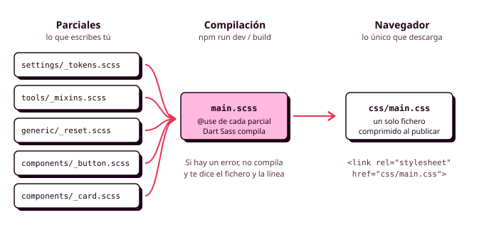

# 3. Apuntes de Sass

Cuando una hoja de estilos implementa un sistema de diseño completo, crece deprisa: los tokens, el reset, los estilos de las etiquetas y una docena de componentes con sus variantes. En un único fichero de mil líneas es difícil encontrar nada, y en un equipo es imposible que dos personas lo toquen a la vez sin pisarse. **Sass** es la herramienta que usan casi todos los equipos para repartir el código en ficheros pequeños y para generar con pocas líneas lo que se repite (RA2-j).



En este apartado vemos las ocho ideas básicas de Sass, en el mismo orden que su guía oficial: preprocesado, variables, anidación, parciales, módulos, mixins, extend y operadores.

## 1. Preprocesado

Un **preprocesador** es un programa que lee un fichero escrito en un lenguaje parecido a CSS, pero con más posibilidades, y lo **compila**, es decir, lo traduce a CSS normal. Tú escribes los ficheros de Sass, el compilador genera el `main.css` y el HTML enlaza ese `main.css`. El navegador nunca ve tus ficheros de Sass.

CSS ya tiene variables y anidación propias, pero Sass trabaja **antes** de que el código llegue al navegador, y eso le permite repartir el código en muchos ficheros, reutilizar grupos de declaraciones y hacer cálculos.

### Instalar y compilar

La versión oficial se llama **Dart Sass** y se instala con `npm` dentro de tu proyecto:

```bash
npm init -y
npm install --save-dev sass
```

Para no escribir el comando de compilación cada vez, guárdalo como **script** en el `package.json`:

```json
{
  "scripts": {
    "dev": "sass --watch scss/main.scss:css/main.css",
    "build": "sass --style=compressed --no-source-map scss/main.scss:css/main.css"
  }
}
```

Mientras trabajas, `npm run dev` vigila tus ficheros y recompila cada vez que guardas. Antes de publicar, `npm run build` genera el CSS comprimido, que pesa menos y es el que piden las **WSG**.

Añade `node_modules` al `.gitignore`, pero sube el `css/main.css` compilado, porque es lo que necesita GitHub Pages. Los scripts quedan escritos en el proyecto, así que cualquier persona del equipo que lo descargue compila exactamente igual con `npm install` y `npm run dev`.

!!! tip "Lee la terminal"

    El navegador ignora los errores de CSS, pero Sass hace lo contrario: si algo está mal, **no compila** y te dice el fichero y la línea. Si un cambio no aparece en el navegador, mira primero la terminal, porque probablemente Sass ha fallado y el `main.css` se ha quedado en la versión anterior.

### SCSS

Sass tiene dos sintaxis, y en este módulo usamos **SCSS** (ficheros `.scss`), que tiene las mismas llaves y puntos y coma que CSS. Cualquier CSS válido es SCSS válido, así que puedes pegar en un fichero `.scss` el CSS que ya tienes y mejorarlo poco a poco.

En SCSS hay dos tipos de comentarios: los de una línea con `//`, que desaparecen al compilar y son solo para quien lee el código, y los de CSS con `/* */`, que llegan al `main.css`.

## 2. Variables

Las variables de Sass empiezan por `$` y guardan un valor para reutilizarlo:

```scss
$bp-md: 48rem;
```

Al compilar, Sass las sustituye por su valor y desaparecen. En cambio, las propiedades personalizadas de CSS (`--color-primary`) llegan al navegador y existen mientras la página está abierta. De ahí sale la regla del proyecto:

- **Los tokens van en propiedades personalizadas**, porque tienen que cambiar con el modo oscuro, redefinirse en los componentes y llamarse igual que en Figma.
- **Las variables de Sass se usan para lo que solo hace falta al compilar**, como los breakpoints. Tienen que ser de Sass porque `var()` no funciona dentro de la condición de una media query.

## 3. Anidación

La anidación de Sass funciona como la de CSS, con una diferencia que te va a servir mucho: **`&` se sustituye por el texto del selector**, así que puedes pegarle cualquier cosa detrás y formar nombres de clase nuevos.

```scss
.card {
  padding: var(--space-4);

  &:hover    { box-shadow: var(--elevation-2); }  // .card:hover
  &__title   { font: var(--font-heading-3); }     // .card__title
  &--featured { border-width: 2px; }              // .card--featured
}
```

Así, todo un componente queda dentro de un único bloque y el CSS compilado tiene selectores de una sola clase. Los nombres `card__title` y `card--featured` siguen la convención BEM, que verás en el apartado 5.

!!! warning "No anides de más"

    Anidar demasiado complica el mantenimiento y genera selectores largos y muy específicos. Con `&__` y `&--`, casi nunca necesitarás más de un nivel de anidación.

## 4. Parciales

Un **parcial** es un fichero cuyo nombre empieza por guion bajo (`_button.scss`). Sass **no genera un CSS propio** para él: solo se compila como parte de otro fichero que lo carga. Es la razón más importante para usar Sass, porque te permite tener **un fichero por componente**, y que cada persona del equipo trabaje en el suyo sin tocar los de las demás.

## 5. Módulos

Para cargar un parcial dentro de otro fichero se usa **`@use`**, y Sass los junta todos en un único `main.css`. Se escribe el nombre sin el guion bajo y sin la extensión:

```scss
// main.scss
@use "variables";
@use "button";
@use "card";
```

`@use` también da acceso a las variables, funciones y mixins del fichero que carga, a través de su nombre, que actúa como **espacio de nombres**: `variables.$breakpoints`. Con `as *` puedes usarlos sin prefijo, y es lo habitual con las herramientas que usas en todas partes. **Cada fichero carga con `@use` lo que necesita**, aunque otro fichero ya lo haya cargado.

!!! warning "`@import` está obsoleto"

    En tutoriales antiguos verás `@import` en lugar de `@use`. Está obsoleto y desaparecerá, así que usa siempre `@use`. Los módulos solo funcionan con Dart Sass, que es el que instalamos.

## 6. Mixins

Un **mixin** es un grupo de declaraciones con nombre que puedes incluir en cualquier regla. Se define con `@mixin` y se usa con `@include`, y puede recibir parámetros con un valor por defecto:

```scss
// _mixins.scss
@mixin focus-ring($color: var(--color-primary)) {
  outline: 3px solid $color;
  outline-offset: 2px;
}
```

```scss
.button {
  &:focus-visible { @include focus-ring; }
}
```

Todos los componentes usan el mismo anillo de foco, y si un día decides cambiarlo, lo cambias en un sitio. Un mixin también puede recibir un bloque de reglas, que se coloca donde está **`@content`**. Así se escriben los breakpoints:

```scss
@mixin from($width) {
  @media (width >= $width) {
    @content;
  }
}

.court-list {
  @include from($bp-md) { grid-template-columns: repeat(2, 1fr); }
}
```

Usa los mixins para cosas pequeñas, porque **cada `@include` copia el código** en el CSS final. Para reutilizar un componente entero, usa su clase en el HTML.

## 7. Extend

`@extend` hace que un selector **comparta las propiedades de otro**. Se usa sobre todo con los **placeholders**, selectores que empiezan por `%` y que **solo aparecen en el CSS si alguien los extiende**:

```scss
%message {
  padding: var(--space-3);
  border: 1px solid var(--color-border);
}

.message-success { @extend %message; border-color: var(--color-success); }
.message-error   { @extend %message; border-color: var(--color-error); }
```

```css
/* CSS compilado: los selectores se agrupan */
.message-success, .message-error {
  padding: var(--space-3);
  border: 1px solid var(--color-border);
}
.message-success { border-color: var(--color-success); }
.message-error   { border-color: var(--color-error); }
```

A diferencia de un mixin, que copia el código en cada sitio, `@extend` agrupa los selectores y el código no se repite. Pero tiene efectos difíciles de prever (cambia el orden de las reglas y no funciona dentro de media queries), y por eso muchos equipos lo evitan. **En tu proyecto, usa un mixin pequeño o una clase base** y deja `@extend` para cuando entiendas bien lo que hace.

## 8. Operadores

Sass hace cálculos al compilar con los operadores `+`, `-`, `*` y `%` (resto). La división se hace con **`math.div()`**, que viene en el módulo `sass:math`, porque la barra `/` ya no divide:

```scss
@use "sass:math";

.sidebar {
  inline-size: math.div(300px, 960px) * 100%;   // 31.25%
}
```

Es útil para convertir los números de Figma a unidades relativas. Los píxeles de Figma pasan a `rem` dividiendo entre 16:

```scss
padding: math.div(24px, 16px) * 1rem;   // 1.5rem
```

## Antes de seguir

Antes de pasar al siguiente apartado, comprueba que:

1. **`npm run dev` compila sin errores** y recompila al guardar.
2. Tus tokens son **propiedades personalizadas** y solo usas variables de Sass para lo que se necesita al compilar.
3. Cada componente está en **su propio parcial** y no tiene más de un nivel de anidación.
4. Cargas los ficheros con **`@use`**, nunca con `@import`.
5. **`npm run build` genera un `main.css` comprimido.**

## Recursos

- [Sass Basics: la guía oficial](https://sass-lang.com/guide/)
- [Sass en español, de Manz (lenguajecss.com)](https://lenguajecss.com/sass/)
- [Sass Playground](https://sass-lang.com/playground/), para probar código sin instalar nada
