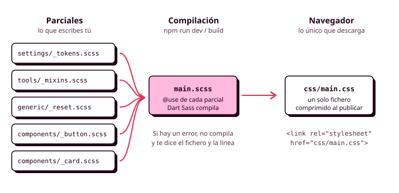

# Órbita 3 — Dar forma al sistema

## 3. Apuntes de Sass

Cuando tu hoja de estilos implementa un sistema de diseño completo, empieza a crecer deprisa: los tokens primitivos, los semánticos con sus dos modos, la escala tipográfica, el reset, los estilos base y una docena de componentes con sus variantes y sus estados. Todo eso en un único fichero `main.css` de mil líneas es difícil de leer y todavía más difícil de mantener, y además te obliga a escribir a mano cosas que se repiten con un patrón muy claro, como las ocho variables de espaciado o las mismas tres líneas de foco en cada componente. **Sass** es la herramienta que se usa en la mayoría de los equipos para resolver esos dos problemas, y en este apartado vas a aprender a usarla para organizar tu sistema en varios ficheros y generar con unas pocas líneas lo que antes escribías una y otra vez (RA2-j).

Todos los ejemplos de estos apuntes parten del CSS de los [apuntes de CSS3](02_css3.md) y del que escribirás en el [apartado 4](04_del_sistema_al_codigo.md). En la semana del 16 de noviembre repartirás este código en las carpetas de ITCSS y le pondrás nombres con BEM, y Sass es lo que hace que esa organización sea cómoda de mantener.



### Qué es un preprocesador

Un **preprocesador de CSS** es un programa que lee un fichero escrito en un lenguaje parecido a CSS, pero con más posibilidades, y lo traduce a CSS normal, que es lo único que entiende el navegador. A esa traducción se le llama **compilar**. Tú escribes y mantienes los ficheros de Sass, el compilador genera el `main.css` y el HTML enlaza ese `main.css`, igual que hasta ahora. El navegador nunca llega a ver tus ficheros de Sass.

Sass apareció en 2006 y es el preprocesador más extendido, por delante de Less y Stylus, que funcionan de forma parecida. Durante años se usó sobre todo por tres cosas que CSS no tenía, las variables, la anidación y la posibilidad de repartir el código en varios ficheros sin penalizar la carga. Hoy CSS ya tiene variables y anidación propias, así que es razonable que te preguntes para qué sigues necesitando Sass. La respuesta es que Sass trabaja **antes** de que el código llegue al navegador, y eso le permite hacer cosas que CSS no puede hacer:

- **Organizar el código en módulos** (un fichero por componente, por ejemplo) y juntarlos todos en un único `main.css`, que es lo que necesitarás para ITCSS.
- **Generar código** con bucles y condiciones, como todas las variables de espaciado a partir de una lista de pasos.
- **Reutilizar bloques de declaraciones** con los mixins, como el anillo de foco de todos tus componentes.
- **Hacer cálculos y comprobaciones** al compilar, y avisarte con un error si algo no cuadra, algo que CSS nunca hace.
- **Formar nombres de clase** con la anidación, que es justo lo que pide BEM (`&__title`).

Las propiedades personalizadas de CSS y las variables de Sass, por tanto, conviven en tu proyecto, y más adelante verás qué papel tiene cada una.

### Instalación y compilación

Sass se escribe hoy en el lenguaje Dart, y por eso a la versión oficial se la llama **Dart Sass**. Verás en tutoriales antiguos otras versiones (Ruby Sass, LibSass o `node-sass`) que están abandonadas, así que si un tutorial las usa, búscate otro. La forma más sencilla de instalar Dart Sass en tu proyecto es con `npm`, que ya conoces de otros módulos:

```bash
npm init -y
npm install --save-dev sass
```

La opción `--save-dev` lo instala como **dependencia de desarrollo**, porque Sass solo lo necesitas tú mientras programas y no forma parte de lo que se publica. Para compilar, el comando recibe el fichero de origen y el de destino separados por dos puntos, y con `--watch` se queda vigilando tus ficheros y vuelve a compilar cada vez que guardas uno:

```bash
npx sass --watch scss/main.scss:css/main.css
```

Como vas a escribir estos comandos muchas veces, lo cómodo es guardarlos como **scripts** en el `package.json`, de modo que te baste con escribir `npm run dev` mientras trabajas y `npm run build` antes de entregar:

```json
{
  "scripts": {
    "dev": "sass --watch scss/main.scss:css/main.css",
    "build": "sass --style=compressed --no-source-map scss/main.scss:css/main.css"
  }
}
```

La diferencia entre los dos está en los estilos de salida, que verás al final del apartado. Añade la carpeta `node_modules` a tu `.gitignore`, porque se regenera con `npm install` y pesa mucho. El `css/main.css` compilado, en cambio, sí tiene que estar en el repositorio, porque es lo que necesita GitHub Pages para publicar tu aplicación.

En Visual Studio Code existen también extensiones que compilan al guardar, como *Live Sass Compiler*. Funcionan, pero cada persona del equipo tendría que instalarla y configurarla igual, mientras que los scripts de `npm` quedan escritos en el proyecto y funcionan en cualquier ordenador.

!!! tip "Los errores de Sass son una ayuda"

    El navegador ignora en silencio los errores de CSS, y Sass hace lo contrario: si escribes algo que no entiende, **se niega a compilar** y te dice el fichero, la línea y el motivo. Lee siempre la terminal donde tienes el `npm run dev`, porque si Sass ha fallado, tu `main.css` se ha quedado en la versión anterior y los cambios que has hecho no aparecerán en el navegador.

### Las dos sintaxis: SCSS y Sass

Sass tiene dos sintaxis. La original, con la extensión `.sass`, quita las llaves y los puntos y coma y usa la sangría para saber qué va dentro de qué, como Python. La segunda, con la extensión `.scss` (*Sassy CSS*), usa las mismas llaves y puntos y coma que CSS, de modo que **cualquier fichero CSS válido es también un fichero SCSS válido**.

```scss
// SCSS (la que usamos en el módulo)
.card {
  padding: var(--space-4);

  &:hover {
    box-shadow: var(--elevation-2);
  }
}
```

```sass
// Sintaxis original con sangría
.card
  padding: var(--space-4)

  &:hover
    box-shadow: var(--elevation-2)
```

En este módulo usamos SCSS, que es la que se usa en la gran mayoría de proyectos y la que te permite pegar en un fichero `.scss` todo el CSS que ya tienes y empezar a mejorarlo poco a poco. Aunque escribas en SCSS, el lenguaje y la herramienta se siguen llamando Sass.

### Comentarios

Además del comentario de CSS (`/* ... */`), en SCSS existe el comentario de una línea con `//`. Los dos se comportan de forma distinta al compilar. Los comentarios con `//` son **solo para quien lee el código fuente** y desaparecen del CSS compilado, mientras que los comentarios con `/* */` se copian al CSS en el estilo de salida normal y se eliminan en el comprimido. Hay una tercera forma, `/*! ... */`, que se conserva incluso al comprimir y se usa para avisos de licencia.

```scss
// Este comentario no llega al main.css
/* Este sí llega, salvo en la versión comprimida */
```

Usa `//` para casi todo, y reserva `/* */` para los títulos de sección que quieras ver al revisar el CSS compilado en el inspector.

### Anidación

La anidación de Sass funciona como la de CSS que ya conoces: una regla dentro de otra se aplica a los descendientes del selector exterior, y `&` representa el selector padre. La diferencia importante es que en Sass, `&` se sustituye por el texto del selector **antes** de compilar, así que puedes pegarle cualquier cosa detrás para **formar nombres de clase nuevos**.

```scss
.card {
  padding: var(--space-4);

  &:hover { box-shadow: var(--elevation-2); }  // .card:hover
  &__title { font: var(--font-heading-3); }    // .card__title
  &__price { font: var(--font-label); }        // .card__price
  &--featured { border-width: 2px; }           // .card--featured

  .is-full & { opacity: 0.6; }                 // .is-full .card
}
```

Los nombres `card__title` y `card--featured` siguen la convención **BEM**, que verás en detalle la semana del 16. Lo que te interesa ahora es que, gracias a `&`, todo el componente queda dentro de un único bloque y el CSS compilado tiene selectores de una sola clase, con la especificidad baja y uniforme que buscábamos en los apuntes de CSS3. Esto es algo que la anidación nativa de CSS no puede hacer, porque en CSS `&__title` no es un selector válido.

Las media queries también se pueden anidar, y Sass las saca fuera y les añade el selector al compilar:

```scss
.court-list {
  display: grid;
  gap: var(--space-4);

  @media (width >= 48rem) {
    grid-template-columns: repeat(2, 1fr);
  }
}
```

```css
/* CSS compilado */
.court-list { display: grid; gap: var(--space-4); }
@media (width >= 48rem) {
  .court-list { grid-template-columns: repeat(2, 1fr); }
}
```

La advertencia de los apuntes de CSS3 vale igual aquí, y con más motivo. Anidar en Sass es tan cómodo que es fácil acabar con cinco niveles (`.app .main .court-list .card .card__header h3`), que generan selectores larguísimos y muy específicos. **Con `&__` y `&--` casi nunca necesitarás más de un nivel**, y si te encuentras escribiendo el tercero, probablemente te falte una clase en el HTML.

### Variables

Las variables de Sass empiezan por el signo `$` y se declaran con dos puntos, igual que una propiedad:

```scss
$space-unit: 4px;
$font-family-base: "Atkinson Hyperlegible", system-ui, sans-serif;

body {
  font-family: $font-family-base;
}
```

Al compilar, Sass sustituye cada variable por su valor, así que en el `main.css` no queda ni rastro de `$font-family-base`. Una variable declarada dentro de un bloque solo existe dentro de ese bloque, y una declarada fuera de cualquier bloque está disponible en todo el fichero. Si a un valor le añades **`!default`**, la variable solo toma ese valor si nadie le ha dado otro antes, lo que permite configurar un fichero desde fuera, como verás al hablar de módulos.

#### Variables de Sass y propiedades personalizadas: cuál usar

Esta es la decisión que más dudas genera, y la diferencia está en **cuándo existe cada una**. Una variable de Sass existe solo mientras se compila: se sustituye por su valor y desaparece, así que el navegador no sabe nada de ella. Una propiedad personalizada llega al navegador y existe mientras la página está abierta, así que se hereda, se puede redefinir dentro de un selector, cambia con el modo oscuro y se puede consultar y modificar desde el inspector o desde JavaScript.

De ahí sale la regla que vamos a seguir en el proyecto. **Los tokens de tu sistema llegan al navegador como propiedades personalizadas**, porque tienen que cambiar con el modo oscuro, tienen que poder redefinirse en los tokens de componente y tienen que tener el mismo nombre que en Figma. Las variables de Sass se quedan para lo que solo hace falta al compilar:

- **Los datos a partir de los cuales se generan los tokens**, como verás en el apartado de mapas y bucles.
- **Los breakpoints**, porque las propiedades personalizadas no se pueden usar dentro de la condición de una media query (`@media (width >= var(--bp-md))` no funciona), y una variable de Sass sí, ya que cuando llega al navegador ya se ha sustituido por su valor.
- **Valores internos de un mixin o de una función.**

### Parciales y módulos

Esta es probablemente la razón más importante para usar Sass en tu proyecto. Un **parcial** es un fichero de Sass cuyo nombre empieza por un guion bajo, como `_button.scss`. El guion bajo le dice a Sass que ese fichero solo se compila como parte de otro, y así puedes tener un fichero por componente sin que cada uno genere su propio CSS.

Los parciales se cargan desde otros ficheros con la regla **`@use`**, sin el guion bajo ni la extensión. El fichero principal (`main.scss`, sin guion bajo) carga todos los demás, y Sass los junta en un único `main.css`. El navegador descarga un solo fichero, que es lo más eficiente, y tú trabajas con ficheros pequeños y fáciles de encontrar.

```text
scss/
├── main.scss
├── settings/
│   ├── _index.scss
│   └── _tokens.scss
├── tools/
│   ├── _functions.scss
│   └── _mixins.scss
└── components/
    ├── _button.scss
    └── _card.scss
```

```scss
// main.scss
@use "settings";
@use "tools/mixins";
@use "components/button";
@use "components/card";
```

`@use` hace dos cosas. La primera es incluir en el CSS compilado las reglas que contiene el fichero, **una sola vez** aunque lo cargues desde varios sitios. La segunda es darte acceso a sus variables, mixins y funciones, siempre a través de un **espacio de nombres**, que por defecto es el nombre del fichero:

```scss
@use "settings/tokens";

.layout {
  max-width: tokens.$content-max-width;  // la variable $content-max-width de _tokens.scss
}
```

Puedes cambiar el espacio de nombres con `as` (`@use "settings/tokens" as t;` y después `t.$content-max-width`), o quitarlo con `as *`, aunque esto último conviene reservarlo para ficheros de herramientas que uses en todas partes, porque si no, al leer el código no sabrás de dónde sale cada variable.

Un detalle importante es que **cada fichero tiene que cargar con `@use` lo que necesita**. Si `_button.scss` usa un mixin de `_mixins.scss`, tiene que tener su propio `@use "../tools/mixins"` al principio, aunque `main.scss` ya lo haya cargado. Al principio parece engorroso, pero hace que cada fichero diga explícitamente de qué depende.

#### Reunir varios ficheros con @forward

Cuando una carpeta tiene varios parciales que siempre se usan juntos, puedes crear en ella un fichero `_index.scss` que los reúna con **`@forward`**. `@forward` hace accesibles las variables, mixins y funciones de otro fichero a quien cargue este, y Sass busca automáticamente el `_index.scss` cuando haces `@use` de una carpeta.

```scss
// settings/_index.scss
@forward "tokens";
@forward "breakpoints";
```

```scss
// Cualquier otro fichero
@use "../settings";        // carga settings/_index.scss
// settings.$breakpoints está disponible
```

#### Configurar un módulo

Las variables con `!default` de un módulo se pueden cambiar al cargarlo, con `with`. Es la forma que tienen las librerías de Sass de dejarse personalizar sin que tengas que tocar su código.

```scss
// tools/_spacing.scss
$space-unit: 4px !default;
```

```scss
@use "tools/spacing" with ($space-unit: 8px);
```

#### Y @import, que verás en todas partes

En muchos tutoriales y proyectos antiguos verás **`@import`** en lugar de `@use`. Hacía algo parecido, pero metía todas las variables de todos los ficheros en un único espacio global, de modo que dos ficheros con una variable del mismo nombre se pisaban sin avisar, y el mismo fichero podía acabar incluido varias veces en el CSS final. Sass lo marcó como obsoleto en 2024 y desaparecerá en la próxima versión importante, así que **en tu proyecto usa siempre `@use` y `@forward`**. Si copias código que usa `@import`, el compilador te avisará.

### Mixins

Un **mixin** es un bloque de declaraciones con nombre que puedes incluir en cualquier regla. Se define con **`@mixin`** y se usa con **`@include`**, y sirve para no repetir grupos de declaraciones que aparecen juntas en varios sitios. El caso más claro de tu sistema es el anillo de foco, que tiene que ser idéntico en todos los componentes que se pueden pulsar:

```scss
// tools/_mixins.scss
@mixin focus-ring($color: var(--color-primary)) {
  outline: 3px solid $color;
  outline-offset: 2px;
}
```

```scss
// components/_button.scss
@use "../tools/mixins" as *;

.button {
  &:focus-visible {
    @include focus-ring;
  }
}

.slot:has(input:focus-visible) {
  @include focus-ring(var(--color-on-surface));
}
```

Un mixin puede recibir **parámetros**, como una función de programación, y cada parámetro puede tener un valor por defecto, que se usa cuando no le pasas nada. Si un día decides que el foco de tu aplicación tiene que ser de 4 píxeles, lo cambias en el mixin y se actualiza en todos los componentes, que es exactamente la misma idea que la de los tokens.

#### Mixins con @content: el mixin de breakpoint

Un mixin puede recibir, además de parámetros, un **bloque de reglas** entero, que se coloca donde aparece la palabra **`@content`**. Este es el mecanismo con el que casi todos los proyectos escriben sus media queries, porque permite dar un nombre a cada breakpoint y comprobar al compilar que existe:

```scss
// tools/_mixins.scss
@use "sass:map";
@use "../settings" as s;

@mixin from($bp) {
  @if not map.has-key(s.$breakpoints, $bp) {
    @error "El breakpoint `#{$bp}` no existe en $breakpoints.";
  }
  @media (width >= map.get(s.$breakpoints, $bp)) {
    @content;
  }
}
```

```scss
.court-list {
  display: grid;
  gap: var(--space-4);

  @include from("md") {
    grid-template-columns: repeat(2, 1fr);
  }
}
```

Los breakpoints quedan definidos en un único sitio con un nombre que tiene sentido para tu proyecto, y si alguien escribe `from("tablet")` por error, Sass se niega a compilar y le explica por qué.

#### Un mixin no es un componente

Los mixins son tan cómodos que hay quien acaba metiendo componentes enteros dentro de ellos, y eso es un problema, porque **cada `@include` copia todas las declaraciones del mixin** en el CSS compilado. Un mixin de 20 líneas incluido en 15 sitios son 300 líneas en tu `main.css`. Usa los mixins para patrones pequeños (el foco, un breakpoint, el texto oculto visualmente) y escribe los componentes como clases que se reutilizan en el HTML. Las **WSG** piden evitar el código redundante, y el tamaño del CSS compilado es una de las cosas que comprobarás en la auditoría de sostenibilidad de la Órbita 5.

### Herencia con @extend y selectores marcadores

**`@extend`** hace que un selector herede todas las reglas de otro. En lugar de copiar las declaraciones como un mixin, Sass **agrupa los selectores** en el CSS compilado:

```scss
%button-base {
  display: inline-flex;
  align-items: center;
  min-height: 2.75rem;
  border: none;
}

.button { @extend %button-base; }
.chip   { @extend %button-base; }
```

```css
/* CSS compilado */
.button, .chip {
  display: inline-flex;
  align-items: center;
  min-height: 2.75rem;
  border: none;
}
```

El selector que empieza por `%` es un **selector marcador** (*placeholder*): solo existe para que otros lo extiendan, y no aparece en el CSS compilado si nadie lo hace.

`@extend` tiene más riesgos de los que parece. Agrupa selectores que pueden estar en ficheros muy distintos, cambia el orden en el que aparecen las reglas en el CSS final (y con ello quién gana en los empates de la cascada) y no funciona dentro de una media query hacia un selector que está fuera de ella. Por eso muchos equipos lo evitan, y en tu proyecto te recomiendo hacer lo mismo: **para compartir declaraciones, usa un mixin pequeño o, mejor todavía, una clase base en el HTML** (`class="button button--danger"`), que es justo lo que propone BEM.

### Operaciones y funciones

Sass puede hacer operaciones con números al compilar, incluidas las unidades: `4px * 4` da `16px`, y `16px + 1rem` da un error, porque Sass no sabe cuánto mide un `rem` (eso solo lo sabe el navegador). Para mezclar unidades distintas, deja que lo calcule el navegador con `calc()`. La división es la excepción, porque la barra `/` también se usa en CSS como separador (`font: 1rem/1.5`), y por eso en Sass moderno se divide con la función **`math.div()`**.

Las funciones que trae Sass están organizadas en **módulos**, que se cargan con `@use` igual que tus ficheros, pero con el prefijo `sass:`:

| Módulo | Para qué sirve | Ejemplo |
|---|---|---|
| `sass:math` | Operaciones con números | `math.div(24px, 16px)`, `math.round(1.333)` |
| `sass:color` | Manipular colores | `color.adjust($c, $lightness: -10%)`, `color.mix($a, $b, 20%)` |
| `sass:map` | Trabajar con mapas | `map.get($breakpoints, "md")`, `map.has-key(...)` |
| `sass:list` | Trabajar con listas | `list.nth($pair, 1)`, `list.length($steps)` |
| `sass:string` | Trabajar con textos | `string.to-upper-case("pista")` |
| `sass:meta` | Información sobre el propio código | `meta.type-of($value)`, `meta.load-css(...)` |

En tutoriales antiguos verás funciones globales como `darken($color, 10%)` o `lighten()`, que están obsoletas y se sustituyen por `color.adjust()` o `color.scale()`. Ten en cuenta también que las funciones de color de Sass trabajan con valores que conoce al compilar, así que no pueden recibir una propiedad personalizada (`color.adjust(var(--color-primary), ...)` da error). Para los colores que tienen que cambiar con el modo oscuro, usa la función `color-mix()` de CSS, que calcula el navegador.

#### Funciones propias

Puedes escribir tus propias funciones con **`@function`**, que reciben parámetros y devuelven un valor con **`@return`**. La más útil para tu proyecto convierte los píxeles de Figma en `rem`, de modo que en el código puedes escribir los mismos números que ves en el diseño:

```scss
// tools/_functions.scss
@use "sass:math";

@function rem($px) {
  @return math.div($px, 16px) * 1rem;
}
```

```scss
@use "../tools/functions" as f;

.court-list {
  grid-template-columns: repeat(auto-fit, minmax(f.rem(256px), 1fr));  // 16rem
}
```

Dentro de mixins y funciones tienes tres reglas para comunicarte con quien compila: **`@error`** detiene la compilación con un mensaje (como en el mixin de breakpoint), **`@warn`** muestra un aviso pero sigue compilando y **`@debug`** escribe un valor en la terminal, que es muy útil para entender qué está haciendo un bucle.

### Interpolación

La **interpolación** inserta el valor de una expresión de Sass dentro de un texto, con la sintaxis **`#{...}`**. Se usa en los sitios donde Sass, si no, interpretaría el texto literalmente, como los nombres de los selectores, los nombres de las propiedades o los mensajes de error:

```scss
$component: "card";

.#{$component}__title { font: var(--font-heading-3); }  // .card__title
```

Hay un caso en el que la interpolación es obligatoria y que te va a aparecer enseguida, que son **los valores de las propiedades personalizadas**. Como una propiedad personalizada puede contener cualquier cosa, Sass copia su valor tal cual, sin evaluarlo, así que `--space-4: $value;` dejaría escrito `$value` en tu CSS. Para que Sass ponga el valor de la variable, hay que interpolarla: `--space-4: #{$value};`.

### Listas y mapas

Sass tiene dos tipos de datos para agrupar valores. Una **lista** es una serie de valores separados por comas o espacios (`$space-steps: 1, 2, 3, 4, 6, 8, 12, 16;`), y un **mapa** es una colección de parejas clave y valor entre paréntesis, como un objeto de JavaScript:

```scss
$primitives: (
  "blue-200": #99C1F1,
  "blue-500": #1A5FB4,
  "gray-50":  #F6F5F4,
  "gray-900": #1E1E24,
);

$breakpoints: (
  "md": 48rem,
  "lg": 64rem,
);
```

Los valores de un mapa se leen con `map.get($breakpoints, "md")`. Los mapas son la forma natural de guardar en Sass los datos de tu sistema, porque cada fila de las tablas de tokens de la Órbita 2 es una pareja de clave y valor.

### Control de flujo: condiciones y bucles

Sass tiene las estructuras de control de cualquier lenguaje de programación. **`@if`** y **`@else`** ejecutan un bloque según una condición, y los usarás sobre todo para comprobar los parámetros de un mixin. **`@each`** recorre una lista o un mapa, **`@for`** repite un bloque entre dos números y **`@while`** repite mientras se cumpla una condición (este último casi nunca hace falta).

El bucle que más vas a usar es `@each` sobre un mapa, porque te permite **generar todos los tokens de tu sistema a partir de los datos**. Este es el ejemplo completo del polideportivo, que puedes adaptar a tus propios tokens:

```scss
// settings/_tokens.scss
$primitives: (
  "blue-200": #99C1F1,
  "blue-500": #1A5FB4,
  "gray-50":  #F6F5F4,
  "gray-900": #1E1E24,
);

// Cada semántico: (primitivo en modo claro, primitivo en modo oscuro)
$semantic: (
  "primary":    ("blue-500", "blue-200"),
  "surface":    ("gray-50", "gray-900"),
  "on-surface": ("gray-900", "gray-50"),
);

$space-unit: 4px;
$space-steps: 1, 2, 3, 4, 6, 8, 12, 16;
```

```scss
// main.scss
@use "sass:list";
@use "settings" as s;
@use "tools/functions" as f;

:root {
  color-scheme: light dark;

  @each $name, $value in s.$primitives {
    --#{$name}: #{$value};
  }

  @each $name, $pair in s.$semantic {
    --color-#{$name}: light-dark(var(--#{list.nth($pair, 1)}), var(--#{list.nth($pair, 2)}));
  }

  @each $step in s.$space-steps {
    --space-#{$step}: #{f.rem($step * s.$space-unit)};
  }
}
```

```css
/* CSS compilado */
:root {
  color-scheme: light dark;
  --blue-200: #99C1F1;
  --blue-500: #1A5FB4;
  --gray-50: #F6F5F4;
  --gray-900: #1E1E24;
  --color-primary: light-dark(var(--blue-500), var(--blue-200));
  --color-surface: light-dark(var(--gray-50), var(--gray-900));
  --color-on-surface: light-dark(var(--gray-900), var(--gray-50));
  --space-1: 0.25rem;
  --space-2: 0.5rem;
  --space-3: 0.75rem;
  --space-4: 1rem;
  --space-6: 1.5rem;
  --space-8: 2rem;
  --space-12: 3rem;
  --space-16: 4rem;
}
```

El resultado es exactamente el CSS que tendrías que escribir a mano (el del apartado 4), pero ahora los datos están en un solo sitio, con el mismo formato que las tablas de tu guía de estilo, y añadir un color o un paso de espaciado es añadir una línea al mapa. Figma puede exportar tus variables (con plugins o con su API), y esos datos son justo los que necesitas para rellenar estos mapas.

!!! warning "Un bucle puede generar mucho más CSS del que crees"

    Con tres líneas de `@each` es muy fácil generar cientos de reglas. Si recorres diez colores para crear clases de texto, de fondo y de borde, y repites cada una en tres breakpoints, has generado noventa clases, y probablemente uses diez. Las **WSG** recomiendan no enviar al navegador código que no se usa, así que antes de escribir un bucle que genera clases, pregúntate cuántas de ellas aparecerán de verdad en tu HTML. Para los tokens no hay problema, porque cada propiedad personalizada se usa.

### Estilos de salida y mapas de código fuente

El compilador puede escribir el CSS de dos formas, que se eligen con la opción `--style`. La salida **`expanded`** (la que se usa por defecto) es CSS normal, con sangrías y saltos de línea, cómodo de leer mientras trabajas. La salida **`compressed`** elimina todos los espacios, saltos de línea y comentarios que no hacen falta, y deja el CSS en una sola línea. El resultado es idéntico para el navegador, pero el fichero pesa bastante menos, y por eso es la versión que se publica. **Publicar el CSS comprimido** es una de las medidas de las **WSG** más fáciles de aplicar, porque no te cuesta nada (es la diferencia entre `npm run dev` y `npm run build`).

Al compilar, Sass también genera un fichero `main.css.map`, que es un **mapa de código fuente** (*source map*). Ese fichero le dice al inspector del navegador de qué línea de qué parcial sale cada regla, de modo que, al inspeccionar un botón, el panel de Estilos te enseña `_button.scss:12` en lugar de una línea del `main.css`. Mientras desarrollas es muy útil, y en la versión que publicas no hace falta, por eso el script `build` lleva `--no-source-map`.

### Cómo organizar el proyecto

Con todo lo anterior ya puedes repartir tu hoja de estilos en parciales, y la pregunta es qué carpetas crear y en qué orden cargarlas. Hay varias propuestas conocidas (el patrón 7-1, SMACSS...), y en este módulo vamos a seguir **ITCSS**, que verás la semana del 16 de noviembre. Por ahora, basta con que entiendas su idea principal, que es la misma que la de las capas de cascada de los apuntes de CSS3: **el orden de los ficheros va de lo más general a lo más concreto**, de modo que primero se cargan los ajustes y las herramientas (que no generan CSS), después el reset y los estilos de las etiquetas, después los componentes y al final las utilidades.

```scss
// main.scss: un adelanto de la estructura de ITCSS
@use "settings";          // tokens y mapas (no generan CSS por sí solos)
@use "tools";             // funciones y mixins (no generan CSS)
@use "generic";           // reset
@use "elements";          // estilos de las etiquetas: body, h1, a...
@use "objects";           // patrones de maquetación: .layout, .stack...
@use "components";        // .button, .card, .slot...
@use "utilities";         // clases de ayuda: .visually-hidden...
```

Si además quieres usar las capas de cascada de CSS, una regla `@use` no se puede escribir dentro de un `@layer`, porque tiene que ir siempre al principio del fichero. Para cargar un parcial dentro de una capa, Sass tiene el mixin `meta.load-css()`:

```scss
@use "sass:meta";

@layer reset, tokens, base, components;

@layer components {
  @include meta.load-css("components/button");
}
```

### Antes de seguir

Antes de pasar a ITCSS, comprueba que tu proyecto cumple estas condiciones:

1. **`npm run dev` compila sin errores** y vuelve a compilar cada vez que guardas un parcial.
2. Tus tokens están en **mapas de Sass** y se generan como **propiedades personalizadas** con `@each`, con los mismos nombres que en Figma.
3. Los breakpoints tienen nombre y se usan siempre a través de un **mixin**.
4. Ningún componente tiene **más de un nivel de anidación**, salvo los `&:hover`, `&__` y `&--`.
5. No hay ningún `@import`, y cada parcial carga con `@use` lo que necesita.
6. **`npm run build` genera un `main.css` comprimido** que pasa el validador del W3C.

Si en algún momento usas una IA para escribir o revisar parte de tu código de Sass, anótalo en el `CHANGELOG.md`, y comprueba que lo que te devuelve no usa `@import` ni funciones obsoletas, porque buena parte del código de Sass que hay en internet (y del que han aprendido estas herramientas) es anterior a 2024.

### Recursos

- [Sass en español, de Manz (lenguajecss.com)](https://lenguajecss.com/sass/)
- [Documentación oficial de Sass](https://sass-lang.com/documentation/)
- [Guía de módulos: `@use` y `@forward`](https://sass-lang.com/documentation/at-rules/use/)
- [Por qué `@import` está obsoleto](https://sass-lang.com/documentation/breaking-changes/import/)
- [Sass Playground](https://sass-lang.com/playground/), para probar código sin instalar nada
