# Órbita 3 — Dar forma al sistema

## 4. Del sistema de Figma a la hoja de estilos

Al terminar la Órbita 2 tienes en Figma un sistema visual completo (los colores con su modo oscuro, la escala tipográfica, el espaciado, los radios, la elevación y los componentes con sus estados) y unos mockups del happy path construidos con él. Todo eso, de momento, es un dibujo. En esta órbita vas a convertirlo en una aplicación que se abre en el navegador, y la herramienta para hacerlo es CSS, que ya conoces del curso pasado. La diferencia está en el punto de partida, porque **las decisiones visuales ya están tomadas y justificadas** en Figma, y tu trabajo consiste en trasladarlas al código sin perder ninguna por el camino.

La sintaxis de una regla, los selectores, la cascada y la especificidad, el modelo de cajas, Flexbox, Grid, las media queries y las animaciones están explicados con detalle en los [apuntes de CSS3](02_css3.md) de esta órbita, que siguen el orden de [lenguajecss.com](https://lenguajecss.com/) y amplían lo que viste en Lenguajes de Marcas, y te remitiré a ellos cada vez que haga falta. Sass, la herramienta con la que organizarás todo este código, tiene sus propios [apuntes de Sass](03_sass.md). Lo que vas a encontrar aquí es cómo se corresponde cada pieza de tu sistema de Figma con una herramienta concreta de CSS, y por qué elegir una u otra. En la auditoría oral de esta órbita te voy a señalar un botón cualquiera de tu aplicación y te voy a preguntar por qué tiene ese relleno y de qué token sale (RA2-f).

Durante todo el apartado seguiremos con la aplicación de reservas del polideportivo, y en concreto con la pantalla en la que Lucía elige hora para la pista de pádel y pulsa "Reservar". En la semana del 16 de noviembre ordenarás todo este código con ITCSS, le pondrás nombres con BEM y lo pasarás a SCSS, así que aquí vamos a escribir CSS estándar, en un solo fichero y con nombres de clase sencillos.

### Antes de empezar: comprueba que te acuerdas

Como este apartado da por sabido el lenguaje, merece la pena que compruebes antes si de verdad te acuerdas de lo esencial. Intenta contestar a estas preguntas sin mirar los apuntes:

1. Si una regla con el selector `#reserva a` y otra con `.boton-reservar` cambian el color del mismo enlace, ¿cuál gana y por qué?
2. ¿Cuánto mide de ancho una caja con `width: 300px`, `padding: 20px` y un borde de 2 píxeles si no has tocado `box-sizing`? ¿Y si tiene `box-sizing: border-box`?
3. ¿Qué diferencia hay entre `1em` y `1rem`, y cuál de las dos usarías para un tamaño de letra?
4. ¿Qué propiedades se heredan y cuáles no? Pon dos ejemplos de cada.
5. ¿Cuándo usarías Flexbox y cuándo Grid?
6. ¿Qué hace `var(--color-primary, blue)` si la variable no existe?

Si alguna se te atasca, repasa el apartado correspondiente de los apuntes de CSS3 antes del 4 de noviembre, porque en clase iremos rápido por esas partes. Yo os recomiendo tenerlos abiertos en otra pestaña mientras leéis este apartado.



### Las variables de Figma se convierten en propiedades personalizadas

En la Órbita 2 creaste dos colecciones de variables en Figma, una de primitivos y otra de semánticos, y a cada variable le configuraste la **sintaxis de código**. Ahora entenderás para qué servía ese campo: es el nombre exacto que tendrá esa variable en tu hoja de estilos. CSS tiene un mecanismo que funciona igual que las variables de Figma, las **propiedades personalizadas** (las variables CSS de los apuntes de CSS3), y la regla de este módulo es que **cada variable de Figma tiene una propiedad personalizada con el mismo nombre**, de modo que el diseño y el código hablen el mismo idioma (RA1-d, RA2-g).

Los primitivos se declaran en `:root` con su valor real, porque son la paleta completa de la que vas eligiendo.

```css
:root {
  /* Primitivos: color */
  --blue-200: #99C1F1;
  --blue-500: #1A5FB4;
  --gray-50:  #F6F5F4;
  --gray-900: #1E1E24;

  /* Primitivos: espaciado (base de 4 píxeles) */
  --space-1: 0.25rem;  /*  4 px */
  --space-2: 0.5rem;   /*  8 px */
  --space-3: 0.75rem;  /* 12 px */
  --space-4: 1rem;     /* 16 px */
  --space-6: 1.5rem;   /* 24 px */
  --space-8: 2rem;     /* 32 px */
}
```

Los semánticos, igual que en Figma, apuntan a un primitivo en lugar de tener un valor propio, y en CSS ese alias se escribe con `var()`. Lo interesante viene con el modo oscuro. En Figma, cada semántico tenía un valor en el modo claro y otro en el oscuro, y CSS tiene una función que hace exactamente eso, **`light-dark()`**, que recibe los dos valores y usa uno u otro según el esquema de color activo. Para que funcione hay que declarar antes `color-scheme`, como verás en los apuntes de CSS3.

```css
:root {
  color-scheme: light dark;

  /* Semánticos: cada uno apunta a un primitivo distinto en cada modo */
  --color-primary:    light-dark(var(--blue-500), var(--blue-200));
  --color-on-primary: light-dark(white, var(--gray-900));
  --color-surface:    light-dark(var(--gray-50), var(--gray-900));
  --color-on-surface: light-dark(var(--gray-900), var(--gray-50));
}
```

Si lo comparas con la tabla de color del apartado 3 de la Órbita 2, verás que cada línea de este bloque es una fila de esa tabla. Con `color-scheme: light dark`, la aplicación sigue la preferencia del sistema operativo de cada persona, que es lo que espera Lucía cuando activa el modo oscuro para ahorrar batería. Si además tu aplicación tiene un interruptor para elegir el modo, basta con que ese interruptor cambie un atributo en el `<html>` y que una regla fuerce el esquema, porque `light-dark()` obedece siempre al valor de `color-scheme`:

```css
:root[data-theme="light"] { color-scheme: light; }
:root[data-theme="dark"]  { color-scheme: dark; }
```

Cambiar el atributo es trabajo de JavaScript y lo harás en DWEC, pero los estilos ya quedan preparados. El navegador, además, adapta solo las barras de desplazamiento, los campos de formulario y el calendario de los campos de fecha, que en la app del polideportivo se usan bastante.

La regla de oro de la Órbita 2 sigue en pie en el código: **las reglas de tus componentes usan solo tokens semánticos**. Si en la hoja de estilos de un botón aparece `var(--blue-500)` o, peor todavía, `#1A5FB4`, ese botón no cambiará en el modo oscuro y no sabrás por qué. Una forma rápida de comprobarlo es buscar en tu fichero el carácter `#` y los nombres de los primitivos, porque solo deberían aparecer en el bloque de primitivos.

#### El tercer nivel: tokens de componente

En la Órbita 2 os dije que dejaríamos para esta órbita un tercer nivel de tokens, los **tokens de componente**, y este es el momento. Un token de componente es una variable que solo existe dentro de un componente y que apunta a un semántico. Sirve para que todas las variantes de un componente se escriban cambiando unas pocas variables, sin repetir las declaraciones.

```css
.button {
  /* Tokens de componente */
  --button-bg: var(--color-primary);
  --button-fg: var(--color-on-primary);

  background-color: var(--button-bg);
  color: var(--button-fg);
  padding: var(--space-3) var(--space-6);
  border-radius: var(--radius-md);
  border: none;
}

.button--danger {
  --button-bg: var(--color-error);
  --button-fg: var(--color-on-error);
}
```

El botón de cancelar la reserva (`button--danger`) solo cambia dos variables, y todo lo demás lo hereda del botón normal. La forma de nombrar la variante con dos guiones la entenderás bien cuando veamos BEM. Como las propiedades personalizadas se heredan, el valor de `--button-bg` solo existe dentro de `.button` y de sus descendientes, y no puede chocar con ningún otro componente que use un nombre parecido.

!!! example "Ejemplo: la prueba del color principal, ahora en código"

    En la Órbita 2 comprobaste que tu sistema funcionaba cambiando el color principal en las variables de Figma y viendo que cambiaba en todas las pantallas. En el código la prueba es la misma: abre el inspector, selecciona el `<html>`, cambia el valor de `--blue-500` en el panel de Estilos y recorre la aplicación. Si queda un solo botón, enlace o borde con el azul anterior, tienes un valor escrito a mano en algún sitio, y el panel de Estilos te dirá en qué regla está.

### La cascada como herramienta para ordenar el sistema

Cuando se aprende CSS, la cascada aparece sobre todo como un problema que había que entender para que las reglas no se pisaran entre sí. Cuando la hoja de estilos implementa un sistema de diseño, conviene verla al revés, como una herramienta para **decidir de antemano qué tipo de regla puede ganar a cuál**. Los tokens tienen que estar disponibles en todas partes, los estilos base de las etiquetas (el `body`, los encabezados, los enlaces) tienen que ser fáciles de sobrescribir, y los componentes tienen que poder sobrescribir a los estilos base sin necesidad de selectores largos.

Para eso sirven las **capas de cascada** (`@layer`), que en los apuntes de CSS3 aparecen como algo para proyectos grandes. Tu proyecto ya lo es, porque tiene un sistema de diseño detrás. Al principio del fichero declaras el orden de las capas, y a partir de ahí una regla de una capa posterior gana siempre a una de una capa anterior, sea cual sea la especificidad de sus selectores.

```css
@layer reset, tokens, base, components, utilities;

@layer reset {
  *, *::before, *::after { box-sizing: border-box; }
  body { margin: 0; }
  img, svg, video { display: block; max-width: 100%; height: auto; }
}

@layer tokens {
  :root { /* primitivos y semánticos */ }
}

@layer base {
  body {
    background-color: var(--color-surface);
    color: var(--color-on-surface);
    font: var(--font-body);
  }
}

@layer components {
  .button { /* ... */ }
  .card   { /* ... */ }
}
```

Fíjate en que este orden (de lo más general a lo más concreto, y de lo que afecta a todo a lo que afecta a un solo elemento) es el mismo que seguía la lista de buenas prácticas de los apuntes de CSS3 para ordenar una hoja de estilos. En la semana del 16 de noviembre verás que tiene nombre, **ITCSS**, y que se organiza en siete capas en lugar de cinco. Por ahora, con estas cinco tienes suficiente, y te ahorrarás casi todos los `!important` (RA2-e).

### Tipografía: la escala en unidades relativas

Tu escala tipográfica de la Órbita 2 tenía entre seis y ocho niveles, cada uno con un tamaño, una altura de línea y un peso. En CSS, cada nivel se convierte en un token, y lo más cómodo es usar la propiedad abreviada `font`, que admite el peso, el tamaño, la altura de línea y la familia en un solo valor.

```css
:root {
  --font-family-base: "Atkinson Hyperlegible", system-ui, sans-serif;

  /*            peso  tamaño / altura de línea   familia */
  --font-display:   700 2.5rem/1.2    var(--font-family-base);  /* 40 / 48 */
  --font-heading-1: 700 2rem/1.25     var(--font-family-base);  /* 32 / 40 */
  --font-heading-2: 600 1.5rem/1.333  var(--font-family-base);  /* 24 / 32 */
  --font-heading-3: 600 1.25rem/1.4   var(--font-family-base);  /* 20 / 28 */
  --font-body:      400 1rem/1.5      var(--font-family-base);  /* 16 / 24 */
  --font-label:     600 0.875rem/1.43 var(--font-family-base);  /* 14 / 20 */
  --font-caption:   400 0.875rem/1.43 var(--font-family-base);  /* 14 / 20 */
}

h1 { font: var(--font-heading-1); }
h2 { font: var(--font-heading-2); }
```

Hay dos conversiones que tienes que hacer al pasar los valores de Figma. La primera es que **los tamaños van en `rem`**, que se obtienen dividiendo los píxeles de Figma entre 16. Como verás en los apuntes de CSS3, `rem` respeta el tamaño de letra que la persona haya elegido en su navegador, y esa es la razón técnica de que la escala aguante a Manuel con la letra al 200 %, que es lo que comprobaste duplicando tamaños en Figma (RA5-a). La segunda es que **la altura de línea va sin unidad**, y se obtiene dividiendo la altura de línea de Figma entre el tamaño: 24 entre 16 da 1,5. Así, si un texto cambia de tamaño, su interlineado se recalcula solo.

El nivel `display` es el que más problemas da en un móvil, y en la Órbita 2 os decía que el polideportivo solo lo usa en la pantalla de inicio. En código tienes una solución mejor que una media query, la **tipografía fluida** con `clamp()`: `font-size: clamp(2rem, 1.5rem + 2vw, 2.5rem)` hace que el título mida 32 píxeles en un móvil, 40 en un monitor y vaya creciendo entre medias. Úsala solo en los niveles grandes, porque el texto de lectura tiene que medir lo mismo en todas partes.

Para cargar la fuente, Google Fonts te da el `<link>` preparado. Pide solo las familias y los pesos que aparecen en tu escala (en el ejemplo, 400, 600 y 700) y comprueba que la URL incluye `display=swap`, que hace que el texto se vea con la fuente del sistema mientras se descarga la tuya. **Cada peso es un fichero más que descarga el móvil de Lucía**, que tiene una conexión regular en el polideportivo, y las Web Sustainability Guidelines del W3C (**WSG**) recomiendan limitar las variantes tipográficas por esa razón. La pila de fuentes, con `system-ui` y `sans-serif` al final, garantiza que la aplicación se lea bien aunque la fuente no llegue a cargar.

### Espaciado, radios y elevación: el modelo de cajas con tokens

Todo lo que explican los apuntes de CSS3 sobre el modelo de cajas sigue valiendo, con una diferencia de fondo: ahora **ningún relleno, margen o separación se escribe con un número suelto**, porque todos salen de tu escala de espaciado. Si en tu hoja de estilos aparece `padding: 13px`, o bien es un error o bien te falta un valor en la escala, y en los dos casos hay que volver a Figma a resolverlo.

Los tokens de espaciado se escriben en `rem` por la misma razón que los de tipografía. Con la configuración por defecto, `--space-4` mide 16 píxeles, exactamente lo mismo que en Figma, y si Manuel sube el tamaño de letra del navegador, los espacios crecen en la misma proporción y la pantalla mantiene su composición. Los radios y la elevación también se convierten en tokens, y la elevación se traduce a `box-shadow` con los mismos valores que definiste.

```css
:root {
  --radius-sm:   0.25rem;  /*  4 px */
  --radius-md:   0.5rem;   /*  8 px */
  --radius-lg:   1rem;     /* 16 px */
  --radius-full: 9999px;

  --elevation-1: 0 1px 3px rgb(0 0 0 / 12%);
  --elevation-2: 0 4px 12px rgb(0 0 0 / 16%);
  --elevation-3: 0 12px 32px rgb(0 0 0 / 20%);
}
```

En los apuntes de CSS3 verás también que las sombras apenas se ven sobre un fondo oscuro. Si tu sistema distingue las superficies elevadas con un fondo algo más claro en el modo oscuro, ese fondo es un token semántico más (por ejemplo, `--color-surface-raised`), y la tarjeta usará los dos, la sombra y el fondo.

Para separar los elementos de un componente, prefiere **`gap`** dentro de un contenedor Flexbox o Grid a los márgenes. Un margen va pegado al elemento que lo tiene, de modo que cuando reutilizas ese elemento en otra pantalla se lleva el margen consigo y te descoloca lo que haya alrededor. Con `gap`, la separación la decide el contenedor y solo aparece cuando hay dos elementos que separar. Esa idea es justo la que usabas en Figma con el espaciado de Auto layout, y en la sección siguiente verás que la correspondencia es casi exacta. Usa también las **propiedades lógicas** (`padding-inline`, `margin-block`), que en este módulo son la forma habitual de escribir el espaciado.

### Del Auto layout a Flexbox

Si construiste tus componentes con Auto layout, ya has hecho Flexbox sin saberlo, porque Figma creó el Auto layout copiando el modelo de Flexbox. Cada opción del panel de Auto layout tiene su propiedad de CSS, y con esta tabla puedes trasladar un componente de un sitio a otro sin pensar demasiado.

| En Figma (Auto layout) | En CSS (Flexbox) |
|---|---|
| Dirección horizontal o vertical | `flex-direction: row` o `column` |
| Espaciado entre elementos | `gap` |
| Espaciado entre elementos en **Auto** | `justify-content: space-between` |
| Relleno (*padding*) | `padding` |
| Alineación (los nueve puntos) | `justify-content` en el eje principal y `align-items` en el secundario |
| Ajuste al contenido (*Hug contents*) | El comportamiento por defecto de un ítem, o `width: fit-content` |
| Rellenar el contenedor (*Fill container*) | `flex: 1` en el eje principal, o `align-self: stretch` en el secundario |
| Ancho fijo (*Fixed*) | `width` o `flex-basis` con un valor (evítalo salvo en iconos) |
| Ajustar a la línea siguiente (*Wrap*) | `flex-wrap: wrap` |
| Ancho mínimo y máximo | `min-width` y `max-width` |

La tarjeta de pista del polideportivo, por ejemplo, era en Figma un Auto layout vertical con 16 píxeles de relleno y 8 de separación, y dentro tenía una fila horizontal con el nombre de la pista a un lado y el precio al otro. En CSS queda así (los dos guiones bajos de `card__header` indican que esa clase es una parte de la tarjeta, y los entenderás del todo cuando veamos BEM):

```html
<article class="card">
  <div class="card__header">
    <h3 class="card__title">Pista de pádel 2</h3>
    <p class="card__price">8 € / hora</p>
  </div>
  <p class="card__meta">Cubierta · Iluminación incluida</p>
</article>
```

```css
.card {
  display: flex;
  flex-direction: column;
  gap: var(--space-2);
  padding: var(--space-4);
  border-radius: var(--radius-md);
  background-color: var(--color-surface-raised);
  box-shadow: var(--elevation-1);
}

.card__header {
  display: flex;
  justify-content: space-between;  /* espaciado "Auto" en Figma */
  align-items: baseline;
  gap: var(--space-2);
}
```

Abre tu componente en Figma y el inspector del navegador uno al lado del otro, y compara los valores del panel de Auto layout con los de la pestaña **Calculado**. Si coinciden, el componente está bien trasladado. El modo **Dev** de Figma te enseña el CSS de cualquier capa, y puede ayudarte a comprobar un valor concreto, pero ten en cuenta que escribe los valores en píxeles y no conoce tus tokens, así que su código no se puede copiar tal cual en tu proyecto.

### De la retícula a Grid

La retícula que definiste en la Órbita 2 (cuatro columnas en el móvil, con medianiles y márgenes de 16 píxeles, y la que elegiste para escritorio) se construye en CSS con **Grid**, que es la herramienta de CSS pensada para colocar elementos en filas y columnas a la vez. Las columnas se escriben con `fr`, los medianiles con `column-gap` y los márgenes con `padding-inline`, todo con tokens.

```css
.layout {
  display: grid;
  grid-template-columns: repeat(4, 1fr);
  column-gap: var(--space-4);
  padding-inline: var(--space-4);
  max-width: 75rem;           /* los 1200 px que limitan el contenido en escritorio */
  margin-inline: auto;
}

.layout__full { grid-column: 1 / -1; }   /* ocupa toda la fila */
```

En la práctica, no todas las pantallas necesitan una retícula de doce columnas declarada en el código. Para la estructura general (cabecera, contenido y pie) y para los listados de tarjetas, los patrones de los apuntes de CSS3 suelen ser suficientes, sobre todo el de `repeat(auto-fit, minmax(16rem, 1fr))`, que reparte las pistas disponibles en tantas columnas como quepan sin que tengas que escribir ninguna media query. La retícula completa de Figma te sirve para comprobar que, a cada ancho, los elementos caen donde los dibujaste.

### Responsive: los breakpoints salen de tus personas

En la Órbita 2 dejamos para esta órbita los puntos exactos en los que la web cambia de retícula (los breakpoints), y los apuntes de CSS3 te dan el criterio técnico para elegirlos, que es buscar **el ancho en el que tu diseño empieza a verse mal** estrechando la ventana poco a poco, en lugar de copiar una lista de dispositivos de internet. En DIW añadimos un segundo criterio, que son tus personas. Si Lucía usa un móvil de 360 píxeles de ancho y Manuel consulta las reservas en la tableta de su nieta, esos son los dos anchos que tienes que cuidar más, y el breakpoint tiene que estar en algún punto entre los dos, allí donde tu diseño de una columna empiece a desperdiciar espacio.

Escribe la hoja de estilos con el enfoque **mobile first** (primero el diseño de una columna, y después media queries con `width >=` para ir añadiendo) y escribe los breakpoints en `rem`. Con esa unidad, si alguien sube el tamaño de letra del navegador, la media query salta antes y la página pasa al diseño de móvil, que es justo lo que necesita una persona con la letra al 200 % en una pantalla mediana.

```css
.court-list {
  display: grid;
  gap: var(--space-4);                 /* móvil: una columna */

  @media (width >= 48rem) {            /* 768 px con la letra por defecto */
    grid-template-columns: repeat(2, 1fr);
  }
}
```

Para los componentes que aparecen en sitios de distinto ancho, como la tarjeta de pista, que está en el listado principal y también en el resumen lateral de la reserva, usa las **container queries**, que preguntan por el ancho del contenedor en el que está colocado el componente. En Figma tenías que dibujar dos variantes de la tarjeta, y en el código basta con una tarjeta que se adapta sola (RA2-i).

### Los estados de los componentes

Cada componente de tu sistema tenía en Figma sus **variantes de estado** (normal, hover, foco, pulsado, desactivado y, en los campos, error), y cada una tiene en CSS una pseudoclase o un selector de atributo que la activa. Las más importantes las tienes explicadas en los apuntes de CSS3, y lo único nuevo es que ahora cada estado tiene que coincidir con la variante que dibujaste.

| Variante en Figma | Selector en CSS |
|---|---|
| Hover | `:hover`, mejor dentro de `@media (hover: hover)` |
| Foco | `:focus-visible` |
| Pulsado | `:active` |
| Desactivado | `:disabled`, o `[aria-disabled="true"]` si no es un control de formulario |
| Seleccionado | `:checked` en el control, o `[aria-pressed="true"]` en un botón |
| Error | `:user-invalid`, o `[aria-invalid="true"]` |

El ejemplo más claro del polideportivo son los botones de hora, aquellas píldoras con `radius-full` en las que Lucía elige a qué hora juega. Como solo se puede elegir una, en HTML son botones de opción (`<input type="radio">`) dentro de una etiqueta, y gracias a `:has()` la píldora entera cambia de aspecto cuando su botón está marcado.

```css
.slot {
  display: inline-flex;
  padding: var(--space-2) var(--space-4);
  border: 1px solid var(--color-primary);
  border-radius: var(--radius-full);
  font: var(--font-label);
  transition: background-color 150ms ease;

  &:has(input:checked) {
    background-color: var(--color-primary);
    color: var(--color-on-primary);
  }

  &:has(input:focus-visible) {
    outline: 3px solid var(--color-primary);
    outline-offset: 2px;
  }

  &:has(input:disabled) {
    opacity: 0.5;
    text-decoration: line-through;  /* la hora ocupada no depende solo del color */
  }
}
```

Fíjate en la última regla. Una hora ocupada que solo se distingue por ser más clara pasa desapercibida para una persona con baja visión, así que se tacha además de aclararse, por la misma razón que en la Órbita 2 convertías la paleta a escala de grises. **El foco del teclado también es una variante de tu sistema**, y si no la dibujaste en Figma, dibújala ahora, porque en la Órbita 4 navegarás toda tu aplicación con el tabulador y el foco tiene que verse en cada paso.

### El movimiento, con moderación

Las transiciones sirven para que los cambios de estado se entiendan (la píldora que pasa a azul confirma que la hora ha quedado elegida), y para eso bastan duraciones cortas, entre 150 y 300 milisegundos, sobre propiedades concretas como `background-color`, `opacity` o `translate`. Si tu sistema usa siempre las mismas duraciones, conviértelas también en tokens (`--duration-fast: 150ms`), igual que el resto de decisiones.

El movimiento tiene un coste que no se ve. Las **WSG** piden usar las animaciones con moderación, porque cada animación obliga al procesador del dispositivo a redibujar la pantalla y gasta batería, y una animación infinita la gasta mientras la página esté abierta. Coincide con lo que pide la accesibilidad, porque a las personas con trastornos vestibulares las animaciones grandes les provocan mareos, así que respeta siempre `prefers-reduced-motion` con alguna de las dos técnicas que tienes en los apuntes de CSS3. En la app del polideportivo no hay ninguna animación que no responda a algo que ha hecho la persona.

### Hojas de estilos alternativas: la impresión

El modo oscuro es una presentación alternativa de tu aplicación, y hay otra que casi siempre se olvida, la impresa. Mucha gente imprime o guarda en PDF el justificante de una reserva, y si la página sale con la cabecera, el menú, los botones y el fondo oscuro, gasta tinta y papel para nada. Las WSG incluyen entre sus criterios una **hoja de estilos de impresión**, y con unas pocas reglas en `@media print` la pantalla de confirmación del polideportivo sale como un justificante limpio (RA2-d).

```css
@media print {
  :root { color-scheme: light; }        /* siempre en claro, aunque se vea en oscuro */
  header nav, footer, .button { display: none; }
  body { font-size: 12pt; }
  .card { box-shadow: none; border: 1px solid; }
}
```

Para comprobarla sin imprimir, en el panel **Renderizado** del inspector de Chrome puedes emular el medio `print`, igual que emulas el modo oscuro.

### Cuánto pesa tu CSS

Una hoja de estilos que implementa un sistema de diseño suele pesar poco, porque cada valor está escrito una vez y cada componente se escribe una sola vez con sus variantes. El problema llega cuando se acumulan reglas que ya no se usan, componentes duplicados con nombres distintos o una librería entera para usar dos botones. Las **WSG** recomiendan que **el sistema de diseño sea la herramienta para no duplicar estilos ni componentes**, y en tu proyecto eso significa que cada componente de Figma tiene una sola regla en el CSS y que no hay reglas en el CSS para componentes que no existen en Figma.

Para comprobarlo, en la pestaña **Cobertura** (*Coverage*) de las herramientas de Chrome puedes ver qué porcentaje de tu hoja de estilos se usa en cada pantalla. En una aplicación con varias pantallas siempre habrá reglas sin usar en cada una, pero si una regla no se usa en ninguna, sobra. El peso total de tu página lo medirás en la Órbita 5 con Website Carbon Calculator o Ecograder, y conviene que el CSS no sea el motivo de un mal resultado.

### Validar y comprobar

Pasa tu hoja de estilos por el [validador de CSS del W3C](https://jigsaw.w3.org/css-validator/) y guarda la evidencia en tu repositorio (RA2-h). Es posible que te marque como error alguna funcionalidad reciente de las que usamos en este apartado, como `light-dark()`, las capas o la anidación. Si te ocurre, comprueba en [Baseline](https://web.dev/baseline) que está disponible en todos los navegadores principales y explícalo en el `ORBITA3.md`.

Si en algún momento usas una IA para escribir o revisar parte de tu CSS, anótalo en el `CHANGELOG.md` con la herramienta, lo que le pediste y lo que cambiaste de su respuesta. Ten en cuenta que, salvo que se los des, no conoce tus tokens, y que el código que devuelva vendrá lleno de valores escritos a mano que tendrás que sustituir por los de tu sistema.

### Antes de seguir

Antes de pasar a ITCSS, comprueba con tu propia aplicación que puedes hacer estas cosas sin tocar ninguna regla de componente:

1. **Cambiar un primitivo de color en el inspector** y que el cambio llegue a todas las pantallas.
2. **Pasar al modo oscuro** desde el panel Renderizado y que no quede ningún texto ilegible ni ningún fondo claro.
3. **Subir el tamaño de letra del navegador al 200 %** y que nada se corte ni se solape, y que la página pase al diseño de móvil cuando haga falta.
4. **Recorrer el happy path con el tabulador** y ver el foco en cada elemento que se puede pulsar.
5. **Buscar `#` y `px` en tu hoja de estilos** y que solo aparezcan en el bloque de primitivos, en los bordes de 1 píxel y en `--radius-full`.

Si alguna falla, la causa casi siempre es la misma, un valor escrito a mano en lugar de un token. Encontrarlos ahora, con un solo fichero y pocas pantallas, es mucho más fácil que hacerlo la semana que viene, cuando empieces a repartir este código en las carpetas de ITCSS.
