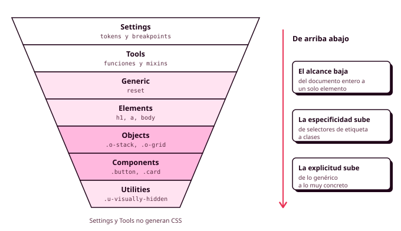

# 4. Arquitectura ITCSS

Con Sass ya puedes repartir tu hoja de estilos en muchos ficheros, pero queda una pregunta sin respuesta obvia: **qué va en cada fichero y en qué orden se cargan**. Si cada persona del equipo lo decide sobre la marcha, al cabo de un mes nadie sabe dónde está el estilo del botón de reservar, hay tres ficheros que tocan los enlaces y empiezan a aparecer los `!important`. **ITCSS** es un criterio para tomar esas decisiones siempre igual, de modo que cualquiera que abra el proyecto sepa dónde buscar y dónde escribir (RA2-e, RA2-j).

ITCSS significa *Inverted Triangle CSS*, CSS en triángulo invertido. Lo propuso Harry Roberts, un consultor británico de CSS, y consiste en una forma de ordenar el código, sin nada que instalar.



## La idea del triángulo

ITCSS ordena el código en **capas**, de arriba abajo, siguiendo una regla sencilla: **primero lo que afecta a todo y después lo que afecta a muy poco**. Arriba están el reset y los estilos de las etiquetas, que tocan toda la página con selectores muy simples. Abajo están los componentes y las clases de ayuda, que tocan elementos concretos con clases.

Ordenado así, cada regla puede sobrescribir a las anteriores sin trucos, porque la especificidad va subiendo poco a poco a medida que bajas por el fichero. Ese es justo el problema que la cascada causa en las hojas de estilos desordenadas, y el que ITCSS evita.

## Las siete capas

| Capa | Qué contiene | Genera CSS | Ejemplo del polideportivo |
|---|---|---|---|
| **Settings** | Los datos del sistema | Solo los tokens | Mapas de colores, breakpoints, propiedades personalizadas |
| **Tools** | Funciones y mixins | No | `rem()`, `focus-ring`, `from()` |
| **Generic** | El reset | Sí | `box-sizing`, márgenes del `body` |
| **Elements** | El estilo base de cada etiqueta, **sin clases** | Sí | `body`, `h1`, `a` |
| **Objects** | Patrones de colocación **sin aspecto** | Sí | `.o-stack`, `.o-grid` |
| **Components** | Las piezas del sistema | Sí | `.button`, `.card`, `.slot` |
| **Utilities** | Clases de una sola función | Sí | `.u-visually-hidden` |

### Settings y Tools

Son las dos capas que no generan CSS, salvo el fichero que convierte los tokens en propiedades personalizadas. **Settings** guarda los datos del sistema (los mapas de colores, el espaciado, los breakpoints) y **Tools**, las funciones y los mixins. Cualquier otro fichero puede cargarlas con `@use`.

### Generic y Elements

**Generic** contiene el reset, que afecta a todo el documento:

```scss
// generic/_reset.scss
*, *::before, *::after { box-sizing: border-box; }
body { margin: 0; }
img, picture, video, svg { display: block; max-width: 100%; height: auto; }
input, button, textarea, select { font: inherit; }
ul[role="list"], ol[role="list"] { margin: 0; padding: 0; list-style: none; }
```

**Elements** da el estilo base a cada etiqueta, el que tendrá en cualquier sitio donde nadie diga lo contrario. Su regla es estricta: **aquí solo hay selectores de etiqueta**, nunca clases.

```scss
// elements/_headings.scss
h1 { font: var(--font-heading-1); }
h2 { font: var(--font-heading-2); }
h3 { font: var(--font-heading-3); }
```

### Objects

Los **objetos** son patrones de colocación sin colores, bordes ni tipografía: solo deciden dónde van las cosas y cuánto espacio hay entre ellas. Son el equivalente de los marcos de Auto layout sin relleno que usabas en Figma para agrupar elementos.

```scss
// objects/_stack.scss: elementos uno debajo de otro
.o-stack {
  display: flex;
  flex-direction: column;
  gap: var(--stack-gap, var(--space-4));
}

// objects/_grid.scss: tantas columnas como quepan
.o-grid {
  display: grid;
  grid-template-columns: repeat(auto-fit, minmax(16rem, 1fr));
  gap: var(--space-4);
}
```

`var(--stack-gap, var(--space-4))` da una separación por defecto que quien usa el objeto puede cambiar sin tocarlo. En el polideportivo, `.o-grid` coloca el listado de pistas y `.o-stack` el formulario de reserva, y los dos se reutilizan en otras pantallas.

### Components

Es la capa donde pasarás más tiempo. Contiene **las piezas de tu sistema de diseño**, las mismas que tienes como componentes en Figma, **una por fichero**. Cada componente lleva todo lo que lo define (su aspecto, sus partes, sus variantes y sus estados), y lo verás en detalle en el apartado 8.

Un componente **no decide dónde se coloca**: no lleva márgenes exteriores ni anchos fijos. Lo coloca el objeto que lo contiene, y por eso la misma tarjeta funciona en el listado y en el resumen lateral.

### Utilities

Clases de una sola función que tienen que ganar siempre, como `.u-visually-hidden`, que oculta un texto a la vista pero lo deja para los lectores de pantalla. Úsalas poco: si una pantalla necesita muchas, lo que le falta es un componente.

## Dónde va cada cosa

Cuando dudes, hazte estas preguntas en orden:

1. ¿Genera CSS? Si no, es **Settings** o **Tools**.
2. ¿Usa clases? Si no, es **Generic** o **Elements**.
3. ¿Solo coloca, sin color ni bordes? Entonces es un **objeto**.
4. ¿Es una pieza con nombre en tu Figma? Entonces es un **componente**.
5. ¿Es una sola función que tiene que ganar siempre? Es una **utilidad**.

## Carpetas y `main.scss`

En Sass, cada capa es una carpeta, y `main.scss` las carga en el orden del triángulo. Si además envuelves cada capa en una **capa de cascada** (`@layer`), el propio navegador garantiza ese orden, aunque algún selector tenga más especificidad de la cuenta.

```text
scss/
├── main.scss
├── settings/     _tokens.scss, _breakpoints.scss, _custom-properties.scss
├── tools/        _functions.scss, _mixins.scss
├── generic/      _reset.scss
├── elements/     _page.scss, _headings.scss, _links.scss
├── objects/      _container.scss, _stack.scss, _cluster.scss, _grid.scss
├── components/   _button.scss, _card.scss, _field.scss...
└── utilities/    _visually-hidden.scss
```

```scss
// main.scss
@use "sass:meta";

@layer settings, generic, elements, objects, components, utilities;

@layer settings   { @include meta.load-css("settings/custom-properties"); }
@layer generic    { @include meta.load-css("generic/reset"); }
@layer elements   { @include meta.load-css("elements/page"); /* ... */ }
@layer objects    { @include meta.load-css("objects/stack"); /* ... */ }
@layer components { @include meta.load-css("components/index"); }
@layer utilities  { @include meta.load-css("utilities/visually-hidden"); }
```

La primera línea con `@layer` declara el orden. Como `@use` no se puede escribir dentro de un `@layer`, cada carpeta se carga con `meta.load-css()`. Tools no aparece porque no genera CSS: cada componente la carga con su propio `@use`.

Esta organización es la que permite trabajar en equipo: cada persona sabe en qué carpeta escribir, cada componente está en su fichero y nadie necesita tocar el de los demás.

## Prefijos

En este módulo, los objetos llevan el prefijo **`o-`** y las utilidades **`u-`**, para que al leer el HTML se sepa de dónde viene cada clase. Los componentes van sin prefijo, para que su nombre coincida con el de Figma (`button`, `card`).

## Errores frecuentes

- **Clases en la capa Elements.** `.card h3` en `elements/` mete un componente donde no toca.
- **Aspecto en los objetos.** Un `.o-stack` con color de fondo deja de ser reutilizable.
- **Componentes que se colocan solos.** Un `margin-top` en la tarjeta funciona en un sitio y estorba en otro.
- **Componentes que cambian a otros.** `.card .button` ata los dos componentes. La variante del botón se elige en el HTML.
- **Un fichero para todos los componentes.** Un componente, un fichero.

??? info "Para saber más: capas y `!important`"

    Con las capas de cascada, una declaración normal de una capa posterior gana a una anterior. Con `!important` ocurre al revés: **un `!important` de una capa anterior gana a todo lo que venga después**, incluidas las utilidades. Es otra razón para no usar `!important` en tu proyecto.

??? info "Para saber más: por qué no usamos un framework de CSS"

    Un framework de CSS completo trae cientos de componentes y miles de clases pensadas para cualquier proyecto, y si no se configura con cuidado, la mayor parte llega al navegador sin usarse. Con ITCSS y tus propios tokens solo escribes lo que tu sistema necesita: el CSS completo del polideportivo ocupa unos 10 KB comprimido, menos que una fotografía. Las **WSG** piden precisamente no enviar código que no se usa.

## Antes de seguir

Comprueba que:

1. Tu carpeta `scss` tiene **una carpeta por capa**, cargadas en el orden del triángulo.
2. En Generic y Elements **no hay ninguna clase**.
3. Los objetos **solo colocan** y llevan el prefijo `o-`.
4. Cada componente está **en su propio fichero**, sin márgenes exteriores ni anchos fijos.
5. No hay ningún `!important`.

## Recursos

- [ITCSS: Scalable and Maintainable CSS Architecture (Xfive)](https://www.xfive.co/blog/itcss-scalable-maintainable-css-architecture/)
- [Capas de cascada, `@layer` (MDN Web Docs)](https://developer.mozilla.org/es/docs/Web/CSS/@layer)
