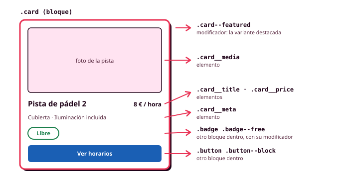

# 5. Nomenclatura BEM

Con ITCSS ya sabes en qué fichero va cada regla, pero vas a tomar cientos de veces otra decisión: **cómo se llama cada clase**. Si el título de la tarjeta se llama `.titulo`, chocará con el del diálogo; si se llama `.card .title`, tendrá más especificidad que el resto; y si cada persona del equipo nombra a su manera, nadie encontrará nada. **BEM** es una convención para poner nombres que resuelve esos problemas, y en este módulo es la forma de nombrar las clases de tus componentes (RA2-g).

BEM significa *Block, Element, Modifier* (bloque, elemento y modificador). Lo creó el equipo de Yandex para mantener interfaces enormes con mucha gente trabajando a la vez, y encaja de forma natural con tu sistema de Figma: **cada componente es un bloque, sus capas son elementos y sus variantes son modificadores**.



## Bloque, elemento y modificador

| Parte | Qué es | Cómo se escribe | Ejemplo |
|---|---|---|---|
| **Bloque** | Un componente que funciona por sí solo | `bloque` | `.card`, `.button` |
| **Elemento** | Una parte del bloque que no tiene sentido fuera de él | `bloque__elemento` (dos guiones bajos) | `.card__title`, `.card__price` |
| **Modificador** | Una variante del bloque o del elemento | `bloque--modificador` (dos guiones) | `.card--featured`, `.button--danger` |

```html
<article class="card card--featured">
  <div class="card__header">
    <h3 class="card__title">Pista de pádel 2</h3>
    <p class="card__price">8 € / hora</p>
  </div>
  <p class="card__meta">Cubierta · Iluminación incluida</p>
</article>
```

Las palabras se escriben **en minúsculas y separadas por un guion** (`main-nav__link`), y en inglés, igual que los tokens. Los dobles guiones resultan raros al principio, pero a cambio sabes qué es cada clase con solo leerla, y encuentras todo lo de un componente buscando `card__` en el proyecto.

El nombre resuelve los tres problemas del principio: `.card__title` y `.dialog__title` no pueden chocar, todos los selectores tienen **una sola clase** y la misma especificidad, y cualquier persona del equipo nombra igual.

## Cinco reglas

1. **Un elemento pertenece al bloque, nunca a otro elemento.** El título se llama `.card__title` aunque esté dentro de la cabecera, nunca `.card__header__title`. Así puedes moverlo sin cambiarle el nombre.
2. **Un modificador siempre acompaña a la clase base**: `class="button button--danger"`. El modificador solo describe lo que cambia, y todo lo demás está en `.button`.
3. **Un bloque no depende de dónde está.** Nada de `.sidebar .card`. Si la tarjeta tiene que verse distinta, es un modificador o una container query.
4. **Nombres por la función.** `.button--danger` en lugar de `.button-red`, que dejaría de tener sentido si cambias el color.
5. **Una sola clase por selector**, salvo las pseudoclases y los atributos de estado (`.button:hover`).

## Estados

Las variantes que se eligen al escribir el HTML (el botón de peligro) son **modificadores**. Los estados que cambian mientras se usa la aplicación (una hora seleccionada, la pantalla actual del menú) se expresan, por este orden de preferencia:

1. Con una **pseudoclase**, si existe: `:checked`, `:disabled`, `:focus-visible`.
2. Con un **atributo de ARIA**, si el estado tiene que anunciarse: `[aria-current="page"]`, `[aria-expanded="true"]`.
3. Con una **clase de estado** (`.is-loading`), solo si no hay otra opción.

```scss
.main-nav__link {
  &[aria-current="page"] { color: var(--color-primary); }
}
```

Con `aria-current`, el lector de pantalla también sabe cuál es la pantalla actual, cosa que una clase `--active` no le dice.

## De Figma a BEM

Si tus componentes de Figma tienen nombres claros, ya tienes casi todos los nombres de BEM:

| En Figma | En BEM |
|---|---|
| Nombre del componente (`Card`) | Bloque (`.card`) |
| Capas con nombre (`Title`, `Price`) | Elementos (`.card__title`, `.card__price`) |
| Propiedad de variante (`Type=Danger`) | Modificador (`.button--danger`) |
| Propiedad de estado (`State=Hover`) | Pseudoclase o atributo (`:hover`) |

Para que funcione, **las capas de tus componentes en Figma tienen que tener nombre**. Renómbralas con los mismos nombres que tendrán en el código, y el diseño y el código hablarán el mismo idioma, igual que con los tokens.

## BEM con Sass y con tokens

Con Sass, cada componente se escribe en un único bloque gracias a `&__` y `&--`, y sus modificadores solo cambian los tokens de componente que necesitan:

```scss
.button {
  --button-bg: var(--color-primary);
  --button-fg: var(--color-on-primary);

  background-color: var(--button-bg);
  color: var(--button-fg);

  &__icon { inline-size: 1.25rem; }

  &--danger {
    --button-bg: var(--color-error);
    --button-fg: var(--color-on-error);
  }
}
```

Un modificador ocupa dos o tres líneas y nunca repite lo que ya está en el bloque.

??? info "Para saber más: mezclas"

    A veces un mismo nodo es una parte de un bloque y, a la vez, un bloque en sí mismo. El resumen de la reserva es un elemento de la pantalla (su posición la decide la pantalla) y es también una tarjeta (su aspecto lo decide la tarjeta). BEM lo resuelve poniéndole las dos clases: `<aside class="booking__summary card">`. Así un bloque coloca a otro sin tocar su aspecto.

## BEM y `@scope`

Desde finales de 2025, CSS tiene una herramienta propia para que las reglas de una parte de la página no afecten al resto: la regla **`@scope`**, que ya funciona en todos los navegadores principales. Limita un bloque de reglas a lo que hay dentro de un elemento, que se llama **raíz** y se selecciona con `:scope`:

```css
@scope (.prose) {
  :scope { max-width: 65ch; }
  h2 { font: var(--font-heading-2); }
  a  { color: var(--color-primary); }
}
```

Solo los `<h2>` y los `<a>` que están dentro de `.prose` reciben esos estilos, y además **la raíz no suma especificidad**: dentro del ámbito, `a` sigue valiendo como una etiqueta, así que cualquier componente puede sobrescribirlo con una clase.

En este módulo **seguimos usando BEM para los componentes**, porque los nombres dicen qué es cada cosa, se corresponden con las capas de Figma y no dependen de la etiqueta. `@scope` es la herramienta para **el contenido en el que no se pueden poner clases**, y estos son sus tres usos más claros:

!!! example "Ejemplo 1: el texto de las normas de uso"

    Las normas de uso de las pistas son un texto con títulos, listas y enlaces que llega de un editor o de una base de datos, sin clases. Con el bloque `@scope (.prose)` de arriba, reciben su estilo, y el enlace de la cabecera, que está fuera de `.prose`, no cambia.

!!! example "Ejemplo 2: un componente dentro del texto"

    Si en medio de las normas aparece un aviso de tu sistema, las reglas de `.prose` también le afectarían. Con **`to`** se pone un límite inferior, y las reglas se detienen al llegar a él:

    ```css
    @scope (.prose) to (.alert, .card, .dialog) {
      p { color: var(--color-on-surface); }
      a { color: var(--color-primary); }
    }
    ```

    El aviso conserva el aspecto que tiene en cualquier otra pantalla.

!!! example "Ejemplo 3: zonas claras dentro de zonas oscuras"

    En la pantalla de inicio hay una franja oscura con la oferta de verano, y dentro, una tarjeta clara. Con selectores normales, un enlace de la tarjeta clara cumple las dos reglas y gana la escrita después, así que puede quedar azul claro sobre fondo claro:

    ```css
    /* Sin @scope: gana la regla escrita después */
    .surface-light a { color: var(--blue-500); }
    .surface-dark a  { color: var(--blue-200); }
    ```

    Con `@scope`, cuando dos reglas empatan, **gana la de la raíz más cercana** al elemento. Es el criterio de **proximidad**, y hace que cada enlace tome el color de la zona que lo rodea:

    ```css
    /* Con @scope: gana la zona más cercana */
    @scope (.surface-light) { a { color: var(--blue-500); } }
    @scope (.surface-dark)  { a { color: var(--blue-200); } }
    ```

Sass entiende `@scope` y lo pasa tal cual al CSS. En tu arquitectura de ITCSS, un bloque como `.prose` va en la capa de componentes, en su propio fichero.

## Errores frecuentes

| Así no | Así sí |
|---|---|
| `.card__header__title` | `.card__title` |
| `class="button--danger"` | `class="button button--danger"` |
| `.sidebar .card { ... }` | `.card--compact` o una container query |
| `.button-red` | `.button--danger` |
| `.card h3 { ... }` | `.card__title { ... }` |
| `.main-nav__link--active` | `.main-nav__link[aria-current="page"]` |

## Antes de seguir

Revisa el HTML y el SCSS de tus componentes:

1. Cada componente de Figma tiene **un bloque con el mismo nombre**.
2. Ningún nombre encadena **dos elementos**.
3. Los modificadores van **junto a su clase base**.
4. Los estados usan **pseudoclases o atributos** siempre que existan.
5. Todos los selectores tienen **una sola clase**.

## Recursos

- [BEM: introducción (getbem.com)](https://getbem.com/introduction/)
- [`@scope` (MDN Web Docs)](https://developer.mozilla.org/en-US/docs/Web/CSS/@scope)
