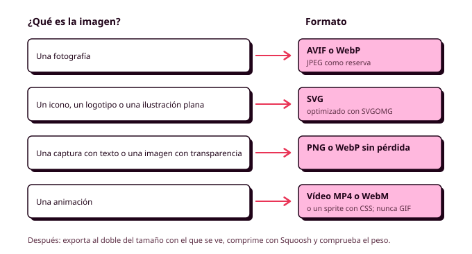

# 6. Multimedia y ecodiseño

En casi cualquier página web, lo que más pesa son las imágenes, los vídeos y las fuentes, muy por encima del HTML y del CSS. Tu hoja de estilos completa puede ocupar 10 KB, y una sola foto de la pista de pádel sacada con el móvil y subida tal cual, 4 MB. Esa foto la descarga Lucía cada vez que abre la aplicación desde el polideportivo, donde la cobertura es regular, y cada megabyte que viaja por la red y se procesa en su móvil consume energía, gasta batería y gasta datos de su tarifa. En este apartado vas a aprender a elegir el formato de cada archivo, a prepararlo para la web y a integrarlo en tus pantallas de forma que pese lo mínimo sin perder calidad, y también a usarlo respetando los derechos de quien lo creó (RA3, RA4).

Es también el apartado en el que el **ecodiseño** pesa más dentro de esta órbita. Las Web Sustainability Guidelines del W3C (**WSG**) dedican varios criterios a la multimedia (usar formatos modernos, servir cada archivo a su tamaño, cargar solo lo que se ve, no reproducir vídeo de forma automática y ofrecer alternativas cuando algo no carga), y todos ellos coinciden con lo que hace que una aplicación cargue rápido y funcione para todo el mundo.



## Por qué importa el peso

El peso de una página se mide en kilobytes (KB) o megabytes (MB), y es la suma de todo lo que el navegador tiene que descargar para mostrarla. Afecta a tus personas de tres formas:

- **Tiempo.** Con una conexión lenta, cada megabyte puede tardar varios segundos en llegar. Si la pantalla de "Elegir hora" tarda en aparecer, Lucía no sabe si la aplicación funciona y vuelve a pulsar, o la cierra.
- **Datos y dinero.** Muchas personas tienen tarifas con pocos datos, y cada visita les cuesta una parte. Una aplicación pesada es más cara de usar para quien menos tiene.
- **Energía.** Transmitir datos por la red y procesarlos en el dispositivo consume electricidad, en el móvil, en las antenas y en los servidores. Cuanto menos pesa una página, menos energía consume cada visita, y en una aplicación que se usa a diario esa diferencia se multiplica.

En la Órbita 1 anotaste en la ficha de cada persona su conexión y su dispositivo habituales. Ese dato es el que tienes que usar ahora: **la persona con peor conexión es la que marca el peso máximo de tu aplicación**.

## El presupuesto de peso

Un **presupuesto de peso** (*performance budget*) es un límite que te pones antes de maquetar y que no puedes superar. Funciona igual que cualquier presupuesto: si una imagen nueva se pasa del límite, o la optimizas más o quitas otra cosa. Sirve para que el peso sea una decisión de diseño que tomas con criterio desde el principio, antes de que la página se vuelva lenta.

Para el polideportivo, pensando en Lucía, un presupuesto razonable sería que **ninguna pantalla supere los 500 KB en total** la primera vez que se carga, y que ninguna imagen supere los 150 KB. El número exacto depende de tu proyecto y de tus personas, y lo importante es que puedas explicar de dónde sale. En la auditoría oral te puedo preguntar cuánto pesa una de tus pantallas y por qué, y la respuesta tendrá que apoyarse en tus personas.

Para saber cuánto pesa una pantalla, abre el inspector, ve a la pestaña **Red** (*Network*), marca la casilla **Desactivar caché** y recarga la página. En la parte de abajo verás el total transferido, y en la lista, el peso de cada archivo, que puedes ordenar de mayor a menor para encontrar los que más pesan. En la misma pestaña puedes simular una conexión lenta (por ejemplo, *Slow 4G*) para ver la pantalla como la vería Lucía.

## Formatos de imagen

Cada formato de imagen está pensado para un tipo de contenido, y elegir el adecuado puede reducir el peso de un archivo a la mitad o a la décima parte sin que se note la diferencia.

| Formato | Para qué sirve | Ventajas | Inconvenientes |
|---|---|---|---|
| **AVIF** | Fotografías e imágenes complejas | El que menos pesa con la misma calidad | Tarda más en comprimirse |
| **WebP** | Fotografías e imágenes con transparencia | Mucho más ligero que JPEG y PNG | Algo más pesado que AVIF |
| **JPEG** | Fotografías, como formato de reserva | Compatible con absolutamente todo | Pesa más que los formatos modernos y no admite transparencia |
| **PNG** | Capturas de pantalla, imágenes con texto o transparencia | Sin pérdida de calidad | Pesa mucho con fotografías |
| **SVG** | Iconos, logotipos, ilustraciones sencillas, gráficos | Es código, se ve nítido a cualquier tamaño y pesa muy poco | Solo sirve para gráficos vectoriales, no para fotos |
| **GIF** | Prácticamente nada hoy | Compatible con todo | Pesa muchísimo en animaciones y tiene solo 256 colores |

AVIF y WebP funcionan en todos los navegadores actuales, así que **son los formatos por defecto para las fotografías** de tu proyecto. Para los iconos y el logotipo, usa siempre SVG. Y si alguna vez piensas en un GIF animado, usa en su lugar un vídeo corto, que con la misma duración puede pesar diez veces menos.

Los formatos se distinguen también por cómo comprimen. Los formatos **con pérdida** (JPEG, WebP y AVIF en su modo habitual) descartan información que el ojo apenas percibe, y te dejan elegir un nivel de calidad: entre 60 y 80 sobre 100 suele ser imposible de distinguir del original en una pantalla. Los formatos **sin pérdida** (PNG, y WebP en su modo sin pérdida) conservan cada píxel, y son los adecuados cuando la imagen tiene texto o bordes muy definidos, que con pérdida se verían borrosos.

## Tamaño y resolución

El error más frecuente con las imágenes es usar un archivo mucho más grande de lo que se va a ver. Una foto de 4000 píxeles de ancho mostrada en una tarjeta de 400 píxeles se ve exactamente igual que una de 800, pero pesa unas veinticinco veces más. El navegador la descarga entera y después la reduce, así que todo ese peso se gasta para nada.

La regla práctica es exportar cada imagen **al doble del tamaño máximo con el que se va a mostrar**. El doble, porque las pantallas de los móviles actuales tienen más píxeles físicos que píxeles de CSS (es lo que se llama densidad de píxeles), y una imagen exactamente al tamaño de CSS se vería algo borrosa en ellas. Si la imagen de la tarjeta de pista ocupa como mucho 400 píxeles de ancho en tu diseño, el archivo tiene que tener 800.

Para preparar las imágenes vas a usar tres herramientas gratuitas que funcionan en el navegador (RA3-c, RA3-d):

- **Squoosh** (squoosh.app) cambia el tamaño, el formato y la calidad de una imagen, y te enseña el original y el resultado uno al lado del otro, con el peso de cada uno. Es la herramienta principal para las fotografías.
- **SVGOMG** (svgomg.net) optimiza los archivos SVG, eliminando la información que añaden los programas de diseño y que el navegador no necesita. Un icono exportado de Figma suele quedarse en la mitad de su peso.
- **Photopea** (photopea.com) es un editor de imágenes parecido a Photoshop, para recortar, retocar o ajustar el color de una imagen antes de optimizarla.

Desde Figma también puedes exportar directamente cualquier capa, eligiendo el formato y la escala (por ejemplo, `2x`) en el panel **Export**. Para las fotografías, exporta en PNG o JPEG a buena calidad y optimízalas después con Squoosh, porque Figma no comprime tanto como las herramientas especializadas.

Cuando trates las imágenes, recuerda que también forman parte de tu sistema visual (RA3-h): usa las proporciones que definiste en la Órbita 2 (por ejemplo, 16:9 para las fotos de las pistas), aplica los radios de tus tokens y mantén un mismo tratamiento de color en todas las fotos.

## Imágenes adaptables

Una sola imagen al doble de su tamaño máximo sigue siendo demasiado grande para un móvil si en escritorio se ve mucho más ancha. Para resolverlo, HTML permite ofrecer varias versiones de la misma imagen y dejar que el navegador elija la que necesita.

### Varios tamaños con `srcset` y `sizes`

El atributo **`srcset`** da una lista de archivos con su ancho real en píxeles, y el atributo **`sizes`** le dice al navegador qué ancho ocupará la imagen en la pantalla según el tamaño de la ventana. Con esos dos datos y la densidad de la pantalla, el navegador elige el archivo más pequeño que se verá nítido.

```html
= 64rem) 25rem, 100vw"
     alt="Pista de pádel cubierta con paredes de cristal"
     width="1200" height="675"
     loading="lazy">
```

En este ejemplo, `sizes` dice que en pantallas de 64rem o más la imagen ocupa 25rem, y que en las demás ocupa todo el ancho. Un móvil de 360 píxeles con densidad doble descargará la versión de 800, y un monitor, la de 400 o la de 800 según su densidad. `src` queda como imagen de reserva.

### Varios formatos con `<picture>`

El elemento **`<picture>`** permite ofrecer la misma imagen en varios formatos, de modo que el navegador use el primero que entienda. Es útil si quieres servir AVIF, que es el más ligero, y dejar WebP o JPEG como reserva.

```html
<picture>
  <source srcset="img/polideportivo.avif" type="image/avif">
  <source srcset="img/polideportivo.webp" type="image/webp">
  
</picture>
```

El `` del final es obligatorio: es el que lleva el `alt`, el tamaño y el estilo, y el que se muestra si el navegador no entiende ninguno de los formatos anteriores. `<picture>` también sirve para la **dirección de arte**, es decir, para mostrar un recorte distinto de la foto en el móvil (más cerrado, para que se vea la pista y no el aparcamiento), usando `media` en cada `<source>`.

## Cómo se cargan las imágenes

Además de elegir el archivo, puedes decirle al navegador cuándo y cómo cargarlo. En el repaso de HTML5 viste los atributos básicos, y aquí tienes su efecto en el peso:

- **`loading="lazy"`** hace que la imagen solo se descargue cuando está a punto de aparecer en pantalla. En un listado de diez pistas, si Lucía solo ve las tres primeras, las otras siete no se descargan. Las **WSG** lo recomiendan expresamente. No lo pongas en la imagen principal, la que se ve al abrir la pantalla, porque retrasaría justo la que más importa.
- **`fetchpriority="high"`** hace lo contrario: le dice al navegador que esa imagen es la más importante y que la descargue antes que las demás. Úsalo solo en la imagen principal de cada pantalla, si la hay.
- **`width` y `height`** permiten al navegador reservar el hueco de la imagen antes de descargarla, para que el contenido no salte mientras se carga. Con `aspect-ratio` en el CSS consigues lo mismo en las imágenes que cambian de tamaño.
- **Un color de fondo** en el contenedor de la imagen (`background-color: var(--color-surface-raised)`) hace que el hueco se vea como parte del diseño mientras la imagen llega, o si no llega nunca.

## Iconos y gráficos en SVG

Un SVG es un archivo de texto que describe formas, así que se ve nítido a cualquier tamaño y, después de pasar por SVGOMG, un icono ocupa unos pocos cientos de bytes. Hay tres formas de usarlo en tus pantallas:

- **Con ``**, como cualquier imagen. Es lo más sencillo, pero el icono no puede cambiar de color con el CSS.
- **Dentro del HTML** (`<svg>...</svg>`). El icono hereda el color del texto si sus trazos usan `fill="currentColor"` o `stroke="currentColor"`, así que cambia solo con el modo oscuro y con los estados de los componentes. Es la forma más habitual para los iconos de la interfaz.
- **Con un sprite**, un único archivo SVG con todos los iconos dentro, cada uno con un `id`, que se usan con `<svg><use href="img/iconos.svg#reloj"></use></svg>`. El navegador descarga el archivo una sola vez y reutiliza cada icono todas las veces que aparece.

```html
<button class="button" type="button">
  <svg class="button__icon" aria-hidden="true"><use href="img/iconos.svg#calendar"></use></svg>
  Cambiar día
</button>
```

Recuerda lo que viste en el repaso de HTML5: si el icono va junto a un texto que dice lo mismo, lleva `aria-hidden="true"`; si va solo, el botón que lo contiene necesita un nombre accesible.

## Vídeo

El vídeo es, con mucha diferencia, el contenido más pesado de la web, así que antes de añadir uno pregúntate si de verdad aporta algo que no pueda contar una imagen o un texto. Si la respuesta es sí (por ejemplo, un vídeo corto que enseña cómo llegar a las pistas cubiertas), el elemento **`<video>`** te permite integrarlo sin depender de ninguna plataforma externa (RA4-e).

```html
<video controls preload="none" width="1280" height="720"
       poster="img/como-llegar-poster.webp">
  <source src="video/como-llegar.webm" type="video/webm">
  <source src="video/como-llegar.mp4" type="video/mp4">
  <track kind="captions" src="video/como-llegar.vtt" srclang="es" label="Español">
  <p>Tu navegador no puede reproducir este vídeo.
     <a href="video/como-llegar.mp4">Descárgalo aquí</a>.</p>
</video>
```

Cada atributo tiene su razón:

- **`controls`** muestra los controles del navegador (reproducir, pausa, volumen, pantalla completa), que ya funcionan con el teclado.
- **`preload="none"`** hace que el navegador no descargue nada del vídeo hasta que la persona pulse reproducir. Junto con **`poster`**, que muestra una imagen fija mientras tanto, es lo que más peso ahorra.
- **Varias fuentes** permiten servir WebM, que suele pesar menos, y dejar MP4 (con el códec H.264) como reserva compatible con todo.
- **`<track>`** añade los subtítulos, que verás con detalle en la Órbita 4.
- **El contenido de dentro** se muestra si el navegador no puede reproducir el vídeo, y es la alternativa que piden las WSG cuando un recurso no carga.

Las **WSG** piden también **no reproducir vídeo de forma automática**. Un vídeo que empieza solo descarga megas que nadie ha pedido, distrae y, si tiene sonido, molesta a cualquiera y entorpece el uso de los lectores de pantalla. Si en algún caso usas un vídeo decorativo que se reproduce solo, tiene que ir sin sonido (`autoplay muted loop playsinline`), ser muy corto y detenerse cuando la persona tenga activada la preferencia de reducir el movimiento.

Si el vídeo está en YouTube o en otra plataforma, insertarlo con su `<iframe>` carga de golpe mucho código de la plataforma, aunque nadie llegue a reproducirlo. Añade siempre `loading="lazy"` al `<iframe>`, o mejor todavía, muestra una imagen del vídeo con un enlace a la plataforma.

## Audio

El audio se integra con el elemento **`<audio>`**, que funciona igual que `<video>`: `controls` para los controles, `preload="none"` para no descargar nada hasta que se pulse y varias `<source>` para ofrecer distintos formatos. MP3 es compatible con todo, y Opus (en un contenedor OGG o WebM) consigue la misma calidad con menos peso. Como con el vídeo, el audio nunca se reproduce solo, y si contiene información (un aviso grabado, una entrevista), necesita una transcripción en texto.

## Animaciones a partir de imágenes fijas

Una animación sencilla (un indicador de carga, una pelota que bota mientras se confirma la reserva) se puede construir con una serie de imágenes fijas en lugar de con un vídeo o un GIF (RA3-f). La técnica clásica es el **sprite animado**: todos los fotogramas se colocan uno al lado de otro en una sola imagen, y el CSS los muestra de uno en uno desplazando el fondo con una animación por pasos.

```scss
.bouncing-ball {
  width: 4rem;
  height: 4rem;
  background: url("../img/pelota-sprite.webp") 0 0 / 32rem 4rem;   // 8 fotogramas de 4rem

  @media (prefers-reduced-motion: no-preference) {
    animation: bounce 0.8s steps(8) infinite;
  }
}

@keyframes bounce {
  to { background-position: -32rem 0; }
}
```

La imagen mide ocho fotogramas de ancho, y la animación la desplaza hacia la izquierda todo su ancho. La función **`steps(8)`** hace que ese desplazamiento ocurra en ocho saltos, de modo que en cada momento se ve un fotograma completo, y como solo se descarga una imagen, el resultado pesa muy poco. Para animaciones de formas sencillas, como un icono que gira, todavía es más ligero animar directamente un SVG con las transiciones y animaciones de los apuntes de CSS3. Y recuerda que toda animación tiene que respetar `prefers-reduced-motion`, como en el ejemplo.

## Cuando algo no carga

Una conexión que se corta, un archivo mal enlazado o un formato que el navegador no entiende pueden dejar un hueco en tu pantalla, y las **WSG** piden que la aplicación siga siendo útil cuando eso ocurre. La mayor parte de las alternativas ya las tienes:

- El **`alt`** de cada imagen, que se muestra en lugar de la imagen si no carga.
- El **color de fondo** del contenedor, que mantiene la composición.
- El **`poster`** y el **contenido de reserva** de los vídeos.
- La **pila tipográfica** con `system-ui` y `sans-serif`, por si la fuente no llega.
- Un **texto o un enlace** junto a cualquier contenido incrustado de otra plataforma.

Para comprobarlo, en la pestaña Red del inspector puedes bloquear un archivo concreto (clic derecho, **Bloquear URL de solicitud**) y recargar la pantalla para ver qué queda.

## Licencias y derechos de autor

Que una imagen aparezca en un buscador no significa que puedas usarla. **Toda obra tiene derechos de autor desde el momento en que se crea**, y solo puedes usarla si su autor te lo permite, ya sea de forma expresa o mediante una licencia (RA3-a). Esto vale para fotografías, ilustraciones, iconos, fuentes, vídeos y música.

Las licencias más habituales para el material que puedes usar en tus proyectos son las **Creative Commons**, que combinan varias condiciones:

| Condición | Significa que... |
|---|---|
| **BY** (atribución) | Tienes que citar al autor |
| **SA** (compartir igual) | Si modificas la obra, tienes que publicarla con la misma licencia |
| **NC** (no comercial) | No puedes usarla con fines comerciales |
| **ND** (sin obras derivadas) | No puedes modificarla, ni siquiera recortarla |
| **CC0** (dominio público) | Puedes usarla como quieras, sin citar a nadie |

Bancos como Unsplash o Pexels tienen sus propias licencias, que permiten usar las fotos gratis con algunas condiciones, y Openverse busca imágenes con licencias abiertas en muchos sitios a la vez. Las librerías de iconos suelen tener licencias de software libre (MIT, Apache o similares), y la mayoría de las fuentes de Google Fonts, la licencia SIL Open Font License. En la Órbita 2 anotaste la licencia de tu librería de iconos, y lo mismo tienes que hacer con cada imagen, vídeo o audio: **de dónde sale, quién es su autor y con qué licencia lo usas**. Es una buena práctica reunir esa información en el `README.md` del repositorio o en un fichero de créditos.

Si generas alguna imagen con una herramienta de IA, anótalo en el `CHANGELOG.md` con la herramienta y lo que le pediste, revisa las condiciones de uso de esa herramienta y ten presente que no debe imitar a un artista concreto ni incluir a personas reales.

## Comprobar en distintos navegadores y dispositivos

La multimedia es la parte de una página que más varía de un navegador a otro, porque depende de los formatos y de los códecs que cada uno entiende. Antes de dar una pantalla por terminada, comprueba que las imágenes, los vídeos y los audios se ven y se reproducen en al menos dos navegadores distintos (por ejemplo, Chrome y Firefox, o Safari si tienes un dispositivo de Apple), en el modo de dispositivo del inspector con un ancho de móvil y, si puedes, en tu propio móvil con los datos móviles en lugar de la wifi (RA4-g).

## Antes de seguir

Antes de pasar al apartado 7, revisa la multimedia de tu pantalla principal:

1. Has decidido un **presupuesto de peso** a partir de la conexión de tus personas, y la pantalla lo cumple.
2. Las fotografías están en **AVIF o WebP**, exportadas como mucho al doble de su tamaño máximo y comprimidas con Squoosh.
3. Los iconos y el logotipo son **SVG optimizados** con SVGOMG.
4. Todas las imágenes tienen **`alt`, `width` y `height`**, y las que no se ven al abrir la pantalla llevan `loading="lazy"`.
5. Ningún vídeo ni audio se **reproduce solo**, y todos tienen `preload="none"`.
6. Sabes **de dónde sale cada archivo** y con qué licencia lo usas.

## Recursos

- [Aprende imágenes (web.dev)](https://web.dev/learn/images?hl=es)
- [Imágenes adaptables (MDN Web Docs)](https://developer.mozilla.org/es/docs/Web/HTML/Responsive_images)
- [Squoosh](https://squoosh.app/), [SVGOMG](https://svgomg.net/) y [Photopea](https://www.photopea.com/)
- [Licencias Creative Commons](https://creativecommons.org/licenses/?lang=es)
- [Openverse](https://openverse.org/es)
- [Web Sustainability Guidelines (W3C)](https://www.w3.org/TR/web-sustainability-guidelines/)
