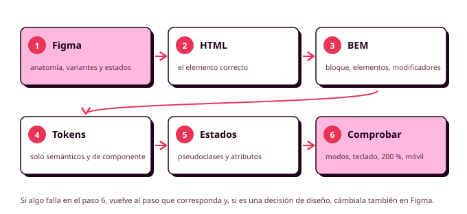

# 7. Componentes: el set mínimo

Casi todas las aplicaciones usan las mismas piezas: botones, campos de formulario, tarjetas, una navegación, etiquetas, diálogos y avisos. Lo que cambia es cómo se ven, y eso ya lo decidiste en tu sistema de Figma. En este apartado ves cómo se construye cada pieza en código, juntando lo anterior: el HTML correcto, los tokens, ITCSS, BEM y los estados.

Los ejemplos son los componentes del polideportivo y son **mínimos a propósito**: tus componentes tienen que salir de tus diseños de Figma, con tus tokens y tus variantes (RA2-f, RA2-g).



## Cómo se construye un componente

Siempre los mismos pasos, en este orden:

1. **Abre el componente en Figma** y apunta sus partes, tokens, variantes y estados.
2. **Escribe el HTML** con el elemento correcto para cada parte.
3. **Pon los nombres de BEM**: bloque, elementos y modificadores.
4. **Escribe el SCSS** en su propio fichero, con tokens.
5. **Añade los estados**: hover, foco, desactivado, error.
6. **Compruébalo** en los dos modos, con el teclado y en móvil.

Te recomiendo una **página de prueba** con todos los componentes y todas sus variantes: cuando cambies un token, verás al momento si has estropeado algo.

!!! tip "Antes de escribir un `<div>`"

    Casi siempre hay un elemento con significado que encaja mejor: `<button>`, `<article>`, `<header>`, `<footer>`, `<nav>`, `<p>`, `<ul>`. Usa un `<div>` solo cuando ninguno sirva.

## Botones

Tres variantes: la principal ("Reservar"), la secundaria ("Ver más horas") y la de peligro ("Cancelar reserva"). Si lleva a otra pantalla es un `<a>`, y si hace algo es un `<button>`: el mismo componente sirve para los dos.

<div class="demo" markdown>
<div class="demo__codigo" markdown>

```html
<button class="button" type="submit">Reservar</button>
<button class="button button--secondary" type="button">Ver más horas</button>
<button class="button button--danger" type="button">Cancelar reserva</button>
```

</div>
<div class="demo__resultado">
  <button class="button" type="button">Reservar</button>
  <button class="button button--secondary" type="button">Ver más horas</button>
  <button class="button button--danger" type="button">Cancelar reserva</button>
  <p class="demo__nota">Pasa el ratón por encima o recórrelos con el tabulador para ver el hover y el foco.</p>
</div>
</div>

```scss
// components/_button.scss
@use "../tools/mixins" as *;

.button {
  // Tokens de componente
  --button-bg: var(--color-primary);
  --button-bg-hover: color-mix(in oklch, var(--color-primary), black 15%);
  --button-fg: var(--color-on-primary);

  display: inline-flex;
  align-items: center;
  justify-content: center;
  min-height: 2.75rem;                    // objetivo táctil de 44 px
  padding: var(--space-3) var(--space-6);
  border: 2px solid var(--button-bg);
  border-radius: var(--radius-md);
  background-color: var(--button-bg);
  color: var(--button-fg);
  font: var(--font-label);
  cursor: pointer;

  &:hover { background-color: var(--button-bg-hover); }
  &:focus-visible { @include focus-ring; }
  &:disabled { opacity: 0.5; cursor: not-allowed; }

  &--secondary {
    --button-bg: transparent;
    --button-bg-hover: color-mix(in oklch, var(--color-primary), transparent 90%);
    --button-fg: var(--color-primary);
  }

  &--danger {
    --button-bg: var(--color-error);
    --button-bg-hover: color-mix(in oklch, var(--color-error), black 15%);
    --button-fg: var(--color-on-error);
  }
}
```

Cada variante solo cambia sus **tokens de componente**, así que el `:hover` se escribe una sola vez.

Un botón con `disabled` no recibe el foco, y quien navega con teclado no sabe que existe. Si es importante que se sepa (el botón "Reservar" antes de elegir hora), déjalo activo y explica qué falta al pulsarlo.

## Campos de formulario

Un campo agrupa la etiqueta, el control y el mensaje de error.

<div class="demo" markdown>
<div class="demo__codigo" markdown>

```html
<div class="field">
  <label class="field__label" for="phone">Teléfono de contacto</label>
  <input class="input" type="tel" id="phone" required aria-describedby="phone-error">
  <p class="field__error" id="phone-error">Escribe un teléfono para poder avisarte.</p>
</div>
```

</div>
<div class="demo__resultado">
  <div class="field">
    <label class="field__label" for="demo-phone">Teléfono de contacto</label>
    <input class="input" type="tel" id="demo-phone" required aria-describedby="demo-phone-error">
    <p class="field__error" id="demo-phone-error">Escribe un teléfono para poder avisarte.</p>
  </div>
  <p class="demo__nota">Escribe algo, bórralo y sal del campo: aparece el error.</p>
</div>
</div>

```scss
// components/_field.scss
@use "../tools/mixins" as *;

.field {
  display: flex;
  flex-direction: column;
  gap: var(--space-1);

  &__label { font: var(--font-label); }

  &__error {
    display: none;
    margin: 0;
    color: var(--color-error);
  }

  &:has(:user-invalid) &__error { display: block; }
}

.input {
  min-height: 2.75rem;
  padding: var(--space-2) var(--space-3);
  border: 1px solid var(--color-outline);
  border-radius: var(--radius-sm);
  background-color: var(--color-surface-raised);
  color: var(--color-on-surface);

  &:focus-visible { @include focus-ring; }
  &:user-invalid { border-color: var(--color-error); border-width: 2px; }
}
```

Tres detalles importantes:

- **El error solo aparece cuando hace falta**, gracias a `:user-invalid` y `:has()`, sin JavaScript. Está asociado al campo con `aria-describedby`, así que el lector de pantalla lo lee, y no depende solo del color: el borde se hace más grueso y aparece un texto.
- **El borde del campo necesita un contraste de 3:1**, que es lo que piden las WCAG para identificar un control.
- **Casillas, botones de opción y listas son los nativos**. Las casillas se colorean con `accent-color: var(--color-primary)`, y las listas conservan el desplegable del sistema, que en el móvil es mucho más cómodo.

## Tarjetas

La tarjeta de pista aparece en el listado, en el resumen de la reserva y en "Mis reservas", así que tiene que funcionar a cualquier ancho y **no decide dónde se coloca**.

<div class="demo" markdown>
<div class="demo__codigo" markdown>

```html
<article class="card">
  
  <header class="card__header">
    <h3 class="card__title">Pista de pádel 2</h3>
    <p class="card__price">8 € / hora</p>
  </header>
  <footer class="card__actions">
    <a class="button" href="/pistas/padel-2">Ver horarios</a>
  </footer>
</article>
```

</div>
<div class="demo__resultado">
  <article class="card">
    <span class="card__media" aria-hidden="true"></span>
    <header class="card__header">
      <h3 class="card__title">Pista de pádel 2</h3>
      <p class="card__price">8 € / hora</p>
    </header>
    <footer class="card__actions">
      <a class="button" href="#tarjetas">Ver horarios</a>
    </footer>
  </article>
  <article class="card card--featured">
    <span class="card__media" aria-hidden="true"></span>
    <header class="card__header">
      <h3 class="card__title">Pista de tenis 1</h3>
      <p class="card__price">12 € / hora</p>
    </header>
    <footer class="card__actions">
      <a class="button" href="#tarjetas">Ver horarios</a>
    </footer>
  </article>
  <p class="demo__nota">A la derecha, la variante <code>card--featured</code>. El degradado sustituye a la foto.</p>
</div>
</div>

```scss
// components/_card.scss
.card {
  display: flex;
  flex-direction: column;
  gap: var(--space-2);
  padding: var(--space-4);
  border: 1px solid var(--color-outline);
  border-radius: var(--radius-md);
  background-color: var(--color-surface-raised);

  &__media { aspect-ratio: 16 / 9; object-fit: cover; }

  &__header {
    display: flex;
    justify-content: space-between;
    align-items: baseline;
  }

  &__title { margin: 0; font: var(--font-heading-3); }
  &__price { margin: 0; font: var(--font-label); }
  &__actions { margin-block-start: auto; }

  &--featured { border: 2px solid var(--color-primary); }
}
```

La imagen lleva `alt=""` porque aquí es decorativa: el nombre de la pista ya está en el título. Con `margin-block-start: auto`, los botones de todas las tarjetas de una cuadrícula quedan a la misma altura.

## Navegación

<div class="demo" markdown>
<div class="demo__codigo" markdown>

```html
<nav class="main-nav" aria-label="Principal">
  <ul class="main-nav__list" role="list">
    <li><a class="main-nav__link" href="/pistas" aria-current="page">Pistas</a></li>
    <li><a class="main-nav__link" href="/reservas">Mis reservas</a></li>
  </ul>
</nav>
```

</div>
<div class="demo__resultado">
  <nav class="main-nav" aria-label="Ejemplo de navegación">
    <ul class="main-nav__list" role="list">
      <li><a class="main-nav__link" href="#navegacion" aria-current="page">Pistas</a></li>
      <li><a class="main-nav__link" href="#navegacion">Mis reservas</a></li>
    </ul>
  </nav>
</div>
</div>

```scss
// components/_nav.scss
@use "../tools/mixins" as *;

.main-nav {
  &__list { display: flex; gap: var(--space-6); }

  &__link {
    display: inline-flex;
    align-items: center;
    min-height: 2.75rem;
    color: var(--color-on-surface);
    font: var(--font-label);
    text-decoration: none;

    &:hover { color: var(--color-primary); }
    &:focus-visible { @include focus-ring; }

    &[aria-current="page"] { color: var(--color-primary); text-decoration: underline; }
  }
}
```

El `<nav>` lleva su `aria-label`, y la pantalla actual se marca con `aria-current="page"`, que además no se distingue solo por el color. Para el móvil, la **barra de pestañas** de abajo sigue el mismo patrón con otro bloque (`.tab-bar`), y cada navegación se muestra o se oculta según el ancho con el mixin de breakpoint: `@include from($bp-md) { display: none; }`. El menú que se abre con un botón necesita JavaScript y gestión del foco, y lo verás en la Órbita 4.

## Etiquetas

Indican un estado, como "Libre" o "Completa". Son el ejemplo más claro de un componente resuelto con **un solo token de componente**:

<div class="demo" markdown>
<div class="demo__codigo" markdown>

```html
<span class="badge badge--free">Libre</span>
```

</div>
<div class="demo__resultado">
  <span class="badge badge--free">Libre</span>
  <span class="badge badge--full">Completa</span>
  <p class="demo__nota">A la derecha, la variante <code>badge--full</code>.</p>
</div>
</div>

```scss
// components/_badge.scss
.badge {
  --badge-color: var(--color-primary);

  display: inline-flex;
  padding: var(--space-1) var(--space-3);
  border: 2px solid var(--badge-color);
  border-radius: var(--radius-full);
  color: var(--badge-color);
  font: var(--font-label);

  &--free { --badge-color: var(--color-success); }
  &--full { --badge-color: var(--color-error); }
}
```

Como el color se usa para el texto, tiene que llegar a 4,5:1 de contraste en los dos modos, y el propio texto dice el estado, así que el color no es la única pista.

## Diálogos

Un diálogo interrumpe lo que la persona está haciendo, así que se usa poco: en el polideportivo, solo para cancelar una reserva. El elemento `<dialog>` resuelve casi todo: al abrirlo con `showModal()`, el navegador lo pone encima, oscurece el fondo, lleva el foco dentro y lo cierra con Escape.

<div class="demo" markdown>
<div class="demo__codigo" markdown>

```html
<button class="button button--danger" type="button" id="open-cancel">Cancelar reserva</button>

<dialog class="dialog" id="cancel-dialog" aria-labelledby="cancel-title">
  <h2 id="cancel-title">¿Cancelar la reserva?</h2>
  <p>Se liberará la pista de pádel 2 el jueves 12 a las 19:00.</p>
  <form class="dialog__actions" method="dialog">
    <button class="button button--secondary">Mantener la reserva</button>
    <button class="button button--danger">Sí, cancelar</button>
  </form>
</dialog>

<script>
  document.getElementById('open-cancel')
    .addEventListener('click', () => document.getElementById('cancel-dialog').showModal());
</script>
```

</div>
<div class="demo__resultado">
  <button class="button button--danger" type="button" onclick="this.nextElementSibling.showModal()">Cancelar reserva</button>
  <dialog class="dialog" aria-labelledby="demo-cancel-title">
    <h2 id="demo-cancel-title">¿Cancelar la reserva?</h2>
    <p>Se liberará la pista de pádel 2 el jueves 12 a las 19:00.</p>
    <form class="dialog__actions" method="dialog">
      <button class="button button--secondary">Mantener la reserva</button>
      <button class="button button--danger">Sí, cancelar</button>
    </form>
  </dialog>
  <p class="demo__nota">Pulsa el botón para abrir el diálogo, y ciérralo con sus botones o con Escape.</p>
</div>
</div>

```scss
// components/_dialog.scss
.dialog {
  width: min(100% - 2 * var(--space-4), 28rem);
  padding: var(--space-6);
  border: none;
  border-radius: var(--radius-lg);
  background-color: var(--color-surface-raised);
  color: var(--color-on-surface);

  &::backdrop { background-color: rgb(0 0 0 / 50%); }

  &__actions { display: flex; justify-content: flex-end; gap: var(--space-2); }
}
```

JavaScript solo hace falta para abrirlo: el formulario con `method="dialog"` lo cierra al pulsar cualquier botón. Fíjate en los textos: "Mantener la reserva" y "Sí, cancelar" dicen exactamente qué pasará, y la opción que no destruye nada no está escondida. Lo revisarás en la auditoría de patrones engañosos de la Órbita 5.

## Avisos

Comunican el resultado de una acción, como que la reserva se ha confirmado:

<div class="demo" markdown>
<div class="demo__codigo" markdown>

```html
<p class="alert alert--success" role="status">
  <strong>Reserva confirmada.</strong> Pádel 2, jueves 12 a las 19:00.
</p>
```

</div>
<div class="demo__resultado">
  <p class="alert alert--success">
    <strong>Reserva confirmada.</strong> Pádel 2, jueves 12 a las 19:00.
  </p>
  <p class="alert alert--error">
    <strong>No se ha podido reservar.</strong> La pista ya está ocupada a esa hora.
  </p>
  <p class="demo__nota">Debajo, la variante <code>alert--error</code>.</p>
</div>
</div>

```scss
// components/_alert.scss
.alert {
  --alert-accent: var(--color-primary);

  margin: 0;
  padding: var(--space-4);
  border-inline-start: 4px solid var(--alert-accent);
  background-color: var(--color-surface-raised);

  &--success { --alert-accent: var(--color-success); }
  &--error   { --alert-accent: var(--color-error); }
}
```

`role="status"` hace que el lector de pantalla lea el aviso cuando termina lo que estaba diciendo, que es lo adecuado para una confirmación. Para un error urgente se usa `role="alert"`, que interrumpe. Lo verás en la Órbita 4.

## Los objetos que los colocan

Ningún componente decide dónde se coloca: eso lo hacen los objetos de ITCSS. Con unos pocos objetos y una docena de componentes construyes todas las pantallas:

```html
<main class="container stack">
  <h1>Elegir hora</h1>
  <ul class="grid" role="list">
    <li><article class="card">...</article></li>
    <li><article class="card card--featured">...</article></li>
  </ul>
</main>
```

Si una pantalla nueva necesita algo que no tienes, pregúntate si es un componente nuevo de tu sistema (y entonces tiene que existir también en Figma) o una variante de uno que ya tienes.

## Antes de seguir

Un componente está terminado cuando:

1. Tiene **el mismo nombre, partes y variantes** que en Figma.
2. Usa **el elemento de HTML correcto**, sin `<div>` de más.
3. Su SCSS está **en su propio fichero**, con **tokens** y selectores de **una sola clase**.
4. Todos sus **estados** funcionan, también con el teclado.
5. Se ve bien en **los dos modos**, con el contraste comprobado.
6. **No decide dónde se coloca.**

Si quieres ver estos mismos componentes en React o en Angular, los tienes en el [anexo](anexo_frameworks.md).

## Recursos

- [El elemento `<dialog>` (MDN Web Docs)](https://developer.mozilla.org/es/docs/Web/HTML/Element/dialog)
- [GOV.UK Design System](https://design-system.service.gov.uk/components/), un sistema de diseño público con componentes accesibles muy bien documentados
