# 7. Del sistema de Figma a la hoja de estilos

En los apartados anteriores has repasado las herramientas: el HTML, el CSS, Sass, ITCSS, BEM y la preparación de las imágenes. En este vas a usarlas juntas sobre tu propio proyecto. Al terminar la Órbita 2 tenías en Figma un sistema visual completo (colores con modo oscuro, escala tipográfica, espaciado, radios, elevación y componentes con sus estados), y aquí vas a ver **cómo se traslada cada pieza al código**. Las decisiones visuales ya están tomadas y justificadas, así que tu trabajo consiste en llevarlas a la hoja de estilos sin perder ninguna por el camino.

Este apartado funciona como una **hoja de ruta para maquetar**. Cómo funciona cada herramienta lo tienes en los apartados anteriores, y aquí te vas a centrar en qué herramienta corresponde a cada pieza de tu sistema. En la auditoría oral te voy a señalar un botón cualquiera de tu aplicación y te voy a preguntar por qué tiene ese relleno y de qué token sale (RA2-f).

Los ejemplos están en CSS, porque así se ve lo que llega al navegador, pero en tu proyecto los escribirás en SCSS, repartidos en las capas de ITCSS y con los nombres de BEM.



## Antes de empezar

Comprueba que te ha quedado lo esencial de los apartados anteriores intentando contestar sin mirar:

1. ¿Cuándo es un `<a>` y cuándo un `<button>` lo que en tu mockup parece un botón?
2. ¿Por qué se da estilo con clases y no con ids?
3. ¿Por qué los tamaños van en `rem`?
4. ¿Cuándo usarías Flexbox y cuándo Grid?

Si alguna se te atasca, vuelve al apartado correspondiente antes de seguir.

## Tokens: de las variables de Figma a CSS

En Figma configuraste la **sintaxis de código** de cada variable, y ahora verás para qué: es el nombre que tendrá en tu hoja de estilos. La regla del módulo es que **cada variable de Figma tiene una propiedad personalizada con el mismo nombre** (RA1-d). En un equipo, esa coincidencia es lo que permite que quien diseña y quien programa hablen del mismo color con la misma palabra.

Los **primitivos** se declaran en `:root` con su valor real, y los **semánticos** apuntan a un primitivo con `var()`. Para el modo oscuro, `light-dark()` recibe el primitivo de cada modo, igual que la tabla de modos de Figma:

```css
:root {
  color-scheme: light dark;

  /* Primitivos */
  --blue-200: #99C1F1;
  --blue-500: #1A5FB4;
  --gray-50:  #F6F5F4;
  --gray-900: #1E1E24;

  /* Semánticos */
  --color-primary:    light-dark(var(--blue-500), var(--blue-200));
  --color-surface:    light-dark(var(--gray-50), var(--gray-900));
  --color-on-surface: light-dark(var(--gray-900), var(--gray-50));
}
```

En tu proyecto no escribirás esto a mano: lo generarás con los mapas y los bucles del apartado de Sass.

La regla de la Órbita 2 sigue en pie: **los componentes usan solo tokens semánticos**. Si en la regla de un botón aparece `var(--blue-500)` o `#1A5FB4`, ese botón no cambiará en el modo oscuro. Para comprobarlo, busca `#` y los nombres de los primitivos en tus ficheros: solo deberían aparecer en Settings.

??? info "Para saber más: un interruptor de modo oscuro"

    Con `color-scheme: light dark`, la aplicación sigue la preferencia del sistema operativo. Si quieres un interruptor para elegir el modo, basta con que cambie un atributo del `<html>` y que una regla fuerce el esquema, porque `light-dark()` obedece siempre a `color-scheme`:

    ```css
    :root[data-theme="light"] { color-scheme: light; }
    :root[data-theme="dark"]  { color-scheme: dark; }
    ```

    Cambiar el atributo es trabajo de JavaScript, que verás en DWEC.

### Tokens de componente

En la Órbita 2 quedó pendiente un tercer nivel de tokens, los **tokens de componente**: variables que solo existen dentro de un componente y apuntan a un semántico. Sirven para que cada variante cambie solo unas pocas variables:

```css
.button {
  --button-bg: var(--color-primary);
  --button-fg: var(--color-on-primary);

  background-color: var(--button-bg);
  color: var(--button-fg);
}

.button--danger {
  --button-bg: var(--color-error);
  --button-fg: var(--color-on-error);
}
```

!!! example "La prueba del color principal"

    En la Órbita 2 comprobaste tu sistema cambiando el color principal en Figma. En el código, la prueba es la misma: selecciona el `<html>` en el inspector, cambia el valor de `--blue-500` y recorre la aplicación. Si queda algún elemento con el azul anterior, hay un valor escrito a mano en algún sitio.

## Tipografía

Cada nivel de tu escala se convierte en un token, y la propiedad `font` permite escribir peso, tamaño, altura de línea y familia en un solo valor:

```css
:root {
  --font-family-base: "Atkinson Hyperlegible", system-ui, sans-serif;
  --font-heading-1: 700 2rem/1.25 var(--font-family-base);   /* 32 / 40 */
  --font-body:      400 1rem/1.5  var(--font-family-base);   /* 16 / 24 */
  --font-label:     600 0.875rem/1.43 var(--font-family-base); /* 14 / 20 */
}
```

Al pasar los valores de Figma hay que hacer dos conversiones:

- **Tamaño en `rem`**: los píxeles entre 16 (32 px son `2rem`). Así la escala respeta la letra al 200 % de Manuel (RA5-a).
- **Altura de línea sin unidad**: la altura entre el tamaño (24 entre 16 son `1.5`).

Para los títulos muy grandes, que en el móvil ocupan demasiado, usa la tipografía fluida con `clamp()` de los apuntes de CSS3.

## Espaciado, radios y elevación

**Ningún relleno, margen o separación se escribe con un número suelto**: todos salen de tu escala de espaciado, en `rem`, igual que los radios y las sombras salen de sus tokens. Si en tu código aparece `padding: 13px`, o es un error o te falta un valor en la escala, y en los dos casos hay que volver a Figma.

```css
:root {
  --space-2: 0.5rem;    /*  8 px */
  --space-4: 1rem;      /* 16 px */
  --radius-md: 0.5rem;
  --elevation-1: 0 1px 3px rgb(0 0 0 / 12%);
}
```

Para separar los elementos de un componente, usa **`gap`** en lugar de márgenes: un margen va pegado al elemento y se lo lleva a cualquier sitio donde lo reutilices, mientras que `gap` lo decide el contenedor. Es la misma idea que el espaciado del Auto layout.

## Del Auto layout a Flexbox

El Auto layout de Figma está basado en Flexbox, así que cada opción tiene su propiedad:

| En Figma (Auto layout) | En CSS (Flexbox) |
|---|---|
| Dirección horizontal o vertical | `flex-direction: row` o `column` |
| Espaciado entre elementos | `gap` |
| Espaciado en **Auto** | `justify-content: space-between` |
| Relleno | `padding` |
| Alineación | `justify-content` y `align-items` |
| *Fill container* | `flex: 1` |
| *Wrap* | `flex-wrap: wrap` |

La tarjeta de pista era en Figma un Auto layout vertical con 16 píxeles de relleno y 8 de separación, con una fila horizontal dentro para el nombre y el precio:

```css
.card {
  display: flex;
  flex-direction: column;
  gap: var(--space-2);
  padding: var(--space-4);
}

.card__header {
  display: flex;
  justify-content: space-between;   /* espaciado "Auto" en Figma */
  align-items: baseline;
}
```

Para comprobarlo, pon el componente de Figma y el inspector uno al lado del otro y compara los valores. El modo Dev de Figma te enseña el CSS de cada capa, pero en píxeles y sin tus tokens, así que úsalo solo para comprobar valores.

## De la retícula a Grid

La retícula de la Órbita 2 (cuatro columnas en el móvil, con medianiles y márgenes de 16 píxeles) se construye con **Grid**:

```css
.o-layout {
  display: grid;
  grid-template-columns: repeat(4, 1fr);
  column-gap: var(--space-4);
  padding-inline: var(--space-4);
  max-width: 75rem;            /* el ancho máximo del contenido en escritorio */
  margin-inline: auto;
}
```

En la práctica, para los listados de tarjetas suele bastar el patrón `repeat(auto-fit, minmax(16rem, 1fr))`, que reparte las tarjetas en tantas columnas como quepan. La retícula de Figma te sirve para comprobar que, a cada ancho, todo cae donde lo dibujaste.

## Breakpoints

El breakpoint correcto es **el ancho en el que tu diseño empieza a verse mal**, y en DIW añadimos un segundo criterio: **tus personas**. Si Lucía usa un móvil de 360 píxeles y Manuel una tableta, esos son los anchos que tienes que cuidar, y el breakpoint estará en algún punto entre los dos.

Escribe el CSS **mobile first**, con los breakpoints en `rem` y con el mixin de breakpoint de Sass, y usa container queries para los componentes que aparecen en sitios de distinto ancho (RA2-i).

## Estados

Cada variante de estado que dibujaste en Figma tiene su selector en CSS:

| Variante en Figma | Selector en CSS |
|---|---|
| Hover | `:hover` |
| Foco | `:focus-visible` |
| Pulsado | `:active` |
| Desactivado | `:disabled` o `[aria-disabled="true"]` |
| Seleccionado | `:checked` o `[aria-pressed="true"]` |
| Error | `:user-invalid` |

**El foco del teclado también es una variante de tu sistema.** Si no la dibujaste en Figma, dibújala ahora, porque en la Órbita 4 recorrerás la aplicación con el tabulador. Y recuerda que ningún estado puede depender solo del color: la hora ocupada se tacha, además de aclararse. En el apartado 8 tienes el código completo de los estados de cada componente.

## Movimiento, impresión y peso

Tres decisiones más completan el paso al código:

- **Movimiento.** Transiciones cortas (entre 150 y 300 milisegundos) sobre propiedades concretas, siempre respetando `prefers-reduced-motion`. Si tu sistema usa siempre las mismas duraciones, conviértelas en tokens.
- **Impresión.** Una hoja `@media print` para que el justificante de la reserva salga limpio (RA2-d).
- **Peso.** Cada componente de Figma tiene una sola regla en el CSS, y no hay reglas para componentes que no existen. La pestaña **Cobertura** del inspector de Chrome te dice qué parte de tu CSS no se usa. Las **WSG** piden que el sistema de diseño sirva precisamente para no duplicar estilos.

## Validar

Pasa tu `main.css` por el [validador del W3C](https://jigsaw.w3.org/css-validator/) y guarda la evidencia (RA2-h). Si marca como error alguna función reciente (`light-dark()`, `@layer`), compruébala en [Baseline](https://web.dev/baseline) y explícalo en tu documentación.

Si usas una IA para escribir o revisar tu CSS, anótalo en el `CHANGELOG.md`. Ten en cuenta que no conoce tus tokens, y que lo que devuelva vendrá lleno de valores escritos a mano que tendrás que sustituir.

## Antes de seguir

Comprueba con tu aplicación que puedes hacer todo esto sin tocar ninguna regla de componente:

1. **Cambiar un primitivo** en el inspector y que el cambio llegue a todas las pantallas.
2. **Pasar al modo oscuro** y que no quede nada ilegible.
3. **Subir la letra al 200 %** y que nada se corte ni se solape.
4. **Recorrer el happy path con el tabulador** viendo el foco en cada paso.
5. **Buscar `#` y `px`** en tu SCSS y que solo aparezcan en Settings y en los bordes de 1 píxel.

Si algo falla, casi siempre es por la misma causa: un valor escrito a mano en lugar de un token.
