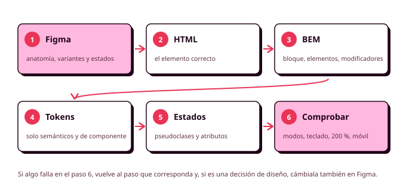

# 8. Componentes: el set mínimo

Casi todas las aplicaciones están construidas con los mismos tipos de pieza: botones, campos de formulario, tarjetas, una navegación, estilos de texto, etiquetas, diálogos y avisos. Lo que cambia de una aplicación a otra es cómo se ven y cómo se combinan, y eso lo decidiste en tu sistema de Figma. En este apartado vas a ver cómo se construye en código cada uno de esos componentes, juntando todo lo anterior: el HTML correcto, los tokens, ITCSS, BEM y los estados.

Los ejemplos son los componentes del polideportivo, y todo el código compila y se ha probado en el navegador en modo claro, en modo oscuro y en móvil. Úsalos como referencia, pero tus componentes tienen que salir de tus diseños de Figma, con tus tokens y tus variantes (RA2-f, RA2-g).



## Cómo se construye un componente

Sigue siempre los mismos pasos, en este orden:

1. **Abre el componente en Figma** y apunta sus partes, sus tokens, sus variantes y sus estados.
2. **Escribe el HTML** con el elemento correcto para cada parte.
3. **Pon los nombres de BEM**: bloque, elementos y modificadores.
4. **Escribe el SCSS** en su propio fichero, con tokens semánticos y tokens de componente.
5. **Añade los estados**: hover, foco, pulsado, desactivado, seleccionado, error.
6. **Compruébalo** en los dos modos, con el teclado, con la letra al 200 % y en móvil.

Como cada componente está en su fichero y sus nombres no chocan, en un equipo cada persona puede construir uno distinto a la vez. Para comprobarlos todos de un vistazo, los equipos suelen tener una **página de prueba** con todos los componentes en todas sus variantes y estados. Te recomiendo hacer una en tu proyecto: cuando cambies un token, sabrás al momento si has estropeado algo.

## Botones

El polideportivo tiene tres variantes: la principal ("Reservar"), la secundaria ("Ver más horas") y la de peligro ("Cancelar reserva"). Si lleva a otra pantalla es un `<a>`, y si hace algo es un `<button>`; el mismo componente sirve para los dos.

```html
<button class="button" type="submit">Reservar</button>
<button class="button button--secondary" type="button">Ver más horas</button>
<button class="button button--danger" type="button">Cancelar reserva</button>
<a class="button button--secondary" href="/reservas">Ver mis reservas</a>
```

```scss
// components/_button.scss
@use "../tools" as *;

.button {
  // Tokens de componente
  --button-bg: var(--color-primary);
  --button-bg-hover: color-mix(in oklch, var(--color-primary), black 15%);
  --button-fg: var(--color-on-primary);
  --button-border: transparent;

  display: inline-flex;
  align-items: center;
  justify-content: center;
  gap: var(--space-2);
  min-height: 2.75rem;                       // objetivo táctil de 44 px
  padding: var(--space-3) var(--space-6);
  border: 2px solid var(--button-border);
  border-radius: var(--radius-md);
  background-color: var(--button-bg);
  color: var(--button-fg);
  font: var(--font-label);
  text-decoration: none;
  cursor: pointer;
  transition: background-color var(--duration-fast) ease;

  &:hover { background-color: var(--button-bg-hover); }
  &:focus-visible { @include focus-ring; }
  &:active { translate: 0 1px; }

  &:disabled,
  &[aria-disabled="true"] {
    opacity: 0.5;
    cursor: not-allowed;
  }

  &__icon { inline-size: 1.25rem; block-size: 1.25rem; }

  &--secondary {
    --button-bg: transparent;
    --button-bg-hover: color-mix(in oklch, var(--color-primary), transparent 90%);
    --button-fg: var(--color-primary);
    --button-border: var(--color-primary);
  }

  &--danger {
    --button-bg: var(--color-error);
    --button-bg-hover: color-mix(in oklch, var(--color-error), black 15%);
    --button-fg: var(--color-on-error);
  }

  &--block { width: 100%; }
}
```

Cada variante solo cambia sus tokens de componente, así que el `:hover` se escribe una vez. El borde de 2 píxeles existe en todas (transparente en la principal) para que las tres midan lo mismo.

Un botón con `disabled` no recibe el foco, así que quien navega con el teclado no sabe que existe ni por qué no puede pulsarlo. Si es importante que se sepa (el botón "Reservar" antes de elegir hora), es mejor dejarlo activo y explicar qué falta al pulsarlo.

## Campos de formulario

Son tres componentes que trabajan juntos: `.field` agrupa la etiqueta, el control, la ayuda y el error; `.input` da estilo a los campos de texto, las listas y las áreas de texto; y `.choice`, a las casillas y los botones de opción.

```html
<div class="field">
  <label class="field__label" for="phone">Teléfono de contacto</label>
  <input class="input" type="tel" id="phone" name="phone" required
         aria-describedby="phone-hint phone-error">
  <p class="field__hint" id="phone-hint">Solo lo usaremos si hay que cancelar la pista.</p>
  <p class="field__error" id="phone-error">Escribe un teléfono para poder avisarte.</p>
</div>

<label class="choice">
  <input class="choice__control" type="checkbox" name="rules" required>
  He leído las normas de uso de la pista
</label>
```

```scss
// components/_field.scss
@use "../tools" as *;

.field {
  display: flex;
  flex-direction: column;
  gap: var(--space-1);

  &__label { font: var(--font-label); }

  &__hint,
  &__error {
    margin: 0;
    font: var(--font-caption);
    color: var(--color-on-surface-variant);
  }

  &__error {
    display: none;
    color: var(--color-error);
  }

  &:has(:user-invalid) &__error { display: block; }
}

.input {
  min-height: 2.75rem;
  padding: var(--space-2) var(--space-3);
  border: 1px solid var(--color-outline);
  border-radius: var(--radius-sm);
  background-color: var(--color-surface-raised);
  color: var(--color-on-surface);

  &:focus-visible {
    @include focus-ring;
    border-color: var(--color-primary);
  }

  &:user-invalid {
    border-color: var(--color-error);
    border-width: 2px;
  }

  &--textarea { min-height: 6rem; resize: vertical; }
}

.choice {
  display: flex;
  align-items: center;
  gap: var(--space-2);
  min-height: 2.75rem;
  cursor: pointer;

  &__control {
    inline-size: 1.25rem;
    block-size: 1.25rem;
    margin: 0;
    accent-color: var(--color-primary);
  }

  &:has(:focus-visible) { @include focus-ring; }
}
```

Tres detalles importantes:

- **El error solo aparece cuando hace falta**, gracias a `:user-invalid` y `:has()`, sin JavaScript. Como está asociado al campo con `aria-describedby`, el lector de pantalla lo lee, y no depende solo del color: el borde se hace más grueso y aparece un texto.
- **El borde del campo tiene 3:1 de contraste**, que es lo que piden las WCAG para identificar un control.
- **Las casillas y los botones de opción son los nativos**, coloreados con **`accent-color`**, y las listas desplegables mantienen el desplegable del sistema, que en el móvil es mucho más cómodo.

### Las píldoras de hora

Visualmente son botones con forma de píldora, pero por dentro son **botones de opción** con el mismo `name`, porque solo se puede elegir una hora. El control se oculta visualmente (sin quitarlo, para que funcione con el teclado) y la etiqueta cambia de aspecto con `:has()`:

```html
<fieldset class="o-cluster">
  <legend class="field__label">Hora</legend>
  <label class="slot"><input class="slot__input" type="radio" name="time" value="18:00"> 18:00</label>
  <label class="slot"><input class="slot__input" type="radio" name="time" value="19:00"> 19:00</label>
  <label class="slot"><input class="slot__input" type="radio" name="time" value="20:00" disabled> 20:00</label>
</fieldset>
```

```scss
// components/_slot.scss
@use "../tools" as *;

.slot {
  display: inline-flex;
  align-items: center;
  min-height: 2.75rem;
  padding: var(--space-2) var(--space-4);
  border: 1px solid var(--color-primary);
  border-radius: var(--radius-full);
  font: var(--font-label);
  cursor: pointer;

  &__input { @include visually-hidden; }

  &:has(:checked) {
    background-color: var(--color-primary);
    color: var(--color-on-primary);
  }

  &:has(:focus-visible) { @include focus-ring; }

  &:has(:disabled) {
    opacity: 0.5;
    text-decoration: line-through;   // la hora ocupada no depende solo del color
    cursor: not-allowed;
  }
}
```

Con botones de opción nativos, el teclado funciona como se espera: el tabulador entra en el grupo, las flechas pasan de una hora a otra y las ocupadas se saltan solas.

## Tarjetas

La tarjeta de pista aparece en el listado, en el resumen de la reserva y en "Mis reservas", así que tiene que funcionar a cualquier ancho y **no decide dónde se coloca**.

```html
<article class="card">
  
  <div class="card__header">
    <h3 class="card__title">Pista de pádel 2</h3>
    <p class="card__price">8 € / hora</p>
  </div>
  <p class="card__meta">Cubierta · Iluminación incluida</p>
  <span class="badge badge--free">Libre</span>
  <div class="card__actions">
    <a class="button button--block" href="/pistas/padel-2">Ver horarios</a>
  </div>
</article>
```

```scss
// components/_card.scss
.card {
  display: flex;
  flex-direction: column;
  gap: var(--space-2);
  padding: var(--space-4);
  border: 1px solid var(--color-outline);
  border-radius: var(--radius-md);
  background-color: var(--color-surface-raised);
  box-shadow: var(--elevation-1);

  &__media {
    aspect-ratio: 16 / 9;
    object-fit: cover;
    border-radius: var(--radius-sm);
  }

  &__header {
    display: flex;
    justify-content: space-between;
    align-items: baseline;
    gap: var(--space-2);
  }

  &__title { margin: 0; font: var(--font-heading-3); }
  &__price { margin: 0; font: var(--font-label); font-variant-numeric: tabular-nums; }
  &__meta  { margin: 0; font: var(--font-caption); color: var(--color-on-surface-variant); }
  &__actions { margin-block-start: auto; }

  &--featured { border: 2px solid var(--color-primary); }
}
```

La imagen lleva `alt=""` porque aquí es decorativa: el nombre de la pista ya está en el título. `card__actions` se empuja al final con `margin-block-start: auto`, de modo que en una cuadrícula los botones de todas las tarjetas quedan a la misma altura.

## Navegación

El polideportivo tiene dos navegaciones: un menú horizontal en escritorio y una **barra de pestañas** abajo en el móvil, el patrón que la gente conoce de las aplicaciones de su teléfono y que queda al alcance del pulgar. Las dos están en el HTML, y el CSS muestra una u otra según el ancho.

```html
<nav class="main-nav" aria-label="Principal">
  <ul class="main-nav__list" role="list">
    <li><a class="main-nav__link" href="/pistas" aria-current="page">Pistas</a></li>
    <li><a class="main-nav__link" href="/reservas">Mis reservas</a></li>
  </ul>
</nav>

<nav class="tab-bar" aria-label="Secciones">
  <ul class="tab-bar__list" role="list">
    <li><a class="tab-bar__link" href="/pistas" aria-current="page">Pistas</a></li>
    <li><a class="tab-bar__link" href="/reservas">Reservas</a></li>
  </ul>
</nav>
```

```scss
// components/_nav.scss
@use "../tools" as *;

.main-nav {
  display: none;
  @include from("md") { display: block; }

  &__list { display: flex; gap: var(--space-6); }

  &__link {
    display: inline-flex;
    align-items: center;
    min-height: 2.75rem;
    color: var(--color-on-surface);
    font: var(--font-label);
    text-decoration: none;

    &:hover { color: var(--color-primary); }
    &:focus-visible { @include focus-ring; }

    &[aria-current="page"] {
      color: var(--color-primary);
      text-decoration: underline;
      text-decoration-thickness: 3px;
      text-underline-offset: 0.4em;
    }
  }
}

.tab-bar {
  position: sticky;
  bottom: 0;
  background-color: var(--color-surface-raised);
  box-shadow: var(--elevation-2);
  @include from("md") { display: none; }

  &__list {
    display: grid;
    grid-auto-flow: column;
    grid-auto-columns: 1fr;
  }

  &__link {
    display: flex;
    flex-direction: column;
    align-items: center;
    min-height: 3.5rem;
    padding-block: var(--space-2);
    color: var(--color-on-surface-variant);
    font: var(--font-caption);
    text-decoration: none;

    &:focus-visible { @include focus-ring; }

    &[aria-current="page"] {
      color: var(--color-primary);
      font-weight: 700;
    }
  }
}
```

Cada `<nav>` tiene su `aria-label`, la pantalla actual se marca con `aria-current="page"` y la pestaña activa no se distingue solo por el color. El menú que se abre con un botón (el "menú hamburguesa") necesita JavaScript y gestión del foco, y lo verás en la Órbita 4.

## Componentes tipográficos

Por estructura, un texto puede ser un `<h3>` y tener que verse con otro nivel de tu escala. El bloque `.text` tiene un modificador por cada nivel, y `.prose` da estilo a los textos largos, como las normas de uso, usando el `@scope` que viste en el apartado de BEM:

```scss
// components/_text.scss
.text {
  margin: 0;

  &--display   { font: var(--font-display); }
  &--heading-1 { font: var(--font-heading-1); }
  &--heading-2 { font: var(--font-heading-2); }
  &--heading-3 { font: var(--font-heading-3); }
  &--body      { font: var(--font-body); }
  &--caption   { font: var(--font-caption); color: var(--color-on-surface-variant); }
}
```

```scss
// components/_prose.scss
@scope (.prose) {
  :scope { max-width: 65ch; }
  :scope > * + * { margin-block-start: var(--space-4); }

  h2 { font: var(--font-heading-2); }
  a  { color: var(--color-primary); }
}
```

```html
<p class="text text--display">¿A qué jugamos hoy?</p>
<article class="prose">...las normas de uso...</article>
```

`.prose` limita las líneas a unos 65 caracteres, que es lo cómodo para leer, y `:scope > * + *` separa cada bloque del anterior sin poner una clase a cada párrafo.

## Etiquetas

Las etiquetas indican un estado, como "Libre" o "Completa". Son el ejemplo más claro de componente resuelto con un solo token de componente:

```html
<span class="badge badge--free">Libre</span>
```

```scss
// components/_badge.scss
.badge {
  --badge-color: var(--color-primary);

  display: inline-flex;
  width: fit-content;          // no se estira dentro de la tarjeta
  padding: var(--space-1) var(--space-3);
  border: 2px solid var(--badge-color);
  border-radius: var(--radius-full);
  color: var(--badge-color);
  font: var(--font-label);

  &--free { --badge-color: var(--color-success); }
  &--full { --badge-color: var(--color-error); }
}
```

Como el color se usa para el texto, tiene que llegar a 4,5:1 de contraste en los dos modos, y el texto ya dice el estado, así que el color no es la única pista.

## Diálogos

Un diálogo interrumpe lo que la persona está haciendo, así que se usa poco: en el polideportivo, solo para cancelar una reserva. El elemento `<dialog>` lo resuelve casi todo: al abrirlo con `showModal()`, el navegador lo pone encima de todo, oscurece el fondo, lleva el foco dentro y lo cierra con Escape.

```html
<button class="button button--danger" type="button" data-dialog="cancel-dialog">Cancelar reserva</button>

<dialog class="dialog" id="cancel-dialog" aria-labelledby="cancel-title">
  <h2 class="dialog__title" id="cancel-title">¿Cancelar la reserva?</h2>
  <p class="dialog__body">Se liberará la pista de pádel 2 el jueves 12 a las 19:00. Esta acción no se puede deshacer.</p>
  <form class="dialog__actions" method="dialog">
    <button class="button button--secondary" value="back">Mantener la reserva</button>
    <button class="button button--danger" value="confirm">Sí, cancelar</button>
  </form>
</dialog>

<script>
  document.querySelector('[data-dialog="cancel-dialog"]')
    .addEventListener('click', () => document.getElementById('cancel-dialog').showModal());
</script>
```

```scss
// components/_dialog.scss
.dialog {
  width: min(100% - 2 * var(--space-4), 28rem);
  padding: var(--space-6);
  border: none;
  border-radius: var(--radius-lg);
  background-color: var(--color-surface-raised);
  color: var(--color-on-surface);
  box-shadow: var(--elevation-3);

  &::backdrop { background-color: rgb(0 0 0 / 50%); }

  &__title { margin: 0; font: var(--font-heading-2); }
  &__body { margin-block: var(--space-4); }

  &__actions {
    display: flex;
    flex-wrap: wrap;
    justify-content: flex-end;
    gap: var(--space-2);
  }
}
```

Solo hace falta JavaScript para abrirlo: el formulario con `method="dialog"` lo cierra al pulsar cualquiera de sus botones. Fíjate también en los textos: "Mantener la reserva" y "Sí, cancelar" dicen exactamente qué pasará, y la opción que no destruye nada no está escondida. Lo revisarás en la auditoría de patrones engañosos de la Órbita 5.

## Avisos

Los avisos comunican el resultado de una acción, como que la reserva se ha confirmado:

```html
<div class="alert alert--success" role="status">
  <svg class="alert__icon" aria-hidden="true"><use href="img/iconos.svg#check"></use></svg>
  <div>
    <p class="alert__title">Reserva confirmada</p>
    <p class="alert__text">Pádel 2, jueves 12 de noviembre a las 19:00.</p>
  </div>
</div>
```

```scss
// components/_alert.scss
.alert {
  --alert-accent: var(--color-primary);

  display: flex;
  align-items: flex-start;
  gap: var(--space-3);
  padding: var(--space-4);
  border-inline-start: 4px solid var(--alert-accent);
  border-radius: var(--radius-sm);
  background-color: var(--color-surface-raised);

  &__icon { flex-shrink: 0; inline-size: 1.5rem; color: var(--alert-accent); }
  &__title { margin: 0; font: var(--font-label); }
  &__text  { margin: 0; }

  &--success { --alert-accent: var(--color-success); }
  &--error   { --alert-accent: var(--color-error); }
  &--warning { --alert-accent: var(--color-warning); }
}
```

`role="status"` hace que el lector de pantalla lea el aviso cuando termina lo que estaba diciendo, que es lo adecuado para una confirmación. Para un error urgente se usa `role="alert"`, que interrumpe. Lo verás en la Órbita 4.

## Los objetos que los colocan

Ningún componente decide dónde se coloca: eso lo hacen los objetos de ITCSS. Con unos pocos objetos y una docena de componentes puedes construir todas las pantallas del polideportivo:

```html
<main class="o-container o-stack">
  <h1>Elegir hora</h1>
  <div class="alert alert--success" role="status">...</div>
  <ul class="o-grid" role="list">
    <li><article class="card">...</article></li>
    <li><article class="card card--featured">...</article></li>
  </ul>
  <form class="o-stack">...</form>
</main>
```

Si una pantalla nueva necesita algo que no tienes, pregúntate si es un componente nuevo de tu sistema (y entonces tiene que existir también en Figma) o una variante de uno que ya tienes.

## Antes de seguir

Un componente está terminado cuando:

1. Tiene **el mismo nombre, partes y variantes** que en Figma.
2. Usa **el elemento de HTML correcto** para cada parte.
3. Su SCSS está **en su propio fichero**, con **tokens semánticos** y selectores de **una sola clase**.
4. Todos sus **estados** funcionan.
5. Se ve bien en **los dos modos**, con el contraste comprobado.
6. Se usa **solo con el teclado**, con objetivos táctiles de 44 × 44 píxeles.
7. Aguanta **la letra al 200 %** y un **ancho de móvil**.
8. **No decide dónde se coloca.**

Si usas una IA para generar un componente, anótalo en el `CHANGELOG.md` y revísalo con esta lista: suelen salir `<div>` en lugar de botones, valores escritos a mano y nombres que no siguen BEM. Adaptarlo a tu sistema es parte del trabajo. Y si quieres ver estos mismos componentes en React o en Angular, los tienes en el [anexo](anexo_frameworks.md).

## Recursos

- [El elemento `<dialog>` (MDN Web Docs)](https://developer.mozilla.org/es/docs/Web/HTML/Element/dialog)
- [GOV.UK Design System](https://design-system.service.gov.uk/components/), un sistema de diseño público con componentes accesibles muy bien documentados
